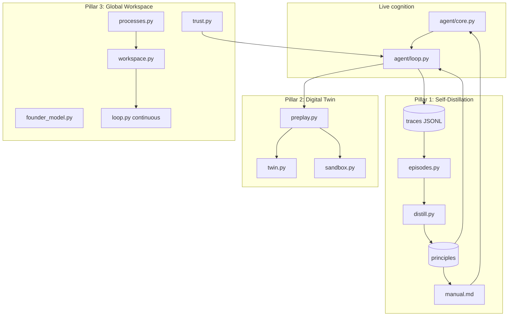

# Lived-Experience Cognitive Engine (LECE)

**A local-first, continually self-improving personal cofounder architecture**

---

## Abstract

State-of-the-art self-evolving agents (EvolveR, EvoSC, Continual Experience Internalization, ProPlay, Global Workspace Agents) are benchmarked on generic tasks. **LECE** applies these frontiers to a setting they do not address: a **single founder's longitudinal, private, on-device life**. LECE combines three pillars:

1. **Experiential self-distillation** — principle-level experience internalization from the agent's own traces (off-policy, step-wise injection, effectiveness decay).
2. **Business digital twin + preplay** — a procedure graph over the founder's real business; high-stakes actions are simulated in an isolated sandbox before execution.
3. **Global Workspace + trust-calibrated autonomy** — attention-driven coalitions bid for salience; autonomy is learned from competence, not only configured.

All data stays local. Heavy/continuous behavior is behind default-off flags. Safe learning (Tier A distillation) is default-on.

---

## 1. Motivation

Founder OS already captures rich per-turn traces (`data/traces/*.jsonl`), action logs, strategies, failures, and a world model — but until LECE, **traces were never consumed by the learning loop**. LECE closes this gap with a recipe aligned to 2026 research on *sustainable* self-evolution:

| Dimension | LECE choice | Rationale (literature) |
|-----------|-------------|------------------------|
| Experience granularity | **Principle-level** | More durable than instance-level (CEI `2606.04703`) |
| Injection pattern | **Step-wise** | Aligns with intermediate decision states |
| Internalization regime | **Off-policy** | Teacher episodes filtered by outcome score |
| Planning | **Preplay on twin** | ProPlay-style procedure graph + expectation feedback |

---

## 2. Architecture



**Package:** `agent/cognition/` (15 modules + `train/` scaffold)

---

## 3. Pillar 1 — Experiential Self-Distillation

### 3.1 Pipeline

1. **`iter_traces(since_ts)`** — read JSONL flight recorder (`agent/trace.py`)
2. **`episodes.py`** — segment traces; score outcomes (0–1) from tool results, decisions, healing events
3. **Off-policy filter** — keep episodes with `score >= 0.6`
4. **`distill.py`** — cluster by tool family; LLM extracts **principles** (not instances)
5. **Semantic dedup** — Chroma `DefaultEmbeddingFunction` (all-MiniLM-L6-v2)
6. **Effectiveness decay** — unreinforced principles decay; quarantine below 0.2
7. **`manual.py`** — rebuild `data/agent_state/lece_manual.md` (Tier A internalization)
8. **Injection** — turn-level via `evolution.retrieve_context()`; step-level via `loop.py`

### 3.2 Tier B scaffold (default OFF)

| Module | Purpose |
|--------|---------|
| `train/dataset.py` | SFT JSONL from successful trajectories |
| `train/lora.py` | Lazy peft/unsloth trainer (no-op without GPU) |
| `train/gate.py` | Eval gate — promote adapter only if score beats baseline |
| `train/modelfile.py` | Ollama Modelfile for promoted adapter |

Enable: `LECE_DISTILL_TRAIN=true` + install `peft`, `transformers`, `torch`.

### 3.3 Schedule

`job_distill` — Cron **03:30** daily (after memory consolidation at 03:00).

---

## 4. Pillar 2 — Business Digital Twin + Preplay

### 4.1 Twin state

Extends `memory/world_model.py` with:
- CRM pipeline, tasks, goals, finance, strategies
- **Procedure graph** in `twin_transitions` (state_key → action_key → outcome_key, reliability)

Bootstrapped from `action_log` + `strategies`.

### 4.2 Sandbox

`contextvars.SIMULATION` + `SimulationContext`:
- Write/side-effect tools return **predicted** results
- Enforced in `agent/registry.py` `call()` and swarm sub-agents when simulation flag set

### 4.3 Preplay

Before high-stakes tools (`send_email`, `x_post`, writes, etc.):
1. Generate N candidate variants
2. Estimate via `learned` | `swarm` | `hybrid` (config: `LECE_PREPLAY_MODE`)
3. Select best branch (critic scoring / transition reliability)
4. Execute for real through normal approval gate
5. **Expectation feedback** — update transition reliabilities; log to `preplay_runs`

---

## 5. Pillar 3 — Global Workspace + Adaptive Autonomy

### 5.1 Workspace

Cross-turn blackboard (`workspace` table): items with salience + decay. Coalitions bid:
- **perception** — approvals, reminders
- **goals** — active goal pressure
- **healing** — unrecovered failures
- **twin_risk** — finance/approval risk elevation

### 5.2 Founder theory-of-mind

`founder_model` KV table: risk tolerance, communication style, decision speed — learned from interaction patterns.

### 5.3 Trust-calibrated autonomy

`trust.py` extends `policy.decide()`:
- Never weaker than static `AUTONOMY_LEVEL` floor
- Per-tool competence from outcomes + failure ledger
- Requires `LECE_TRUST_MIN_TRIALS` before elevation

### 5.4 Continuous loop (default OFF)

`LECE_WORKSPACE_CONTINUOUS=true` → asyncio task via `main.py` `post_init`. When off, scheduled `job_heartbeat` remains.

---

## 6. Measurement spine

| Metric | Module | Description |
|--------|--------|-------------|
| Preplay MAE / accuracy | `metrics.py` | Predicted vs actual outcomes |
| Principle effectiveness | `metrics.py` | Avg effectiveness, quarantine count |
| Trust competence | `metrics.py` | Per action-type scores |
| Ablation harness | `evals/lece/` | principle vs instance, preplay on/off, etc. |
| Synthetic dataset | `scripts/gen_synthetic_life.py` | Reproducible traces without private data |

Dashboard: `/api/cognition` + React `/cognition` panel.

---

## 7. Configuration

| Variable | Default | Purpose |
|----------|---------|---------|
| `LECE_ENABLED` | `true` | Master switch |
| `LECE_DISTILL_ENABLED` | `true` | Nightly + manual distillation |
| `LECE_DISTILL_HOUR` | `3` | Hour for distill job (runs :30) |
| `LECE_DISTILL_TRAIN` | `false` | Tier B LoRA scaffold |
| `LECE_PRINCIPLES_K` | `4` | Principles retrieved per turn/step |
| `LECE_PREPLAY_ENABLED` | `true` | Simulate before high-stakes actions |
| `LECE_PREPLAY_MODE` | `hybrid` | learned / swarm / hybrid |
| `LECE_PREPLAY_BRANCHES` | `3` | Counterfactual branches |
| `LECE_WORKSPACE_CONTINUOUS` | `false` | Continuous cognitive loop |
| `LECE_WORKSPACE_TICK_S` | `120` | Loop tick interval (seconds) |
| `LECE_ADAPTIVE_AUTONOMY` | `true` | Learned trust in policy |
| `LECE_TRUST_MIN_TRIALS` | `5` | Min trials before autonomy elevation |

---

## 8. New tools (10)

`distill_now`, `list_principles`, `preplay_action`, `simulate_strategy`, `twin_state`, `why_did_you`, `workspace_state`, `trust_report`, `founder_profile`, `lece_metrics`

---

## 9. Database tables (7)

`principles`, `twin_transitions`, `preplay_runs`, `workspace`, `founder_model`, `trust_scores`, `distill_runs`

---

## 10. Citations & related work

- EvolveR — experience-driven lifecycle (`2510.16079`)
- EvoSC — self-consolidation (`2602.01966`)
- Continual Experience Internalization (`2606.04703`)
- ProPlay — procedural world models (`2606.12780`)
- Global Workspace Agents (`2604.08206`)

---

## 11. Limitations

- Tier B training requires GPU and manual setup; scaffold validates deps only.
- Swarm preplay rollouts are LLM-estimated, not full environment simulation.
- Founder model uses heuristics; richer ToM needs more longitudinal data.
- Continuous loop increases LLM cost; keep off unless needed.

---

## 12. Reproducibility

```bash
# Generate synthetic traces
python scripts/gen_synthetic_life.py

# Run LECE tests
pytest tests/test_lece.py -v

# Manual distillation
# (via Telegram or tool) distill_now
```

Results tables for ablations: see `evals/lece/__init__.py` — run with your traces and fill MAE / principle effectiveness / autonomy precision columns over weeks.
