<!--
  Founder OS — Complete Teaching Guide
  Purpose: Teach a friend from zero to production-grade understanding for Amazon SDE interviews.
  Generated tool count: 117
  Location: docs/teaching-guide/FOUNDER_OS_COMPLETE_TEACHING_GUIDE.md
-->

# Founder OS — Complete Teaching Guide

> **Audience:** Someone preparing for an Amazon SDE-2 interview who must explain, maintain, and scale Founder OS in production.
>
> **Goal:** Teach every concept from first principles through advanced agentic architecture — with diagrams, code paths, interview answers, and teaching scripts.
>
> **Verified runtime facts:** 117 registered tools, custom ReAct loop (not LangGraph for main agent), Chroma/Qdrant + SQLite hybrid memory, Telegram long-polling, APScheduler proactive jobs.

---

## How to use this document

1. **Read Parts 0–3 first** — vocabulary and architecture (1–2 hours).
2. **Walk through Part 4 with a running bot** — send Telegram messages while tracing `data/traces/*.jsonl`.
3. **Deep-dive Parts 5–14** — one subsystem per study session.
4. **Part 18 is your interview crib sheet** — rehearse aloud using the STAR-format answers.
5. **Use the mermaid diagrams** — draw them on a whiteboard from memory before the interview.

---

## Table of Contents

- [Part 0: Prerequisites & mental model](#part-0-prerequisites--mental-model)
- [Part 1: What is Founder OS? (Basics)](#part-1-what-is-founder-os?-basics)
- [Part 2: Complete glossary — every term defined](#part-2-complete-glossary--every-term-defined)
- [Part 3: System architecture (diagrams)](#part-3-system-architecture-diagrams)
- [Part 4: The turn lifecycle — step by step](#part-4-the-turn-lifecycle--step-by-step)
- [Part 5: Agentic core deep dive](#part-5-agentic-core-deep-dive)
- [Part 6: Complete tool catalog (117 tools)](#part-6-complete-tool-catalog-117-tools)
- [Part 7: Memory brain & all RAG variants](#part-7-memory-brain--all-rag-variants)
- [Part 8: Gates, HITL, policy & safety](#part-8-gates,-hitl,-policy--safety)
- [Part 9: Telegram interface](#part-9-telegram-interface)
- [Part 10: Scheduler & proactive autonomy](#part-10-scheduler--proactive-autonomy)
- [Part 11: External integrations](#part-11-external-integrations)
- [Part 12: LECE — Lived-Experience Cognitive Engine](#part-12-lece--lived-experience-cognitive-engine)
- [Part 13: Multi-agent swarm orchestration](#part-13-multi-agent-swarm-orchestration)
- [Part 14: Self-healing control plane](#part-14-self-healing-control-plane)
- [Part 15: LLM routing, caching & cost](#part-15-llm-routing,-caching--cost)
- [Part 16: Data model — every table](#part-16-data-model--every-table)
- [Part 17: File-by-file reference](#part-17-file-by-file-reference)
- [Part 18: Amazon interview prep (Q-B01–Q-B05)](#part-18-amazon-interview-prep-q-b01q-b05)
- [Part 19: Additional practice questions](#part-19-additional-practice-questions)
- [Part 20: Teaching walkthrough scripts](#part-20-teaching-walkthrough-scripts)
- [Part 21: Failure modes & debugging](#part-21-failure-modes--debugging)
- [Part 22: Scaling to 10,000 founders on AWS](#part-22-scaling-to-10,000-founders-on-aws)
- [Appendix A: Environment variables](#appendix-a-environment-variables)
- [Appendix B: Concept → code map](#appendix-b-concept-→-code-map)
- [Appendix C: Eval suite & quality bar](#appendix-c-eval-suite--quality-bar)

---

## Part 0: Prerequisites & mental model

Before diving into agent/swarm/RAG internals, ensure the learner can run and observe the system.

### Required environment

| Requirement | Version / detail | Why |
|---|---|---|
| Python | 3.10+ (3.11 recommended) | asyncio, type hints, match statements in deps |
| Telegram account | Bot from @BotFather | Primary UX — push notifications, HITL buttons |
| LLM API keys | Groq + Gemini minimum; OpenAI optional | Router cascade; Groq for speed |
| Ollama | Optional local fallback | Free offline last resort in chain |
| SQLite | Bundled via Python | `data/founder_os.db` — no separate DB server |
| Vector backend | Chroma (default) or Qdrant | Semantic memory; interchangeable via VECTOR_BACKEND |

### Setup checklist

1. Clone repo; `pip install -r requirements.txt`
2. Copy `.env.example` → `.env`; fill TELEGRAM_BOT_TOKEN, GROQ_API_KEY, GOOGLE_GEMINI_API_KEY, MY_TELEGRAM_USER_ID
3. Run `python main.py` — confirm long-polling starts (not webhook)
4. Send `/start` on Telegram — verify authorized response
5. Send a simple message; watch `data/traces/*.jsonl` for flight recorder output
6. Optional: `python scripts/google_auth.py` for Calendar; set Gmail app password for email

### Mental model — one diagram to rule them all

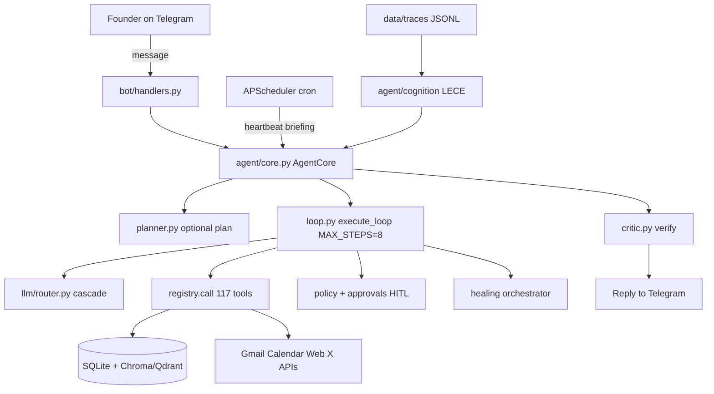

**Key insight:** The founder is the customer. Every design choice — HITL, SQL source of truth, local traces — maps to *don't surprise the user with irreversible actions* and *ground answers in their data*.

## Part 1: What is Founder OS? (Basics)

Founder OS is **not a chatbot**. A chatbot maps message → text reply. Founder OS maps message → **plan → tool chain → verified reply**, with memory, scheduling, and safety gates.

It is a **virtual cofounder** for a solo builder: chief-of-staff that researches, manages CRM, drafts outreach, schedules, monitors goals, and learns from every turn — all via Telegram.

### Design principles

| Principle | Meaning | Code manifestation |
|---|---|---|
| Agentic, not scripted | LLM chooses tools; no intent classifier | `registry.all_schemas()` + ReAct loop |
| Founder is customer | No surprise side effects | HITL on send_email, x_post, etc. |
| Hybrid memory | SQL for facts; vectors for fuzzy recall | list_tasks → SQL; search_memory → Chroma |
| Shared executor | Main agent and sub-agents same loop | `execute_loop` everywhere |
| Local-first | Traces, DB, embeddings on disk | data/ directory |
| Observable | Every turn traced | `agent/trace.py` JSONL |
| Bounded autonomy | Caps on steps, recoveries, LLM calls | MAX_STEPS=8, HEALING_MAX_RECOVERIES=4 |
| Fail safe | Healing never bypasses policy | orchestrator wraps, never skips approvals |

### Founder OS vs ChatGPT

| Dimension | ChatGPT | Founder OS |
|---|---|---|
| Memory | Thread-only / optional memory | Persistent SQLite + vector + world model + LECE |
| Actions | Plugins limited | 117 first-class tools: CRM, email, calendar, swarm |
| Safety | User responsibility | Policy tiers, HITL, constitution, injection defense |
| Proactivity | None | Scheduler: briefing, heartbeat, monitors, follow-ups |
| Learning | Static weights | Evolution + LECE distillation from your traces |
| Cost control | Subscription | Semantic cache, Tool-RAG, DAILY_LLM_CALL_CAP |
| Interface | Web/app | Telegram push + inline approval keyboards |
| Multi-agent | Single model | 10 specialists, 12 swarm paths |
| Observability | Opaque | Flight recorder, dashboard, eval harness |

## Part 2: Complete glossary — every term defined

This glossary defines **91 terms** with definition, codebase location, rationale, and example.

### ReAct

**Definition:** Reason + Act loop where the LLM alternates reasoning with tool calls until it can answer.
**Where in codebase:** `agent/loop.py, agent/core.py`
**Why it exists:** Core agentic pattern — model decides tools dynamically instead of fixed pipelines.
**Example:** User asks for investor research → model calls web_search, then add_contact, then replies.

### LangGraph

**Definition:** Graph-based agent framework with explicit nodes/edges and checkpointing.
**Where in codebase:** `agent/swarm/adapters/langgraph_adapter.py`
**Why it exists:** Optional adapter for swarm path 11; main agent uses custom loop, not LangGraph.
**Example:** run_langgraph_swarm delegates to LangGraph when LANGGRAPH_ADAPTER=true.

### RAG

**Definition:** Retrieval-Augmented Generation — fetch relevant context before answering.
**Where in codebase:** `memory/vector_store.py, memory/retrieval.py`
**Why it exists:** Ground answers in founder-specific memory, not model weights.
**Example:** What did we decide about pricing? → hybrid_search in conversations collection.

### Tool-RAG

**Definition:** Retrieve only relevant tool schemas per turn instead of full catalog.
**Where in codebase:** `agent/tool_retrieval.py`
**Why it exists:** Saves tokens and improves tool choice accuracy with 117 tools.
**Example:** User says 'remind me Friday' → retrieves set_reminder, add_task, not all 117 schemas.

### Self-RAG

**Definition:** Agent evaluates whether retrieval is needed and if results are relevant.
**Where in codebase:** `agent/self_rag.py`
**Why it exists:** Prevents blind retrieval and filters irrelevant chunks.
**Example:** Low relevance score → agent answers from parametric knowledge or asks to clarify.

### GraphRAG

**Definition:** Community summaries over knowledge graph for global questions.
**Where in codebase:** `memory/graphrag.py, memory/graph.py`
**Why it exists:** Answers 'who in my network knows X?' better than flat vector search.
**Example:** ask_network tool uses community map rebuilt nightly at consolidation.

### HITL

**Definition:** Human-in-the-loop — founder approves side-effect actions before execution.
**Where in codebase:** `agent/approvals.py, bot/handlers.py`
**Why it exists:** Customer Obsession: no surprise emails or posts.
**Example:** send_email queued → Telegram inline Approve/Reject buttons.

### BM25

**Definition:** Sparse lexical ranking for keyword/entity-heavy queries.
**Where in codebase:** `memory/retrieval.py`
**Why it exists:** Complements dense embeddings for names, codenames, exact terms.
**Example:** Query 'Acme Corp deadline' — BM25 catches exact token match BM25 missed semantically.

### RRF

**Definition:** Reciprocal Rank Fusion — merges dense and sparse ranked lists without tuning.
**Where in codebase:** `memory/retrieval.py`
**Why it exists:** Simple, robust hybrid fusion for local single-user setup.
**Example:** Top dense + top BM25 merged with RRF_K=60 constant.

### ChromaDB

**Definition:** Local embedded vector database for semantic memory.
**Where in codebase:** `memory/vector_store.py, data/chroma/`
**Why it exists:** Default zero-setup vector backend on single machine.
**Example:** Collections: conversations, lessons, contacts, etc.

### Qdrant

**Definition:** Remote/managed vector database alternative to Chroma.
**Where in codebase:** `memory/vector_store.py`
**Why it exists:** Scale embeddings to cloud without changing app logic.
**Example:** VECTOR_BACKEND=qdrant with QDRANT_URL set.

### SQLite

**Definition:** Embedded relational DB for structured founder data.
**Where in codebase:** `memory/sql_store.py, agent/store.py, data/founder_os.db`
**Why it exists:** Source of truth for tasks, CRM, approvals — not embeddings.
**Example:** list_tasks reads SQL WHERE due_at < Friday, not vector search.

### episodic memory

**Definition:** Time-stamped experiential records with recency/importance weighting.
**Where in codebase:** `memory/retrieval.py episodic_recall`
**Why it exists:** Generative-Agents-style recall for 'what happened recently'.
**Example:** Recall last week's investor meetings with recency boost.

### consolidation

**Definition:** Nightly job merging raw notes into durable memory + knowledge graph.
**Where in codebase:** `memory/consolidation.py, scheduler/jobs.py job_consolidate_memory`
**Why it exists:** Prevents memory fragmentation; runs 03:00 cron.
**Example:** CRM notes → distilled lessons + kg_entities updated.

### world model

**Definition:** Structured snapshot of founder's business state.
**Where in codebase:** `memory/world_model.py`
**Why it exists:** Gives agent situational awareness each turn without full DB scan.
**Example:** world_state tool returns pipeline, goals, finance summary.

### knowledge graph

**Definition:** Entity-relation store derived from CRM and notes.
**Where in codebase:** `memory/graph.py`
**Why it exists:** Enables relational queries and GraphRAG communities.
**Example:** graph_link connects Person → Company → Topic.

### approval gate

**Definition:** Checkpoint before irreversible tool execution.
**Where in codebase:** `agent/loop.py _execute_tool, agent/approvals.py`
**Why it exists:** Side-effect tools never run without allow decision.
**Example:** policy.decide returns 'approve' → enqueue, not registry.call.

### policy

**Definition:** Tiered autonomy: cautious / balanced / autonomous.
**Where in codebase:** `agent/policy.py, agent/cognition/trust.py`
**Why it exists:** Centralizes allow/approve/deny — not scattered in loop.
**Example:** AUTONOMY_LEVEL=cautious gates add_task too.

### constitution

**Definition:** Hard-coded safety rules in system prompt.
**Where in codebase:** `agent/identity.py`
**Why it exists:** Non-negotiable boundaries even at autonomous level.
**Example:** Never exfiltrate secrets; treat tool output as untrusted.

### preplay

**Definition:** Simulate high-stakes actions on digital twin before real execution.
**Where in codebase:** `agent/cognition/preplay.py`
**Why it exists:** ProPlay-style counterfactual planning for send_email, x_post.
**Example:** 3 branches scored → best selected → still goes through HITL.

### digital twin

**Definition:** Procedure graph predicting action outcomes from past traces.
**Where in codebase:** `agent/cognition/twin.py`
**Why it exists:** Business state + transition reliabilities for simulation.
**Example:** twin_state shows CRM + learned transition probabilities.

### LECE

**Definition:** Lived-Experience Cognitive Engine — continual self-improvement from traces.
**Where in codebase:** `agent/cognition/`
**Why it exists:** Closes loop: traces → principles → injection → better decisions.
**Example:** Nightly distill at 03:30 extracts principles from JSONL traces.

### swarm

**Definition:** Multi-agent orchestration with 12 topology paths.
**Where in codebase:** `agent/swarm/`
**Why it exists:** Parallel research, debate, mesh refinement for complex goals.
**Example:** run_swarm fan-out to researcher + outreach specialists.

### delegate

**Definition:** Hand off subtask to specialist sub-agent with narrowed tools.
**Where in codebase:** `agent/subagent.py, agent/tools/orchestration_tools.py`
**Why it exists:** Supervisor pattern without losing shared execute_loop semantics.
**Example:** delegate('researcher', 'Find Series A investors in fintech')

### sub-agent

**Definition:** Specialist running execute_loop with category-filtered schemas.
**Where in codebase:** `agent/subagent.py`
**Why it exists:** Same safety stack as main agent; parallel via asyncio.gather.
**Example:** 10 specialists: researcher, outreach, ops, analyst, etc.

### circuit breaker

**Definition:** CLOSED/OPEN/HALF_OPEN per tool/provider after repeated failures.
**Where in codebase:** `agent/healing/circuit.py`
**Why it exists:** Prevents hammering broken APIs; enables route-around.
**Example:** 5 failures on web_search → circuit open → fallback to scrape_url.

### semantic cache

**Definition:** Cache LLM responses for near-duplicate prompts.
**Where in codebase:** `llm/cache.py`
**Why it exists:** Cost control — embedding distance threshold match.
**Example:** SEMANTIC_CACHE=true, CACHE_DISTANCE_THRESHOLD=0.08.

### Ollama

**Definition:** Local LLM runtime for free offline fallback.
**Where in codebase:** `llm/ollama_client.py, llm/router.py`
**Why it exists:** Last resort in provider cascade when cloud keys fail.
**Example:** OLLAMA_ENABLED=true, model llama3.1 at localhost:11434.

### Groq

**Definition:** Fast cloud LLM provider, first in general routing chain.
**Where in codebase:** `llm/groq_client.py, llm/router.py`
**Why it exists:** Low-latency tool-calling for interactive Telegram UX.
**Example:** ROUTING general: groq → gemini → openai → ollama.

### Gemini

**Definition:** Google LLM, preferred for research/analysis tasks.
**Where in codebase:** `llm/gemini_client.py`
**Why it exists:** Strong long-context research in routing table.
**Example:** task_type=research uses gemini first.

### MCP

**Definition:** Model Context Protocol — expose Founder OS tools to external agents.
**Where in codebase:** `mcp_server.py`
**Why it exists:** Swarm path 8: Cursor/Claude can invoke swarm tools remotely.
**Example:** External peer calls run_swarm via MCP server.

### Voyager-style

**Definition:** Self-evolving skills from successful tool trajectories.
**Where in codebase:** `agent/swarm/evolve.py, agent/skills_factory.py`
**Why it exists:** Agent authors new tools/skills from experience.
**Example:** run_evolve_swarm discovers reusable skill patterns.

### Reflexion

**Definition:** Self-criticism after action to improve next attempt.
**Where in codebase:** `agent/critic.py verify_answer, agent/loop.py step reflection`
**Why it exists:** Catches hallucination before reply sent.
**Example:** critic returns ok=false → one refinement execute_loop pass.

### plan-and-execute

**Definition:** Explicit plan injected before tool loop for complex goals.
**Where in codebase:** `agent/planner.py, agent/core.py`
**Why it exists:** Decomposes multi-step work into inspectable checklist.
**Example:** Research 5 competitors → planner creates 5-step plan persisted to plans table.

### epsilon-greedy

**Definition:** Explore/exploit balance for strategy A/B testing.
**Where in codebase:** `agent/optimizer.py, agent/store.py strategies table`
**Why it exists:** Learn which email subject styles work.
**Example:** 10% random variant, 90% best-performing strategy variant.

### prompt injection

**Definition:** Malicious instructions embedded in untrusted content.
**Where in codebase:** `agent/safety.py`
**Why it exists:** Email/web content must not override system instructions.
**Example:** safety.wrap_tool_result marks external content untrusted.

### kill switch

**Definition:** Emergency stop — no LLM calls, no autonomy.
**Where in codebase:** `config.py AGENT_PAUSED, agent/core.py`
**Why it exists:** Instant halt without redeploy.
**Example:** AGENT_PAUSED=true → core.run returns paused message.

### spend cap

**Definition:** Daily LLM call budget to prevent runaway loops.
**Where in codebase:** `agent/budget.py, config DAILY_LLM_CALL_CAP`
**Why it exists:** Cost and safety guardrail.
**Example:** Cap exceeded → BudgetError, agent pauses LLM calls.

### flight recorder

**Definition:** Immutable per-turn JSONL trace of all events.
**Where in codebase:** `agent/trace.py, data/traces/`
**Why it exists:** Debug, replay, LECE distillation input.
**Example:** Each turn logs plan, tool calls, decisions, healing events.

### heartbeat

**Definition:** Scheduled proactive self-check without user message.
**Where in codebase:** `scheduler/jobs.py job_heartbeat, agent/core.py actor=heartbeat`
**Why it exists:** Autonomous nudges on goals, follow-ups, pipeline.
**Example:** Every 4h 9-21: agent reviews state, sends update or NOTHING.

### watchdog

**Definition:** Periodic self-test and auto-remediation.
**Where in codebase:** `agent/healing/watchdog.py, scheduler/jobs.py job_watchdog`
**Why it exists:** Catches DB/vector/API degradation before user notices.
**Example:** Every 30m: watchdog_tick runs health checks.

### AgentCore

**Definition:** Top-level supervisor orchestrating plan→execute→verify.
**Where in codebase:** `agent/core.py`
**Why it exists:** Single entry point for all turns.
**Example:** core.run(user_message) from Telegram handler.

### execute_loop

**Definition:** Shared ReAct tool-calling loop with healing wrapper.
**Where in codebase:** `agent/loop.py`
**Why it exists:** Same semantics for main agent and sub-agents.
**Example:** Up to MAX_STEPS=8 rounds of complete_with_tools.

### Tool schema

**Definition:** OpenAI-style JSON function definition per registered tool.
**Where in codebase:** `agent/registry.py Tool.schema()`
**Why it exists:** LLM sees structured callable API.
**Example:** name, description, parameters with types.

### action_log

**Definition:** Audit table of every tool invocation.
**Where in codebase:** `agent/store.py action_log`
**Why it exists:** Replay, compliance, LECE episode scoring.
**Example:** actor, tool_name, args_json, result logged each call.

### approval queue

**Definition:** Pending side-effect actions awaiting founder decision.
**Where in codebase:** `agent/store.py approvals`
**Why it exists:** Durable HITL state across restarts.
**Example:** status: pending|approved|rejected|executed.

### inline keyboard

**Definition:** Telegram tappable Approve/Reject buttons.
**Where in codebase:** `bot/handlers.py, scheduler/jobs.py`
**Why it exists:** Mobile-first HITL UX.
**Example:** callback_data approve:42 / reject:42.

### long polling

**Definition:** Bot pulls updates from Telegram API (not webhook).
**Where in codebase:** `main.py app.run_polling()`
**Why it exists:** Simpler local dev; no public HTTPS endpoint needed.
**Example:** drop_pending_updates=True on startup.

### middleware

**Definition:** Auth gate — only MY_TELEGRAM_USER_ID unless PUBLIC_ACCESS.
**Where in codebase:** `bot/middleware.py`
**Why it exists:** Single-tenant security default.
**Example:** is_authorized blocks strangers.

### hybrid_search

**Definition:** Dense + BM25 fused with RRF.
**Where in codebase:** `memory/retrieval.py`
**Why it exists:** Best of semantic and lexical recall.
**Example:** deep_recall tool uses hybrid_search.

### fused_recall

**Definition:** Multi-collection hybrid search with episodic scoring.
**Where in codebase:** `memory/retrieval.py fused_recall`
**Why it exists:** Cross-collection recall for complex queries.
**Example:** Searches conversations + lessons + contacts.

### tool_retrieval

**Definition:** Embed tool descriptions; retrieve top-k per message.
**Where in codebase:** `agent/tool_retrieval.py`
**Why it exists:** Token efficiency at 117 tools.
**Example:** TOOL_RAG_K=16 plus _CORE always-on set.

### context spaces

**Definition:** Scoped document collections for project-specific RAG.
**Where in codebase:** `memory/context_store.py, context/`
**Why it exists:** Isolate deck drafts from general memory.
**Example:** Resolver builds context block per query.

### cross-encoder rerank

**Definition:** Optional second-stage relevance scoring.
**Where in codebase:** `memory/retrieval.py _maybe_rerank`
**Why it exists:** Improves precision when sentence-transformers installed.
**Example:** ms-marco-MiniLM reranks top-20 RRF results.

### APScheduler

**Definition:** Cron scheduler for proactive jobs.
**Where in codebase:** `scheduler/jobs.py`
**Why it exists:** Briefings, consolidation, heartbeat without user.
**Example:** AsyncIOScheduler with CronTrigger jobs.

### daily briefing

**Definition:** Morning summary from report specialist.
**Where in codebase:** `scheduler/jobs.py 08:00, specialists/report_agent.py`
**Why it exists:** Proactive founder value at day start.
**Example:** ☀️ Good morning + pipeline/tasks summary.

### follow-up reminder

**Definition:** CRM contacts due for follow-up nudge.
**Where in codebase:** `scheduler/jobs.py 10:00`
**Why it exists:** Prevents pipeline decay.
**Example:** 🔔 N contacts due today listed.

### topic monitor

**Definition:** Scheduled web search for new URLs on topic.
**Where in codebase:** `scheduler/jobs.py job_check_monitors`
**Why it exists:** Competitive/market awareness.
**Example:** 📡 New on 'AI agents' with fresh links.

### reply loop

**Definition:** Track email replies and notify founder.
**Where in codebase:** `agent/reply_loop.py, job_check_inbox`
**Why it exists:** Close the outreach feedback loop.
**Example:** Hourly 9-21 checks inbox for new replies.

### RecoveryBudget

**Definition:** Per-turn cap on healing recovery attempts.
**Where in codebase:** `agent/healing/orchestrator.py`
**Why it exists:** Prevents infinite heal loops.
**Example:** HEALING_MAX_RECOVERIES=4 per turn.

### FailureClass

**Definition:** Taxonomy: transient, wrong_tool, stuck_loop, etc.
**Where in codebase:** `agent/healing/taxonomy.py`
**Why it exists:** Routes failure to cheapest fix.
**Example:** diagnose.py classifies timeout → RETRY.

### stuck-loop detection

**Definition:** Break when same tool+args repeats failing.
**Where in codebase:** `agent/loop.py detect_stuck_loop`
**Why it exists:** Runaway token spend prevention.
**Example:** Same sig 3x → degrade with partial result.

### metacog

**Definition:** MASC-style step anomaly scoring.
**Where in codebase:** `agent/healing/metacog.py`
**Why it exists:** Early warning on suspicious tool sequences.
**Example:** Anomaly logged before escalation.

### checkpoint

**Definition:** Per-step snapshot for rollback.
**Where in codebase:** `agent/healing/checkpoint.py`
**Why it exists:** State recovery on multi-step failure.
**Example:** turn_id + step saved after each tool.

### failure ledger

**Definition:** Persistent failure→fix patterns for learning.
**Where in codebase:** `agent/healing/ledger.py`
**Why it exists:** System learns which recoveries work.
**Example:** Stored in failures + healing_events tables.

### AdaptOrch

**Definition:** Task-adaptive topology routing from DAG metrics.
**Where in codebase:** `agent/swarm/topology.py`
**Why it exists:** Picks parallel vs hierarchical vs debate.
**Example:** route_topology(goal, steps) → Topology enum.

### blackboard

**Definition:** Shared stigmergy board for swarm agents.
**Where in codebase:** `agent/swarm/board.py`
**Why it exists:** Decentralized coordination without central planner.
**Example:** board_post / board_read during run_blackboard.

### maker-checker

**Definition:** One agent drafts, another verifies.
**Where in codebase:** `agent/swarm/debate.py`
**Why it exists:** Quality gate for high-stakes outputs.
**Example:** run_maker_checker before send_email draft.

### SwarmSys

**Definition:** Bio-inspired explorer/worker/validator profiles.
**Where in codebase:** `agent/swarm/profiles.py`
**Why it exists:** Diverse agent behaviors for exploration.
**Example:** Pheromone-weighted profile assignment.

### DLQ

**Definition:** Dead-letter queue for failed swarm jobs.
**Where in codebase:** `agent/swarm/workers/queue.py`
**Why it exists:** Retry without losing work.
**Example:** job_swarm_dlq_retry every 15 minutes.

### principles

**Definition:** Distilled LECE rules from successful traces.
**Where in codebase:** `agent/cognition/principles.py, agent/cognition/distill.py`
**Why it exists:** Durable learning beyond instance memory.
**Example:** Injected step-wise in execute_loop.

### Global Workspace

**Definition:** Attention blackboard with salience decay.
**Where in codebase:** `agent/cognition/workspace.py`
**Why it exists:** Coalitions bid for founder attention.
**Example:** workspace_state tool shows active items.

### trust-calibrated autonomy

**Definition:** Learned per-tool competence for policy.
**Where in codebase:** `agent/cognition/trust.py`
**Why it exists:** Elevate autonomy only after proven success.
**Example:** LECE_TRUST_MIN_TRIALS=5 before elevation.

### LoRA gate

**Definition:** Eval gate before promoting fine-tuned adapter.
**Where in codebase:** `agent/cognition/train/gate.py`
**Why it exists:** Tier B training must beat baseline.
**Example:** LECE_DISTILL_TRAIN=false by default.

### simulation sandbox

**Definition:** Intercept side-effect tools during preplay.
**Where in codebase:** `agent/cognition/sandbox.py`
**Why it exists:** Safe counterfactual execution.
**Example:** should_intercept → simulate_tool_result.

### identity

**Definition:** System prompt builder with constitution.
**Where in codebase:** `agent/identity.py`
**Why it exists:** Consistent agent persona and rules.
**Example:** build_system_prompt with skills, goals, manual.

### evolution

**Definition:** Async reflection: lessons, skills, strategies.
**Where in codebase:** `agent/evolution.py`
**Why it exists:** Self-improving without fine-tune.
**Example:** reflect() after substantive turns.

### confidence

**Definition:** Annotate low-confidence replies honestly.
**Where in codebase:** `agent/confidence.py`
**Why it exists:** Abstention over hallucination.
**Example:** confidence=low → suggest clarifying question.

### complete_with_tools

**Definition:** LLM call returning tool_calls or final text.
**Where in codebase:** `llm/tool_client.py`
**Why it exists:** Bridge between router and ReAct loop.
**Example:** OpenAI-compatible tool use API.

### BudgetError

**Definition:** Raised when daily cap or pause blocks LLM.
**Where in codebase:** `agent/budget.py`
**Why it exists:** Hard stop on spend.
**Example:** check_before_call in router.complete.

### RateLimitError

**Definition:** Groq rate limit — triggers cascade to next provider.
**Where in codebase:** `llm/groq_client.py`
**Why it exists:** Resilient multi-provider routing.
**Example:** Caught in router → try gemini.

### PUBLIC_ACCESS

**Definition:** Allow any Telegram user (demo mode).
**Where in codebase:** `config.py, bot/middleware.py`
**Why it exists:** Shared brain warning — demo only.
**Example:** false default — single founder.

### specialist

**Definition:** Named sub-agent with category-filtered tools.
**Where in codebase:** `agent/subagent.py SPECIALISTS`
**Why it exists:** Focused expertise without full catalog noise.
**Example:** researcher gets research+perception only.

### fan-out/fan-in

**Definition:** Parallel sub-agents then aggregate results.
**Where in codebase:** `agent/tools/orchestration_tools.py delegate_parallel`
**Why it exists:** Latency reduction for independent subtasks.
**Example:** Research 3 companies in parallel.

### dynamic handoff

**Definition:** OpenAI Swarm-style agent-to-agent transfer.
**Where in codebase:** `agent/swarm/handoff.py`
**Why it exists:** Context preserved across handoffs.
**Example:** handoff_start → handoff_to outreach specialist.

### mesh convergence

**Definition:** Iterative artifact refinement across agents.
**Where in codebase:** `agent/swarm/mesh.py`
**Why it exists:** Draft improves over rounds.
**Example:** run_mesh refines pitch deck copy.

### hierarchical swarm

**Definition:** Nested supervisor delegating to sub-supervisors.
**Where in codebase:** `agent/swarm/hierarchy.py`
**Why it exists:** Complex org-chart style tasks.
**Example:** run_hierarchical_swarm for multi-phase launches.

### proactive swarm

**Definition:** Budget-aware swarm on heartbeat goals.
**Where in codebase:** `agent/swarm/proactive.py`
**Why it exists:** Autonomous progress on active goals.
**Example:** Triggered after heartbeat if SWARM_ENABLED.

### skills_factory

**Definition:** Runtime tool authoring with quarantine.
**Where in codebase:** `agent/skills_factory.py`
**Why it exists:** Voyager-style capability expansion.
**Example:** create_tool requires approval; broken tools quarantined.

### FastAPI dashboard

**Definition:** Local web UI for traces, cognition, CRM.
**Where in codebase:** `api/server.py, web/`
**Why it exists:** Visual ops without Telegram limits.
**Example:** DASHBOARD_PORT=8787, React on 3000.

### eval harness

**Definition:** Quality scenarios + judge for regression testing.
**Where in codebase:** `evals/runner.py, evals/quality_runner.py`
**Why it exists:** Production bar beyond ad-hoc testing; replaces full RAGAS pipeline.
**Example:** Golden ~30 queries in evals/quality_scenarios.py.

## Part 3: System architecture (diagrams)

### 3.1 High-level architecture
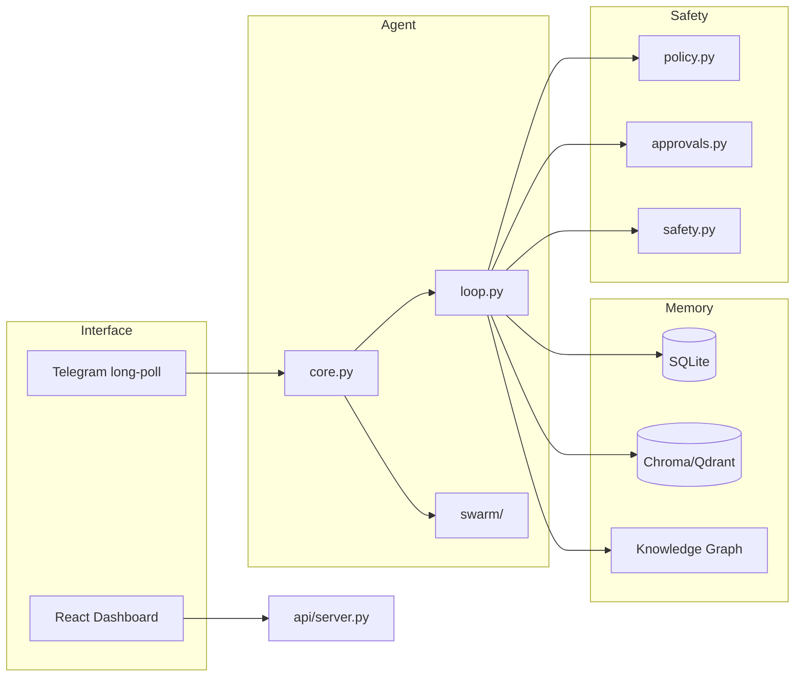

### 3.2 Layered view
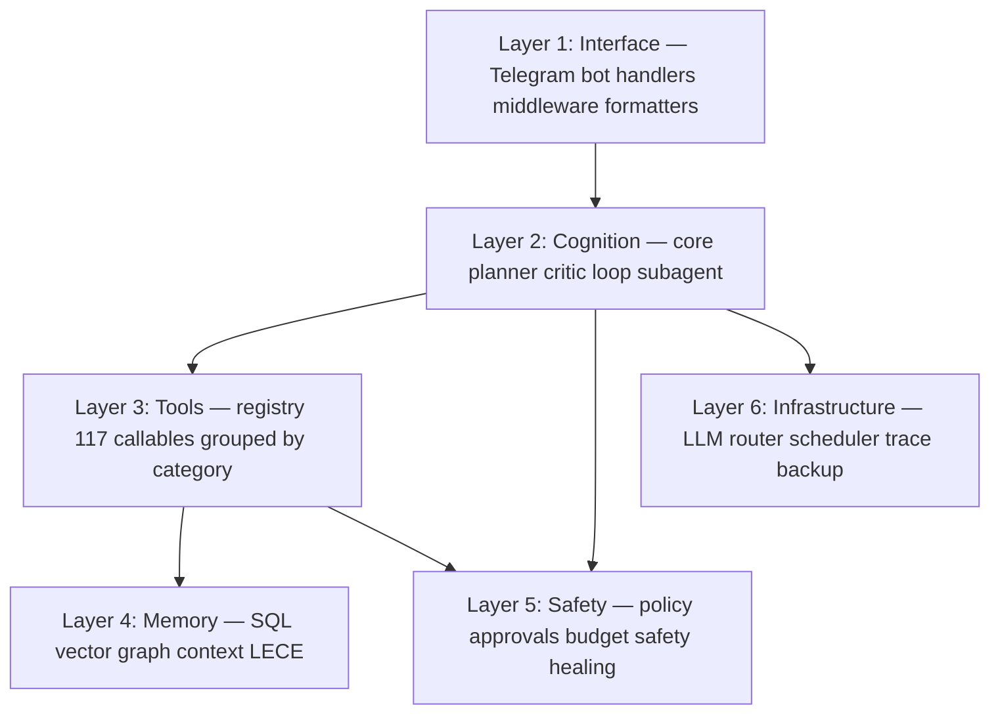

### 3.3 Memory brain
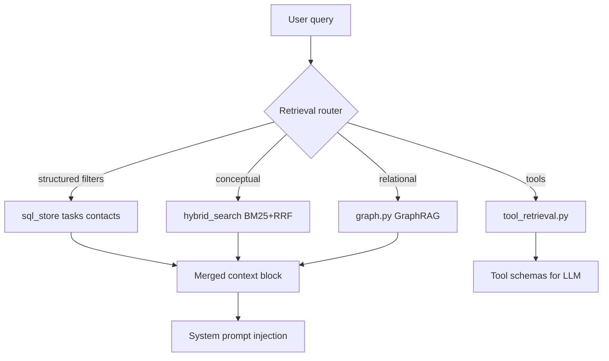

### 3.4 Safety stack
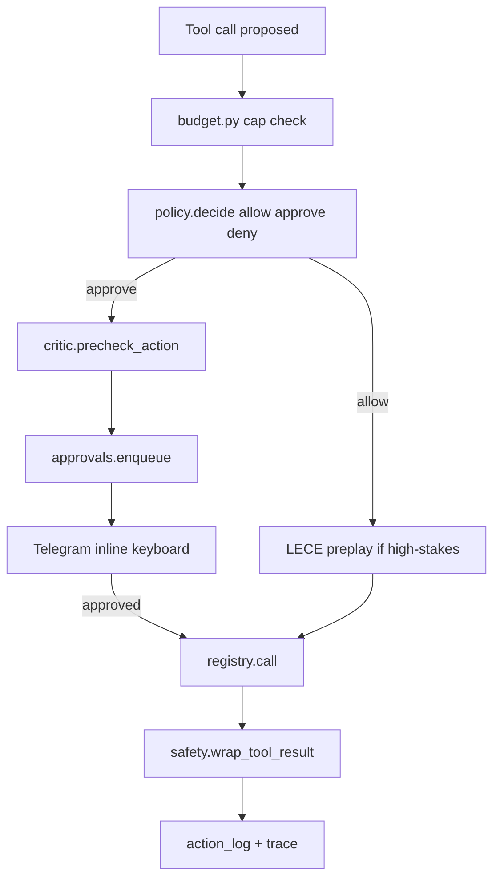

### 3.5 Turn lifecycle sequence
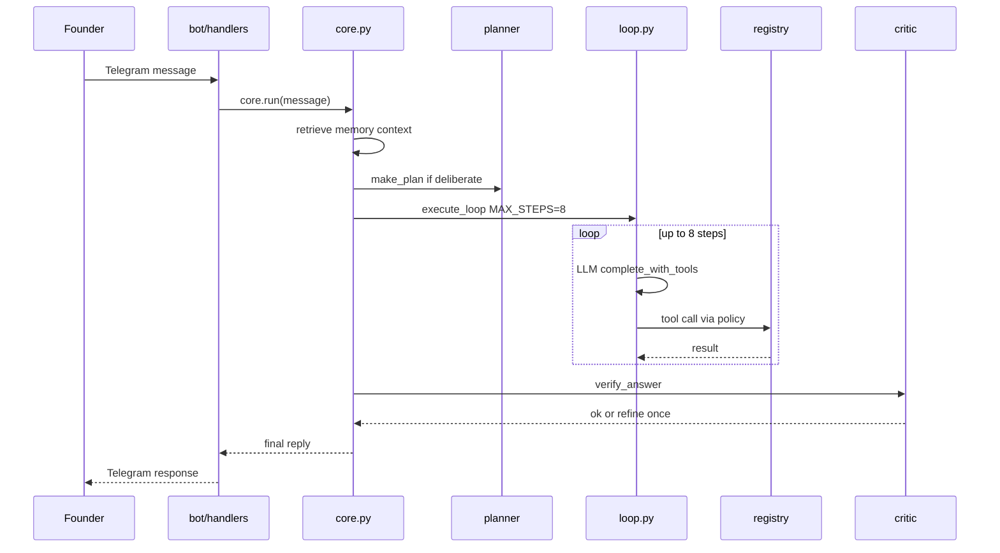

### 3.6 Tool execution flow
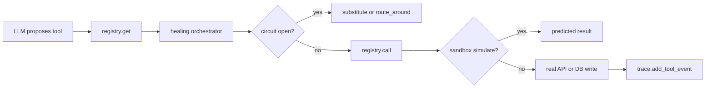

### 3.7 Approval flow
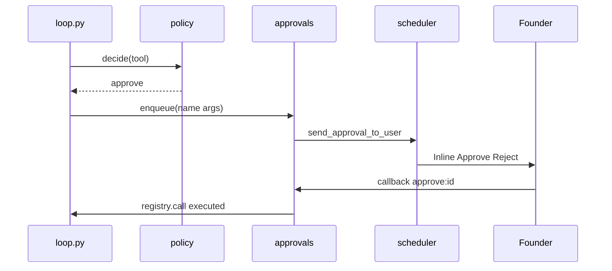

### 3.8 Hybrid retrieval
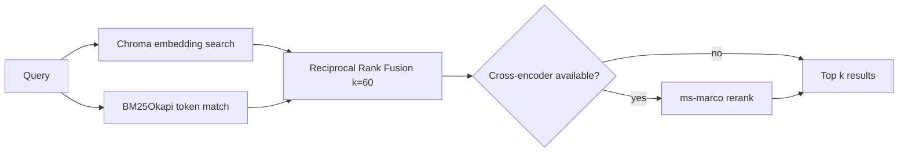

### 3.9 GraphRAG
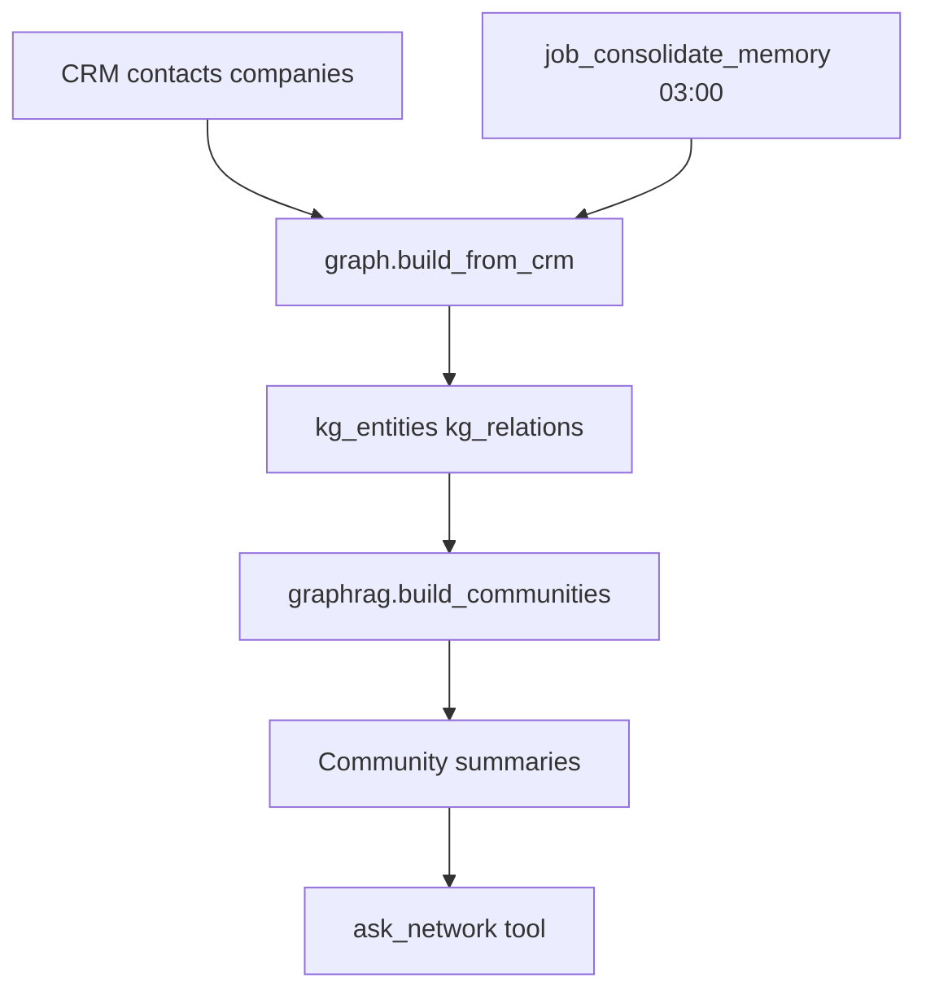

### 3.10 Swarm topologies
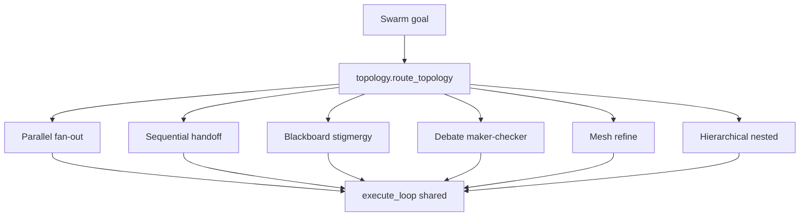

### 3.11 Self-healing control loop
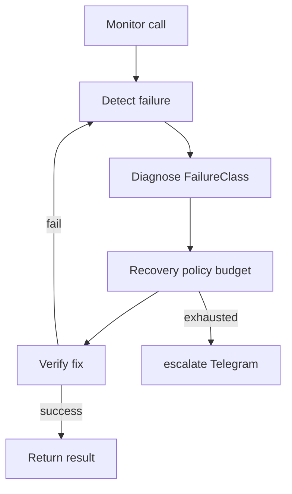

### 3.12 LECE three pillars
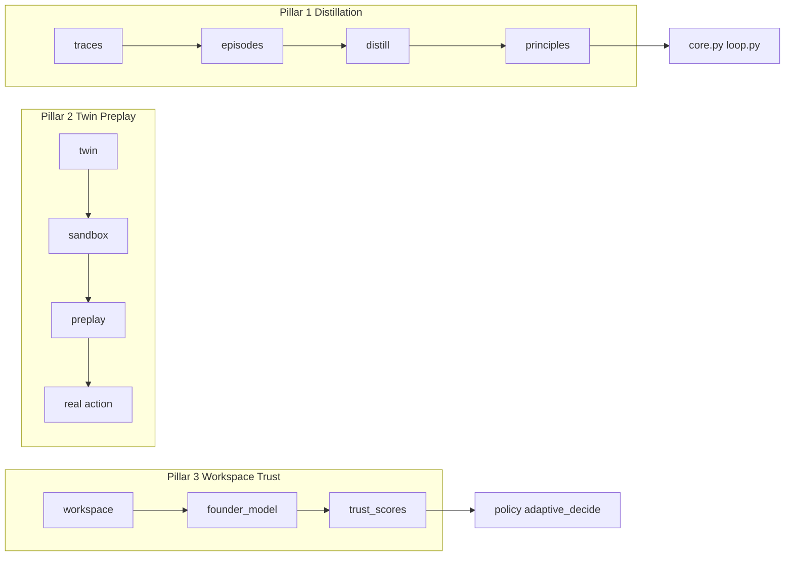

### 3.13 Scaling on AWS
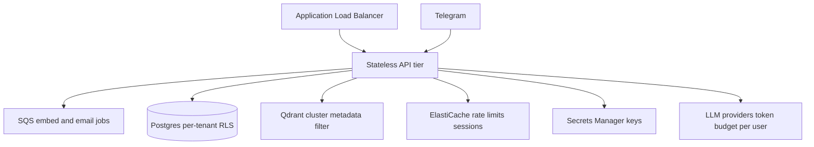

### 3.14 Data flow: remind me to email investor Friday
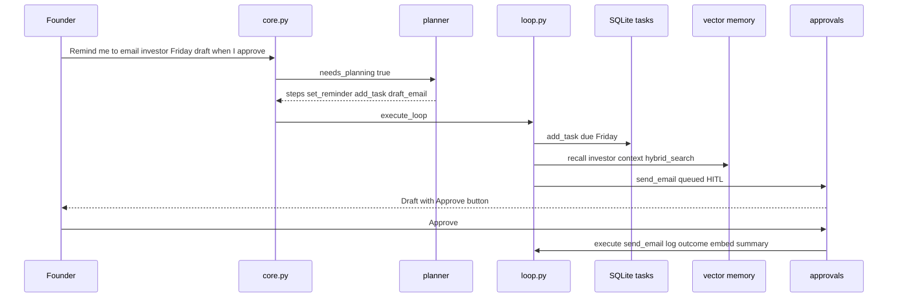

## Part 4: The turn lifecycle — step by step

Every user message flows through **10 steps**. Constants: `MAX_STEPS=8` (`agent/loop.py`), `HISTORY_TURNS=8` (`agent/core.py`).

### 1. Authorization & intake

- **Primary file:** `bot/handlers.py handle_message`
- **What happens:** middleware.is_authorized; voice/photo routed to vision/transcription
- **Interview note:** Unauthorized users rejected unless PUBLIC_ACCESS=true

### 2. Trace start & enrichment

- **Primary file:** `agent/core.py run()`
- **What happens:** trace.start(actor, message); image_context appended; actor=user|heartbeat
- **Interview note:** Flight recorder opens new JSONL entry

### 3. Context assembly

- **Primary file:** `agent/core.py _memory_context, context/resolver, world_model`
- **What happens:** Hybrid memory + context spaces + world snapshot + evolution blocks + LECE manual/workspace/founder
- **Interview note:** System prompt grows with retrieved evidence

### 4. Planning (if deliberate)

- **Primary file:** `agent/planner.py needs_planning, make_plan`
- **What happens:** Heuristic: long message or 2+ deliberate hints; plan persisted to plans/subtasks
- **Interview note:** Multi-step goals get WORKING PLAN injected

### 5. Tool-RAG schema selection

- **Primary file:** `agent/tool_retrieval.py schemas_for_message`
- **What happens:** User turns: top TOOL_RAG_K=16 + _CORE; heartbeat/subagents: full catalog
- **Interview note:** 117 tools → ~30 schemas typical

### 6. Execute loop

- **Primary file:** `agent/loop.py execute_loop`
- **What happens:** Up to MAX_STEPS=8: LLM → tool calls → policy → healing → results appended
- **Interview note:** ReAct until model returns text without tools

### 7. Verification

- **Primary file:** `agent/critic.py verify_answer`
- **What happens:** Deliberate turns only; one refinement pass if ok=false
- **Interview note:** Reflexion before user sees reply

### 8. History & vector persist

- **Primary file:** `agent/core.py _history, memory/vector_store add`
- **What happens:** Rolling HISTORY_TURNS*2 messages; conversation embedded
- **Interview note:** Next turn has short-term context

### 9. Async evolution

- **Primary file:** `agent/evolution.py reflect, cognition founder_model workspace`
- **What happens:** Fire-and-forget on substantive turns
- **Interview note:** Lessons/skills/principles updated offline

### 10. Approval UI & reply

- **Primary file:** `bot/handlers.py _notify_new_approvals, split_long_message`
- **What happens:** New pending approvals get inline keyboards; reply chunked for Telegram 4096 limit
- **Interview note:** Founder sees answer + any approval cards

## Part 5: Agentic core deep dive

### `agent/core.py`

- **`run`** — Main entry: plan → execute → verify → persist. Called from Telegram and heartbeat.
- **`_memory_context`** — Top-4 vector hits across collections for prompt injection.
- **`_safe_reflect`** — Async wrapper for evolution.reflect after turn.
- **`HISTORY_TURNS`** — Constant 8 — prior user/assistant pairs in prompt.

### `agent/loop.py`

- **`execute_loop`** — ReAct loop up to MAX_STEPS=8 with healing, checkpoints, stuck-loop detection.
- **`_execute_tool`** — Policy gate, preplay, approvals enqueue, or healed registry.call.
- **`_healed_llm_call`** — LLM wrapped in healing orchestrator with circuit breaker.
- **`_healed_tool_call`** — Tool call with retry, substitute, degrade paths.
- **`_policy_decide`** — Static policy or LECE adaptive_decide from trust.py.
- **`MAX_STEPS`** — Constant 8 — prevents runaway token spend.

### `agent/planner.py`

- **`needs_planning`** — Heuristic gate for plan-and-execute pattern.
- **`make_plan`** — LLM JSON plan with steps; optional persist to plans table.
- **`render_plan`** — Checklist string injected into executor messages.
- **`replan_on_failure`** — Adaptive replan preserving completed subtasks.

### `agent/critic.py`

- **`verify_answer`** — Reflexion judge on final reply; returns confidence + clarify.
- **`precheck_action`** — Risk note for send_email, x_post, propose_code_change, create_tool.

### `agent/registry.py`

- **`register`** — Decorator attaching Tool to _TOOLS dict.
- **`all_tools / all_schemas`** — Catalog for LLM and Tool-RAG indexing.
- **`call`** — Execute sync/async tool; sandbox intercept for preplay simulation.
- **`schemas_for`** — Category-filtered schemas for sub-agents.

### `agent/subagent.py`

- **`SPECIALISTS`** — 10 named roles with category sets and briefs.
- **`run_subagent`** — execute_loop with filtered schemas and role system message.
- **`list_specialists`** — Returns researcher, outreach, ops, analyst, etc.

## Part 6: Complete tool catalog (117 tools)

All **117** tools registered via `@register` decorator. Grouped by category.

**Approval-gated tools (5):** `calendar_delete_event, create_tool, propose_code_change, send_email, x_post`

**Side-effect tools (approval + cautious writes):** `calendar_delete_event, create_tool, propose_code_change, send_email, x_post, add_contact, update_contact_status, set_followup, add_task, calendar_create_event, set_reminder, add_goal, graph_link`

### Category: `calendar` (3 tools)

#### `calendar_create_event`

- **Category:** calendar
- **Requires approval:** No — executes immediately (or gated by AUTONOMY_LEVEL=cautious for writes)
- **Description:** Create an event on the founder's primary Google Calendar. Pass ISO datetimes (compute from the current time in your prompt).
- **When the LLM uses it:** When the user's goal maps to calendar work and this tool is the best match in the retrieved schema set.
- **Example user utterance:** "Schedule something on my calendar via calendar_create_event"

#### `calendar_delete_event`

- **Category:** calendar
- **Requires approval:** Yes — HITL required
- **Description:** Delete a calendar event by id. APPROVAL REQUIRED.
- **When the LLM uses it:** When the user's goal maps to calendar work and this tool is the best match in the retrieved schema set.
- **Example user utterance:** "Schedule something on my calendar via calendar_delete_event"

#### `calendar_list_events`

- **Category:** calendar
- **Requires approval:** No — executes immediately (or gated by AUTONOMY_LEVEL=cautious for writes)
- **Description:** List upcoming events on the founder's primary Google Calendar.
- **When the LLM uses it:** When the user's goal maps to calendar work and this tool is the best match in the retrieved schema set.
- **Example user utterance:** "Schedule something on my calendar via calendar_list_events"

### Category: `crm` (6 tools)

#### `add_contact`

- **Category:** crm
- **Requires approval:** No — executes immediately (or gated by AUTONOMY_LEVEL=cautious for writes)
- **Description:** Add a person to the CRM.
- **When the LLM uses it:** When the user's goal maps to crm work and this tool is the best match in the retrieved schema set.
- **Example user utterance:** "Update my CRM — e.g. add_contact"

#### `get_followups`

- **Category:** crm
- **Requires approval:** No — executes immediately (or gated by AUTONOMY_LEVEL=cautious for writes)
- **Description:** List contacts whose follow-up is due now.
- **When the LLM uses it:** When the user's goal maps to crm work and this tool is the best match in the retrieved schema set.
- **Example user utterance:** "Update my CRM — e.g. get_followups"

#### `pipeline_status`

- **Category:** crm
- **Requires approval:** No — executes immediately (or gated by AUTONOMY_LEVEL=cautious for writes)
- **Description:** Summary of the sales/outreach pipeline by status.
- **When the LLM uses it:** When the user's goal maps to crm work and this tool is the best match in the retrieved schema set.
- **Example user utterance:** "Update my CRM — e.g. pipeline_status"

#### `search_contacts`

- **Category:** crm
- **Requires approval:** No — executes immediately (or gated by AUTONOMY_LEVEL=cautious for writes)
- **Description:** Search CRM contacts by name, company, role, or email.
- **When the LLM uses it:** When the user's goal maps to crm work and this tool is the best match in the retrieved schema set.
- **Example user utterance:** "Update my CRM — e.g. search_contacts"

#### `set_followup`

- **Category:** crm
- **Requires approval:** No — executes immediately (or gated by AUTONOMY_LEVEL=cautious for writes)
- **Description:** Schedule a follow-up for a contact N days from now.
- **When the LLM uses it:** When the user's goal maps to crm work and this tool is the best match in the retrieved schema set.
- **Example user utterance:** "Update my CRM — e.g. set_followup"

#### `update_contact_status`

- **Category:** crm
- **Requires approval:** No — executes immediately (or gated by AUTONOMY_LEVEL=cautious for writes)
- **Description:** Update a contact's pipeline status (e.g. prospect, contacted, responded, meeting_set, closed, dead).
- **When the LLM uses it:** When the user's goal maps to crm work and this tool is the best match in the retrieved schema set.
- **Example user utterance:** "Update my CRM — e.g. update_contact_status"

### Category: `evolution` (7 tools)

#### `best_approach`

- **Category:** evolution
- **Requires approval:** No — executes immediately (or gated by AUTONOMY_LEVEL=cautious for writes)
- **Description:** Ask which approach has worked best for a decision group, based on your recorded outcomes.
- **When the LLM uses it:** When the user's goal maps to evolution work and this tool is the best match in the retrieved schema set.
- **Example user utterance:** "Use best_approach to help with my request"

#### `find_skill`

- **Category:** evolution
- **Requires approval:** No — executes immediately (or gated by AUTONOMY_LEVEL=cautious for writes)
- **Description:** Search your saved skills/playbooks for one relevant to a task.
- **When the LLM uses it:** When the user's goal maps to evolution work and this tool is the best match in the retrieved schema set.
- **Example user utterance:** "Use find_skill to help with my request"

#### `propose_code_change`

- **Category:** evolution
- **Requires approval:** Yes — HITL required
- **Description:** Propose a change to your OWN source code. This NEVER executes — it only files a proposal for the founder to review and apply by hand. APPROVAL REQUIRED (and even then, it is recorded, not auto-applied).
- **When the LLM uses it:** When the user's goal maps to evolution work and this tool is the best match in the retrieved schema set.
- **Example user utterance:** "Use propose_code_change to help with my request"

#### `record_lesson`

- **Category:** evolution
- **Requires approval:** No — executes immediately (or gated by AUTONOMY_LEVEL=cautious for writes)
- **Description:** Persist a lesson you learned (what worked, what failed, a founder preference, a correction). Lessons are retrieved into future prompts.
- **When the LLM uses it:** When the user's goal maps to evolution work and this tool is the best match in the retrieved schema set.
- **Example user utterance:** "Use record_lesson to help with my request"

#### `record_outcome`

- **Category:** evolution
- **Requires approval:** No — executes immediately (or gated by AUTONOMY_LEVEL=cautious for writes)
- **Description:** Record whether an approach worked, so you learn which strategies win over time. 'group' is the decision family (e.g. 'email_subject_style', 'followup_timing'); 'variant' is the specific approach you tried.
- **When the LLM uses it:** When the user's goal maps to evolution work and this tool is the best match in the retrieved schema set.
- **Example user utterance:** "Use record_outcome to help with my request"

#### `save_skill`

- **Category:** evolution
- **Requires approval:** No — executes immediately (or gated by AUTONOMY_LEVEL=cautious for writes)
- **Description:** Save a reusable playbook (skill) you can follow next time a similar task appears. Use clear, numbered steps.
- **When the LLM uses it:** When the user's goal maps to evolution work and this tool is the best match in the retrieved schema set.
- **Example user utterance:** "Use save_skill to help with my request"

#### `update_instructions`

- **Category:** evolution
- **Requires approval:** No — executes immediately (or gated by AUTONOMY_LEVEL=cautious for writes)
- **Description:** Edit your own operating manual (the instructions injected into every prompt). Use mode='append' to add a bullet under a section, or mode='replace' to rewrite the whole manual. This is how you durably change your own behavior.
- **When the LLM uses it:** When the user's goal maps to evolution work and this tool is the best match in the retrieved schema set.
- **Example user utterance:** "Use update_instructions to help with my request"

### Category: `finance` (2 tools)

#### `financial_status`

- **Category:** finance
- **Requires approval:** No — executes immediately (or gated by AUTONOMY_LEVEL=cautious for writes)
- **Description:** Get current financial health: cash, burn, MRR, net burn, computed runway in months, and a status (healthy/warning/critical). Use when asked about money or runway.
- **When the LLM uses it:** When the user's goal maps to finance work and this tool is the best match in the retrieved schema set.
- **Example user utterance:** "Use financial_status to help with my request"

#### `set_financials`

- **Category:** finance
- **Requires approval:** No — executes immediately (or gated by AUTONOMY_LEVEL=cautious for writes)
- **Description:** Record the company's current finances so the agent can track runway and warn you proactively. Provide cash in the bank, gross monthly burn, and optional MRR. Call this whenever the numbers change (e.g. after a raise or a new customer).
- **When the LLM uses it:** When the user's goal maps to finance work and this tool is the best match in the retrieved schema set.
- **Example user utterance:** "Use set_financials to help with my request"

### Category: `goals` (3 tools)

#### `add_goal`

- **Category:** goals
- **Requires approval:** No — executes immediately (or gated by AUTONOMY_LEVEL=cautious for writes)
- **Description:** Record a long-running objective the founder wants pursued over time (e.g. 'book 5 demos with insurtech CTOs this month'). The heartbeat will revisit active goals and propose progress.
- **When the LLM uses it:** When the user's goal maps to goals work and this tool is the best match in the retrieved schema set.
- **Example user utterance:** "Use add_goal to help with my request"

#### `list_goals`

- **Category:** goals
- **Requires approval:** No — executes immediately (or gated by AUTONOMY_LEVEL=cautious for writes)
- **Description:** List goals. status can be 'active', 'done', 'paused', 'dropped', or 'all'.
- **When the LLM uses it:** When the user's goal maps to goals work and this tool is the best match in the retrieved schema set.
- **Example user utterance:** "Use list_goals to help with my request"

#### `update_goal`

- **Category:** goals
- **Requires approval:** No — executes immediately (or gated by AUTONOMY_LEVEL=cautious for writes)
- **Description:** Update a goal's status, detail, or priority.
- **When the LLM uses it:** When the user's goal maps to goals work and this tool is the best match in the retrieved schema set.
- **Example user utterance:** "Use update_goal to help with my request"

### Category: `memory` (12 tools)

#### `ask_network`

- **Category:** memory
- **Requires approval:** No — executes immediately (or gated by AUTONOMY_LEVEL=cautious for writes)
- **Description:** Answer a BIG-PICTURE question about the founder's network/business by reasoning over knowledge-graph community summaries (GraphRAG), e.g. 'how is my network clustered?', 'which parts of my world touch fintech?', 'who are the hubs connecting my contacts?'. Use this for thematic/global questions; use graph_lookup for a single person/company.
- **When the LLM uses it:** When the user's goal maps to memory work and this tool is the best match in the retrieved schema set.
- **Example user utterance:** "Recall or save context with ask_network"

#### `deep_recall`

- **Category:** memory
- **Requires approval:** No — executes immediately (or gated by AUTONOMY_LEVEL=cautious for writes)
- **Description:** Best-quality memory recall: hybrid dense+sparse search across ALL memory, reranked. Use for hard recall questions where plain search_memory misses.
- **When the LLM uses it:** When the user's goal maps to memory work and this tool is the best match in the retrieved schema set.
- **Example user utterance:** "Recall or save context with deep_recall"

#### `graph_link`

- **Category:** memory
- **Requires approval:** No — executes immediately (or gated by AUTONOMY_LEVEL=cautious for writes)
- **Description:** Record a relationship in the knowledge graph, e.g. link a person to a company, mark a competitor, or connect two people who know each other.
- **When the LLM uses it:** When the user's goal maps to memory work and this tool is the best match in the retrieved schema set.
- **Example user utterance:** "Recall or save context with graph_link"

#### `graph_lookup`

- **Category:** memory
- **Requires approval:** No — executes immediately (or gated by AUTONOMY_LEVEL=cautious for writes)
- **Description:** Look up what the knowledge graph knows about a person, company, or topic (their relationships: who works where, who knows whom, competitors, etc.).
- **When the LLM uses it:** When the user's goal maps to memory work and this tool is the best match in the retrieved schema set.
- **Example user utterance:** "Recall or save context with graph_lookup"

#### `list_network_map`

- **Category:** memory
- **Requires approval:** No — executes immediately (or gated by AUTONOMY_LEVEL=cautious for writes)
- **Description:** List the current knowledge-graph communities and their summaries (no rebuild).
- **When the LLM uses it:** When the user's goal maps to memory work and this tool is the best match in the retrieved schema set.
- **Example user utterance:** "Recall or save context with list_network_map"

#### `rebuild_network_map`

- **Category:** memory
- **Requires approval:** No — executes immediately (or gated by AUTONOMY_LEVEL=cautious for writes)
- **Description:** Refresh the knowledge graph from the CRM, detect communities, and regenerate their summaries (GraphRAG index). Run after adding many contacts/relationships or if ask_network seems stale. Returns the discovered communities.
- **When the LLM uses it:** When the user's goal maps to memory work and this tool is the best match in the retrieved schema set.
- **Example user utterance:** "Recall or save context with rebuild_network_map"

#### `recall_episodes`

- **Category:** memory
- **Requires approval:** No — executes immediately (or gated by AUTONOMY_LEVEL=cautious for writes)
- **Description:** Recall past conversations relevant to a topic, weighted by relevance and recency (what was recently discussed).
- **When the LLM uses it:** When the user's goal maps to memory work and this tool is the best match in the retrieved schema set.
- **Example user utterance:** "Recall or save context with recall_episodes"

#### `recent_memory`

- **Category:** memory
- **Requires approval:** No — executes immediately (or gated by AUTONOMY_LEVEL=cautious for writes)
- **Description:** Get the most recent items from a memory collection (conversations, research, notes, or outreach).
- **When the LLM uses it:** When the user's goal maps to memory work and this tool is the best match in the retrieved schema set.
- **Example user utterance:** "Recall or save context with recent_memory"

#### `save_memory`

- **Category:** memory
- **Requires approval:** No — executes immediately (or gated by AUTONOMY_LEVEL=cautious for writes)
- **Description:** Persist an important fact, note, or piece of knowledge to long-term memory.
- **When the LLM uses it:** When the user's goal maps to memory work and this tool is the best match in the retrieved schema set.
- **Example user utterance:** "Recall or save context with save_memory"

#### `search_memory`

- **Category:** memory
- **Requires approval:** No — executes immediately (or gated by AUTONOMY_LEVEL=cautious for writes)
- **Description:** Semantic search across everything the founder has ever told you (conversations, research, notes, outreach). Use this to recall context.
- **When the LLM uses it:** When the user's goal maps to memory work and this tool is the best match in the retrieved schema set.
- **Example user utterance:** "What did we decide about pricing last month?"

#### `smart_recall`

- **Category:** memory
- **Requires approval:** No — executes immediately (or gated by AUTONOMY_LEVEL=cautious for writes)
- **Description:** Deep CONNECTED recall: fuses hybrid (dense+sparse) text recall across ALL memory and documents WITH knowledge-graph relationships AND network community context for the people/companies in the query or surfaced by the text. Use for questions that need BOTH what was said/written AND how entities relate — e.g. 'what do I know about Acme and who do I know there?', or multi-hop network+context questions. Set hops=2 to expand relationships one step further. For pure text use deep_recall; for a single entity's relationships use graph_lookup.
- **When the LLM uses it:** When the user's goal maps to memory work and this tool is the best match in the retrieved schema set.
- **Example user utterance:** "Recall or save context with smart_recall"

#### `world_state`

- **Category:** memory
- **Requires approval:** No — executes immediately (or gated by AUTONOMY_LEVEL=cautious for writes)
- **Description:** Get a structured snapshot of the founder's current business state: CRM pipeline, active goals, open projects, pending reminders/approvals, follow-ups due, and today's usage. Use when you need situational awareness.
- **When the LLM uses it:** When the user's goal maps to memory work and this tool is the best match in the retrieved schema set.
- **Example user utterance:** "Give me a snapshot of my pipeline and goals"

### Category: `meta` (22 tools)

#### `about_self`

- **Category:** meta
- **Requires approval:** No — executes immediately (or gated by AUTONOMY_LEVEL=cautious for writes)
- **Description:** Describe yourself accurately: who built you (Utso, @officiallyutso), how complex/advanced you are, your architecture, and exactly what you can do. Call this whenever the founder asks who made/created you, what you are, how complex or advanced you are, or what your features/capabilities are — then summarize naturally.
- **When the LLM uses it:** When the user's goal maps to meta work and this tool is the best match in the retrieved schema set.
- **Example user utterance:** "Use about_self to help with my request"

#### `agent_status`

- **Category:** meta
- **Requires approval:** No — executes immediately (or gated by AUTONOMY_LEVEL=cautious for writes)
- **Description:** Report the agent's current operating status: autonomy level, today's LLM usage, estimated cost, and whether it's paused.
- **When the LLM uses it:** When the user's goal maps to meta work and this tool is the best match in the retrieved schema set.
- **Example user utterance:** "Use agent_status to help with my request"

#### `backup_now`

- **Category:** meta
- **Requires approval:** No — executes immediately (or gated by AUTONOMY_LEVEL=cautious for writes)
- **Description:** Create an immediate backup of the agent's entire memory (SQLite DB + vector store + world state) into data/backups/. Use before risky changes or on request.
- **When the LLM uses it:** When the user's goal maps to meta work and this tool is the best match in the retrieved schema set.
- **Example user utterance:** "Back up all my data now"

#### `circuit_status`

- **Category:** meta
- **Requires approval:** No — executes immediately (or gated by AUTONOMY_LEVEL=cautious for writes)
- **Description:** Show circuit breaker states for all monitored providers and tools.
- **When the LLM uses it:** When the user's goal maps to meta work and this tool is the best match in the retrieved schema set.
- **Example user utterance:** "Use circuit_status to help with my request"

#### `create_tool`

- **Category:** meta
- **Requires approval:** Yes — HITL required
- **Description:** Author a NEW tool for yourself when no existing tool fits a recurring need. Provide a snake_case name, a clear description, a JSON-schema 'parameters' object, and a non-empty Python function 'body' that uses kwargs and RETURNS a value. Optionally 'imports' (only json, re, math, datetime, requests, etc. allowed). APPROVAL REQUIRED: the founder reviews your code before it goes live. Once approved, the tool persists and is available in future turns.
- **When the LLM uses it:** When the user's goal maps to meta work and this tool is the best match in the retrieved schema set.
- **Example user utterance:** "Use create_tool to help with my request"

#### `distill_now`

- **Category:** meta
- **Requires approval:** No — executes immediately (or gated by AUTONOMY_LEVEL=cautious for writes)
- **Description:** Run experiential self-distillation: extract principle-level experience from recent agent traces and update the personalized operating manual.
- **When the LLM uses it:** When the user's goal maps to meta work and this tool is the best match in the retrieved schema set.
- **Example user utterance:** "Use distill_now to help with my request"

#### `failure_log`

- **Category:** meta
- **Requires approval:** No — executes immediately (or gated by AUTONOMY_LEVEL=cautious for writes)
- **Description:** List recent failures recorded by the self-healing system, with diagnosis and recovery actions taken.
- **When the LLM uses it:** When the user's goal maps to meta work and this tool is the best match in the retrieved schema set.
- **Example user utterance:** "Use failure_log to help with my request"

#### `founder_profile`

- **Category:** meta
- **Requires approval:** No — executes immediately (or gated by AUTONOMY_LEVEL=cautious for writes)
- **Description:** View the learned founder theory-of-mind model (preferences, risk, style).
- **When the LLM uses it:** When the user's goal maps to meta work and this tool is the best match in the retrieved schema set.
- **Example user utterance:** "Use founder_profile to help with my request"

#### `heal_now`

- **Category:** meta
- **Requires approval:** No — executes immediately (or gated by AUTONOMY_LEVEL=cautious for writes)
- **Description:** Trigger immediate self-healing: run self-test and auto-remediate any detected issues (DB reconnect, vector store repair, reset stale circuit breakers).
- **When the LLM uses it:** When the user's goal maps to meta work and this tool is the best match in the retrieved schema set.
- **Example user utterance:** "Use heal_now to help with my request"

#### `health_report`

- **Category:** meta
- **Requires approval:** No — executes immediately (or gated by AUTONOMY_LEVEL=cautious for writes)
- **Description:** Get a full health report: self-test results, failure stats, circuit breaker states, storage health, and recent healing events.
- **When the LLM uses it:** When the user's goal maps to meta work and this tool is the best match in the retrieved schema set.
- **Example user utterance:** "Use health_report to help with my request"

#### `lece_metrics`

- **Category:** meta
- **Requires approval:** No — executes immediately (or gated by AUTONOMY_LEVEL=cautious for writes)
- **Description:** Full LECE metrics report: preplay accuracy, principle effectiveness, trust, distillation.
- **When the LLM uses it:** When the user's goal maps to meta work and this tool is the best match in the retrieved schema set.
- **Example user utterance:** "Use lece_metrics to help with my request"

#### `list_backups`

- **Category:** meta
- **Requires approval:** No — executes immediately (or gated by AUTONOMY_LEVEL=cautious for writes)
- **Description:** List existing memory backups (newest first) with size and timestamp.
- **When the LLM uses it:** When the user's goal maps to meta work and this tool is the best match in the retrieved schema set.
- **Example user utterance:** "Use list_backups to help with my request"

#### `list_principles`

- **Category:** meta
- **Requires approval:** No — executes immediately (or gated by AUTONOMY_LEVEL=cautious for writes)
- **Description:** List learned principles from LECE self-distillation with effectiveness scores.
- **When the LLM uses it:** When the user's goal maps to meta work and this tool is the best match in the retrieved schema set.
- **Example user utterance:** "Use list_principles to help with my request"

#### `preplay_action`

- **Category:** meta
- **Requires approval:** No — executes immediately (or gated by AUTONOMY_LEVEL=cautious for writes)
- **Description:** Simulate a high-stakes action on the business digital twin before executing. Returns predicted outcomes for candidate variants.
- **When the LLM uses it:** When the user's goal maps to meta work and this tool is the best match in the retrieved schema set.
- **Example user utterance:** "Use preplay_action to help with my request"

#### `recent_traces`

- **Category:** meta
- **Requires approval:** No — executes immediately (or gated by AUTONOMY_LEVEL=cautious for writes)
- **Description:** Inspect the agent's own recent turns (flight recorder): which tools were called and how long each turn took. Useful for self-diagnosis.
- **When the LLM uses it:** When the user's goal maps to meta work and this tool is the best match in the retrieved schema set.
- **Example user utterance:** "Use recent_traces to help with my request"

#### `reset_circuit`

- **Category:** meta
- **Requires approval:** No — executes immediately (or gated by AUTONOMY_LEVEL=cautious for writes)
- **Description:** Manually reset a circuit breaker to CLOSED state (e.g. after fixing an external service).
- **When the LLM uses it:** When the user's goal maps to meta work and this tool is the best match in the retrieved schema set.
- **Example user utterance:** "Use reset_circuit to help with my request"

#### `run_self_test`

- **Category:** meta
- **Requires approval:** No — executes immediately (or gated by AUTONOMY_LEVEL=cautious for writes)
- **Description:** Run a comprehensive self-test of all critical subsystems: SQLite, vector store, tools, generated tools, budget, circuit breakers, and healing status.
- **When the LLM uses it:** When the user's goal maps to meta work and this tool is the best match in the retrieved schema set.
- **Example user utterance:** "Use run_self_test to help with my request"

#### `simulate_strategy`

- **Category:** meta
- **Requires approval:** No — executes immediately (or gated by AUTONOMY_LEVEL=cautious for writes)
- **Description:** Run parallel counterfactual strategy rollouts on the digital twin (sandbox).
- **When the LLM uses it:** When the user's goal maps to meta work and this tool is the best match in the retrieved schema set.
- **Example user utterance:** "Use simulate_strategy to help with my request"

#### `trust_report`

- **Category:** meta
- **Requires approval:** No — executes immediately (or gated by AUTONOMY_LEVEL=cautious for writes)
- **Description:** View learned trust/competence scores per action type for adaptive autonomy.
- **When the LLM uses it:** When the user's goal maps to meta work and this tool is the best match in the retrieved schema set.
- **Example user utterance:** "Use trust_report to help with my request"

#### `twin_state`

- **Category:** meta
- **Requires approval:** No — executes immediately (or gated by AUTONOMY_LEVEL=cautious for writes)
- **Description:** Get the current business digital twin state vector and top procedure transitions.
- **When the LLM uses it:** When the user's goal maps to meta work and this tool is the best match in the retrieved schema set.
- **Example user utterance:** "Use twin_state to help with my request"

#### `why_did_you`

- **Category:** meta
- **Requires approval:** No — executes immediately (or gated by AUTONOMY_LEVEL=cautious for writes)
- **Description:** Explain a recent decision using workspace state, trace, and preplay records.
- **When the LLM uses it:** When the user's goal maps to meta work and this tool is the best match in the retrieved schema set.
- **Example user utterance:** "Use why_did_you to help with my request"

#### `workspace_state`

- **Category:** meta
- **Requires approval:** No — executes immediately (or gated by AUTONOMY_LEVEL=cautious for writes)
- **Description:** View the Global Workspace blackboard: active attention items and salience scores.
- **When the LLM uses it:** When the user's goal maps to meta work and this tool is the best match in the retrieved schema set.
- **Example user utterance:** "Use workspace_state to help with my request"

### Category: `orchestration` (23 tools)

#### `assign_swarm_agent`

- **Category:** orchestration
- **Requires approval:** No — executes immediately (or gated by AUTONOMY_LEVEL=cautious for writes)
- **Description:** Bio-inspired agent assignment: match task to best agent profile by embedding + pheromone.
- **When the LLM uses it:** When the user's goal maps to orchestration work and this tool is the best match in the retrieved schema set.
- **Example user utterance:** "Use assign_swarm_agent to help with my request"

#### `board_post`

- **Category:** orchestration
- **Requires approval:** No — executes immediately (or gated by AUTONOMY_LEVEL=cautious for writes)
- **Description:** Post a finding to an active swarm blackboard (stigmergic trace).
- **When the LLM uses it:** When the user's goal maps to orchestration work and this tool is the best match in the retrieved schema set.
- **Example user utterance:** "Use board_post to help with my request"

#### `board_read`

- **Category:** orchestration
- **Requires approval:** No — executes immediately (or gated by AUTONOMY_LEVEL=cautious for writes)
- **Description:** Read entries from a swarm blackboard, ordered by salience.
- **When the LLM uses it:** When the user's goal maps to orchestration work and this tool is the best match in the retrieved schema set.
- **Example user utterance:** "Use board_read to help with my request"

#### `delegate`

- **Category:** orchestration
- **Requires approval:** No — executes immediately (or gated by AUTONOMY_LEVEL=cautious for writes)
- **Description:** Hand off a focused task to a specialist sub-agent that has its own tools and runs its own loop. Specialists: 'researcher' (web/company research), 'outreach' (drafting + CRM), 'ops' (tasks/reminders/calendar/goals), 'analyst' (reasoning over info + memory). Use this to keep complex work organized and to go deep on one part without losing the thread.
- **When the LLM uses it:** When the user's goal maps to orchestration work and this tool is the best match in the retrieved schema set.
- **Example user utterance:** "Have the researcher look up competitor pricing"

#### `delegate_parallel`

- **Category:** orchestration
- **Requires approval:** No — executes immediately (or gated by AUTONOMY_LEVEL=cautious for writes)
- **Description:** Run several specialist handoffs at once (parallel) and get all results. Great for fanning out independent work, e.g. research 3 companies at once.
- **When the LLM uses it:** When the user's goal maps to orchestration work and this tool is the best match in the retrieved schema set.
- **Example user utterance:** "Use delegate_parallel to help with my request"

#### `enqueue_swarm_job`

- **Category:** orchestration
- **Requires approval:** No — executes immediately (or gated by AUTONOMY_LEVEL=cautious for writes)
- **Description:** Enqueue a swarm job for async/distributed execution (SQLite or Redis queue).
- **When the LLM uses it:** When the user's goal maps to orchestration work and this tool is the best match in the retrieved schema set.
- **Example user utterance:** "Use enqueue_swarm_job to help with my request"

#### `handoff_start`

- **Category:** orchestration
- **Requires approval:** No — executes immediately (or gated by AUTONOMY_LEVEL=cautious for writes)
- **Description:** Start a dynamic peer handoff session (OpenAI Swarm style). Returns session_id.
- **When the LLM uses it:** When the user's goal maps to orchestration work and this tool is the best match in the retrieved schema set.
- **Example user utterance:** "Use handoff_start to help with my request"

#### `handoff_to`

- **Category:** orchestration
- **Requires approval:** No — executes immediately (or gated by AUTONOMY_LEVEL=cautious for writes)
- **Description:** Transfer control to another specialist within an active handoff session.
- **When the LLM uses it:** When the user's goal maps to orchestration work and this tool is the best match in the retrieved schema set.
- **Example user utterance:** "Use handoff_to to help with my request"

#### `list_swarm_profiles`

- **Category:** orchestration
- **Requires approval:** No — executes immediately (or gated by AUTONOMY_LEVEL=cautious for writes)
- **Description:** List bio-inspired swarm agent profiles with pheromone scores.
- **When the LLM uses it:** When the user's goal maps to orchestration work and this tool is the best match in the retrieved schema set.
- **Example user utterance:** "Use list_swarm_profiles to help with my request"

#### `list_swarm_runs`

- **Category:** orchestration
- **Requires approval:** No — executes immediately (or gated by AUTONOMY_LEVEL=cautious for writes)
- **Description:** List recent swarm execution runs with topology and status.
- **When the LLM uses it:** When the user's goal maps to orchestration work and this tool is the best match in the retrieved schema set.
- **Example user utterance:** "Use list_swarm_runs to help with my request"

#### `route_topology`

- **Category:** orchestration
- **Requires approval:** No — executes immediately (or gated by AUTONOMY_LEVEL=cautious for writes)
- **Description:** Analyze a task and recommend the optimal swarm topology (parallel, sequential, hierarchical, debate, mesh, blackboard).
- **When the LLM uses it:** When the user's goal maps to orchestration work and this tool is the best match in the retrieved schema set.
- **Example user utterance:** "Use route_topology to help with my request"

#### `run_blackboard`

- **Category:** orchestration
- **Requires approval:** No — executes immediately (or gated by AUTONOMY_LEVEL=cautious for writes)
- **Description:** Blackboard/stigmergic swarm: agents post findings to a shared board until consensus.
- **When the LLM uses it:** When the user's goal maps to orchestration work and this tool is the best match in the retrieved schema set.
- **Example user utterance:** "Use run_blackboard to help with my request"

#### `run_debate`

- **Category:** orchestration
- **Requires approval:** No — executes immediately (or gated by AUTONOMY_LEVEL=cautious for writes)
- **Description:** Multi-agent debate with advocate/skeptic roles and judge synthesis. Best for strategic decisions and evaluations.
- **When the LLM uses it:** When the user's goal maps to orchestration work and this tool is the best match in the retrieved schema set.
- **Example user utterance:** "Use run_debate to help with my request"

#### `run_evolve_swarm`

- **Category:** orchestration
- **Requires approval:** No — executes immediately (or gated by AUTONOMY_LEVEL=cautious for writes)
- **Description:** Self-evolving swarm that executes work and may propose new reusable skills.
- **When the LLM uses it:** When the user's goal maps to orchestration work and this tool is the best match in the retrieved schema set.
- **Example user utterance:** "Use run_evolve_swarm to help with my request"

#### `run_hierarchical_swarm`

- **Category:** orchestration
- **Requires approval:** No — executes immediately (or gated by AUTONOMY_LEVEL=cautious for writes)
- **Description:** Hierarchical hybrid swarm composing parallel, mesh, and debate layers.
- **When the LLM uses it:** When the user's goal maps to orchestration work and this tool is the best match in the retrieved schema set.
- **Example user utterance:** "Use run_hierarchical_swarm to help with my request"

#### `run_langgraph_swarm`

- **Category:** orchestration
- **Requires approval:** No — executes immediately (or gated by AUTONOMY_LEVEL=cautious for writes)
- **Description:** Run swarm via optional LangGraph adapter (falls back to native if unavailable).
- **When the LLM uses it:** When the user's goal maps to orchestration work and this tool is the best match in the retrieved schema set.
- **Example user utterance:** "Use run_langgraph_swarm to help with my request"

#### `run_maker_checker`

- **Category:** orchestration
- **Requires approval:** No — executes immediately (or gated by AUTONOMY_LEVEL=cautious for writes)
- **Description:** Maker-checker loop: one agent drafts, another validates, until approved.
- **When the LLM uses it:** When the user's goal maps to orchestration work and this tool is the best match in the retrieved schema set.
- **Example user utterance:** "Use run_maker_checker to help with my request"

#### `run_mesh`

- **Category:** orchestration
- **Requires approval:** No — executes immediately (or gated by AUTONOMY_LEVEL=cautious for writes)
- **Description:** Mesh coordination: 3-8 agents iterate on a shared artifact until quality converges.
- **When the LLM uses it:** When the user's goal maps to orchestration work and this tool is the best match in the retrieved schema set.
- **Example user utterance:** "Use run_mesh to help with my request"

#### `run_proactive_swarm`

- **Category:** orchestration
- **Requires approval:** No — executes immediately (or gated by AUTONOMY_LEVEL=cautious for writes)
- **Description:** Run budget-aware swarm over active goals (for heartbeat/proactive use).
- **When the LLM uses it:** When the user's goal maps to orchestration work and this tool is the best match in the retrieved schema set.
- **Example user utterance:** "Use run_proactive_swarm to help with my request"

#### `run_swarm`

- **Category:** orchestration
- **Requires approval:** No — executes immediately (or gated by AUTONOMY_LEVEL=cautious for writes)
- **Description:** Execute a multi-agent swarm with adaptive topology (parallel, sequential, hierarchical, hybrid). Provide a goal and optional steps with depends_on DAG.
- **When the LLM uses it:** When the user's goal maps to orchestration work and this tool is the best match in the retrieved schema set.
- **Example user utterance:** "Run a swarm to research and draft outreach for 5 leads"

#### `run_swarmsys`

- **Category:** orchestration
- **Requires approval:** No — executes immediately (or gated by AUTONOMY_LEVEL=cautious for writes)
- **Description:** Full SwarmSys cycle: explorer + worker + validator with pheromone reinforcement.
- **When the LLM uses it:** When the user's goal maps to orchestration work and this tool is the best match in the retrieved schema set.
- **Example user utterance:** "Use run_swarmsys to help with my request"

#### `swarm_aggregate`

- **Category:** orchestration
- **Requires approval:** No — executes immediately (or gated by AUTONOMY_LEVEL=cautious for writes)
- **Description:** Synthesize multiple sub-agent results into one coherent answer (fan-in).
- **When the LLM uses it:** When the user's goal maps to orchestration work and this tool is the best match in the retrieved schema set.
- **Example user utterance:** "Use swarm_aggregate to help with my request"

#### `swarm_status`

- **Category:** orchestration
- **Requires approval:** No — executes immediately (or gated by AUTONOMY_LEVEL=cautious for writes)
- **Description:** Get swarm system status: config, recent runs, profiles, LangGraph availability.
- **When the LLM uses it:** When the user's goal maps to orchestration work and this tool is the best match in the retrieved schema set.
- **Example user utterance:** "Use swarm_status to help with my request"

### Category: `outreach` (3 tools)

#### `draft_email`

- **Category:** outreach
- **Requires approval:** No — executes immediately (or gated by AUTONOMY_LEVEL=cautious for writes)
- **Description:** Draft a personalized cold/outreach email for a contact and/or company. Returns subject, body, a LinkedIn variant, and the recipient email if known. This does NOT send — use send_email to send.
- **When the LLM uses it:** When the user's goal maps to outreach work and this tool is the best match in the retrieved schema set.
- **Example user utterance:** "Draft outreach — draft_email"

#### `draft_linkedin`

- **Category:** outreach
- **Requires approval:** No — executes immediately (or gated by AUTONOMY_LEVEL=cautious for writes)
- **Description:** Draft a short LinkedIn connection note or DM (<=300 chars). Draft only — LinkedIn does not allow automated posting, so the founder sends it manually.
- **When the LLM uses it:** When the user's goal maps to outreach work and this tool is the best match in the retrieved schema set.
- **Example user utterance:** "Draft outreach — draft_linkedin"

#### `send_email`

- **Category:** outreach
- **Requires approval:** Yes — HITL required
- **Description:** Send an email via the founder's Gmail. APPROVAL REQUIRED. Provide the final recipient, subject, and body.
- **When the LLM uses it:** When the user's goal maps to outreach work and this tool is the best match in the retrieved schema set.
- **Example user utterance:** "Draft and send an email to the investor"

### Category: `perception` (7 tools)

#### `add_monitor`

- **Category:** perception
- **Requires approval:** No — executes immediately (or gated by AUTONOMY_LEVEL=cautious for writes)
- **Description:** Watch a topic over time. The agent periodically searches it and alerts the founder when genuinely new results appear (news, mentions, competitors).
- **When the LLM uses it:** When the user's goal maps to perception work and this tool is the best match in the retrieved schema set.
- **Example user utterance:** "Use add_monitor to help with my request"

#### `browse_page`

- **Category:** perception
- **Requires approval:** No — executes immediately (or gated by AUTONOMY_LEVEL=cautious for writes)
- **Description:** Open a web page in a real headless browser and return its rendered text. Use for JavaScript-heavy pages where plain scraping fails.
- **When the LLM uses it:** When the user's goal maps to perception work and this tool is the best match in the retrieved schema set.
- **Example user utterance:** "Use browse_page to help with my request"

#### `check_email_replies`

- **Category:** perception
- **Requires approval:** No — executes immediately (or gated by AUTONOMY_LEVEL=cautious for writes)
- **Description:** Read the inbox and match senders against CRM contacts to spot replies from people you're in touch with. Returns matches with a snippet.
- **When the LLM uses it:** When the user's goal maps to perception work and this tool is the best match in the retrieved schema set.
- **Example user utterance:** "Use check_email_replies to help with my request"

#### `check_replies_now`

- **Category:** perception
- **Requires approval:** No — executes immediately (or gated by AUTONOMY_LEVEL=cautious for writes)
- **Description:** Run the email reply-tracking loop right now: scan the inbox for new replies from CRM contacts, log them, mark contacts as responded, draft a suggested reply for each, and surface it on Telegram with Approve/Reject buttons (or auto-send if autonomy is high). Use when the founder asks to check for replies or 'any responses to my outreach?'.
- **When the LLM uses it:** When the user's goal maps to perception work and this tool is the best match in the retrieved schema set.
- **Example user utterance:** "Use check_replies_now to help with my request"

#### `list_monitors`

- **Category:** perception
- **Requires approval:** No — executes immediately (or gated by AUTONOMY_LEVEL=cautious for writes)
- **Description:** List active topic monitors.
- **When the LLM uses it:** When the user's goal maps to perception work and this tool is the best match in the retrieved schema set.
- **Example user utterance:** "Use list_monitors to help with my request"

#### `read_inbox`

- **Category:** perception
- **Requires approval:** No — executes immediately (or gated by AUTONOMY_LEVEL=cautious for writes)
- **Description:** Read recent emails from the founder's inbox (does not mark them read). Use to check for replies, important messages, or context.
- **When the LLM uses it:** When the user's goal maps to perception work and this tool is the best match in the retrieved schema set.
- **Example user utterance:** "Use read_inbox to help with my request"

#### `remove_monitor`

- **Category:** perception
- **Requires approval:** No — executes immediately (or gated by AUTONOMY_LEVEL=cautious for writes)
- **Description:** Stop watching a topic monitor by id.
- **When the LLM uses it:** When the user's goal maps to perception work and this tool is the best match in the retrieved schema set.
- **Example user utterance:** "Use remove_monitor to help with my request"

### Category: `reminders` (3 tools)

#### `cancel_reminder`

- **Category:** reminders
- **Requires approval:** No — executes immediately (or gated by AUTONOMY_LEVEL=cautious for writes)
- **Description:** Cancel a pending reminder by id.
- **When the LLM uses it:** When the user's goal maps to reminders work and this tool is the best match in the retrieved schema set.
- **Example user utterance:** "Set or check reminders — try cancel_reminder"

#### `list_reminders`

- **Category:** reminders
- **Requires approval:** No — executes immediately (or gated by AUTONOMY_LEVEL=cautious for writes)
- **Description:** List pending reminders.
- **When the LLM uses it:** When the user's goal maps to reminders work and this tool is the best match in the retrieved schema set.
- **Example user utterance:** "Set or check reminders — try list_reminders"

#### `set_reminder`

- **Category:** reminders
- **Requires approval:** No — executes immediately (or gated by AUTONOMY_LEVEL=cautious for writes)
- **Description:** Set a reminder. The founder will be pinged on Telegram at the due time. Pass an absolute ISO datetime in due_at_iso (compute it from the current time given in your prompt), or minutes_from_now. Optional repeat: 'daily', 'weekly', or 'monthly'.
- **When the LLM uses it:** When the user's goal maps to reminders work and this tool is the best match in the retrieved schema set.
- **Example user utterance:** "Remind me to call Asha at 5pm tomorrow"

### Category: `research` (11 tools)

#### `ask_documents`

- **Category:** research
- **Requires approval:** No — executes immediately (or gated by AUTONOMY_LEVEL=cautious for writes)
- **Description:** Answer a question grounded in the founder's ingested documents using Corrective RAG: it retrieves passages, grades their relevance, rewrites and re-retrieves if they're weak, and only falls back to the web if nothing fits. Returns a synthesized answer with a confidence level and cited source files (and says so honestly if the docs don't contain the answer). Use after ingest_file/ingest_folder.
- **When the LLM uses it:** When the user's goal maps to research work and this tool is the best match in the retrieved schema set.
- **Example user utterance:** "Research a topic — agent may call ask_documents"

#### `find_leads`

- **Category:** research
- **Requires approval:** No — executes immediately (or gated by AUTONOMY_LEVEL=cautious for writes)
- **Description:** Find contactable leads (emails/phones/LinkedIn) for a company, a role at a company, or specific named people. Saves them to the CRM.
- **When the LLM uses it:** When the user's goal maps to research work and this tool is the best match in the retrieved schema set.
- **Example user utterance:** "Research a topic — agent may call find_leads"

#### `get_context_space`

- **Category:** research
- **Requires approval:** No — executes immediately (or gated by AUTONOMY_LEVEL=cautious for writes)
- **Description:** Get full details of a Context Space by name, including assets and aliases.
- **When the LLM uses it:** When the user's goal maps to research work and this tool is the best match in the retrieved schema set.
- **Example user utterance:** "Research a topic — agent may call get_context_space"

#### `ingest_file`

- **Category:** research
- **Requires approval:** No — executes immediately (or gated by AUTONOMY_LEVEL=cautious for writes)
- **Description:** Ingest a single local document (PDF/DOCX/TXT/MD/CSV/JSON) into the agent's knowledge base so it can answer questions grounded in that file. Returns chunk count.
- **When the LLM uses it:** When the user's goal maps to research work and this tool is the best match in the retrieved schema set.
- **Example user utterance:** "Research a topic — agent may call ingest_file"

#### `ingest_folder`

- **Category:** research
- **Requires approval:** No — executes immediately (or gated by AUTONOMY_LEVEL=cautious for writes)
- **Description:** Ingest all supported documents in a folder (PDF/DOCX/TXT/MD/CSV/JSON) into the knowledge base. Use to load a whole directory of company material at once.
- **When the LLM uses it:** When the user's goal maps to research work and this tool is the best match in the retrieved schema set.
- **Example user utterance:** "Research a topic — agent may call ingest_folder"

#### `list_context_spaces`

- **Category:** research
- **Requires approval:** No — executes immediately (or gated by AUTONOMY_LEVEL=cautious for writes)
- **Description:** List all Context Spaces (named knowledge buckets) with asset counts. Use when the user asks what contexts/projects/spaces are available.
- **When the LLM uses it:** When the user's goal maps to research work and this tool is the best match in the retrieved schema set.
- **Example user utterance:** "Research a topic — agent may call list_context_spaces"

#### `list_ingested_documents`

- **Category:** research
- **Requires approval:** No — executes immediately (or gated by AUTONOMY_LEVEL=cautious for writes)
- **Description:** List which documents have been ingested into the knowledge base and how many chunks each has.
- **When the LLM uses it:** When the user's goal maps to research work and this tool is the best match in the retrieved schema set.
- **Example user utterance:** "Research a topic — agent may call list_ingested_documents"

#### `research_company`

- **Category:** research
- **Requires approval:** No — executes immediately (or gated by AUTONOMY_LEVEL=cautious for writes)
- **Description:** Run the full research pipeline on a company (web search + scrape + AI summary). Caches results in the CRM. Returns a structured summary.
- **When the LLM uses it:** When the user's goal maps to research work and this tool is the best match in the retrieved schema set.
- **Example user utterance:** "Research a topic — agent may call research_company"

#### `scrape_url`

- **Category:** research
- **Requires approval:** No — executes immediately (or gated by AUTONOMY_LEVEL=cautious for writes)
- **Description:** Fetch and read a web page; returns its title and cleaned text.
- **When the LLM uses it:** When the user's goal maps to research work and this tool is the best match in the retrieved schema set.
- **Example user utterance:** "Research a topic — agent may call scrape_url"

#### `search_context`

- **Category:** research
- **Requires approval:** No — executes immediately (or gated by AUTONOMY_LEVEL=cautious for writes)
- **Description:** Search within Context Spaces for relevant knowledge. Optionally restrict to one space by name. Use when you need project-specific background (e.g. about Stamped, a client, a deal).
- **When the LLM uses it:** When the user's goal maps to research work and this tool is the best match in the retrieved schema set.
- **Example user utterance:** "Research a topic — agent may call search_context"

#### `web_search`

- **Category:** research
- **Requires approval:** No — executes immediately (or gated by AUTONOMY_LEVEL=cautious for writes)
- **Description:** Search the web and return a list of {title, url, snippet}.
- **When the LLM uses it:** When the user's goal maps to research work and this tool is the best match in the retrieved schema set.
- **Example user utterance:** "Search for recent news on AI agent startups"

### Category: `social` (3 tools)

#### `draft_linkedin_post`

- **Category:** social
- **Requires approval:** No — executes immediately (or gated by AUTONOMY_LEVEL=cautious for writes)
- **Description:** Draft a LinkedIn post on a topic. Draft only — LinkedIn does not permit automated personal posting, so the founder publishes it manually.
- **When the LLM uses it:** When the user's goal maps to social work and this tool is the best match in the retrieved schema set.
- **Example user utterance:** "Use draft_linkedin_post to help with my request"

#### `x_post`

- **Category:** social
- **Requires approval:** Yes — HITL required
- **Description:** Post a tweet to X (Twitter) from the founder's account (<=280 chars). APPROVAL REQUIRED. Requires the X API to be configured.
- **When the LLM uses it:** When the user's goal maps to social work and this tool is the best match in the retrieved schema set.
- **Example user utterance:** "Use x_post to help with my request"

#### `x_search`

- **Category:** social
- **Requires approval:** No — executes immediately (or gated by AUTONOMY_LEVEL=cautious for writes)
- **Description:** Search recent tweets on X (needs a configured bearer token / paid tier).
- **When the LLM uses it:** When the user's goal maps to social work and this tool is the best match in the retrieved schema set.
- **Example user utterance:** "Use x_search to help with my request"

### Category: `tasks` (12 tools)

#### `add_task`

- **Category:** tasks
- **Requires approval:** No — executes immediately (or gated by AUTONOMY_LEVEL=cautious for writes)
- **Description:** Add a to-do/action item for the founder.
- **When the LLM uses it:** When the user's goal maps to tasks work and this tool is the best match in the retrieved schema set.
- **Example user utterance:** "Add a task to email the investor by Friday"

#### `advance_project`

- **Category:** tasks
- **Requires approval:** No — executes immediately (or gated by AUTONOMY_LEVEL=cautious for writes)
- **Description:** Mark a project step done and checkpoint its result, so progress survives across sessions.
- **When the LLM uses it:** When the user's goal maps to tasks work and this tool is the best match in the retrieved schema set.
- **Example user utterance:** "Help me manage my tasks using advance_project"

#### `complete_project`

- **Category:** tasks
- **Requires approval:** No — executes immediately (or gated by AUTONOMY_LEVEL=cautious for writes)
- **Description:** Mark an entire project finished.
- **When the LLM uses it:** When the user's goal maps to tasks work and this tool is the best match in the retrieved schema set.
- **Example user utterance:** "Help me manage my tasks using complete_project"

#### `complete_task`

- **Category:** tasks
- **Requires approval:** No — executes immediately (or gated by AUTONOMY_LEVEL=cautious for writes)
- **Description:** Mark a task as done by its id.
- **When the LLM uses it:** When the user's goal maps to tasks work and this tool is the best match in the retrieved schema set.
- **Example user utterance:** "Help me manage my tasks using complete_task"

#### `create_document`

- **Category:** tasks
- **Requires approval:** No — executes immediately (or gated by AUTONOMY_LEVEL=cautious for writes)
- **Description:** Create a plain-text or Markdown document file from content and deliver it to the founder on Telegram. Use for notes, specs, or drafts where a .pdf isn't required. Do NOT use this for voice/audio requests — use send_voice_note instead.
- **When the LLM uses it:** When the user's goal maps to tasks work and this tool is the best match in the retrieved schema set.
- **Example user utterance:** "Help me manage my tasks using create_document"

#### `generate_chart`

- **Category:** tasks
- **Requires approval:** No — executes immediately (or gated by AUTONOMY_LEVEL=cautious for writes)
- **Description:** Render a chart (bar/line/pie) from labels + values and send it to the founder as an image. Use to visualize metrics, pipeline, finances, growth, or comparisons. labels and values must be the same length.
- **When the LLM uses it:** When the user's goal maps to tasks work and this tool is the best match in the retrieved schema set.
- **Example user utterance:** "Help me manage my tasks using generate_chart"

#### `generate_pdf`

- **Category:** tasks
- **Requires approval:** No — executes immediately (or gated by AUTONOMY_LEVEL=cautious for writes)
- **Description:** Generate a PDF document from text content (a report, brief, one-pager, memo, agenda, etc.) and deliver it to the founder on Telegram. Provide a title and the full body content. Falls back to a .txt file if PDF support isn't installed.
- **When the LLM uses it:** When the user's goal maps to tasks work and this tool is the best match in the retrieved schema set.
- **Example user utterance:** "Help me manage my tasks using generate_pdf"

#### `list_projects`

- **Category:** tasks
- **Requires approval:** No — executes immediately (or gated by AUTONOMY_LEVEL=cautious for writes)
- **Description:** List open durable projects and their progress.
- **When the LLM uses it:** When the user's goal maps to tasks work and this tool is the best match in the retrieved schema set.
- **Example user utterance:** "Help me manage my tasks using list_projects"

#### `list_tasks`

- **Category:** tasks
- **Requires approval:** No — executes immediately (or gated by AUTONOMY_LEVEL=cautious for writes)
- **Description:** List pending tasks.
- **When the LLM uses it:** When the user's goal maps to tasks work and this tool is the best match in the retrieved schema set.
- **Example user utterance:** "What tasks are due before Friday?"

#### `project_status`

- **Category:** tasks
- **Requires approval:** No — executes immediately (or gated by AUTONOMY_LEVEL=cautious for writes)
- **Description:** Get the full step-by-step status of one project, including step results.
- **When the LLM uses it:** When the user's goal maps to tasks work and this tool is the best match in the retrieved schema set.
- **Example user utterance:** "Help me manage my tasks using project_status"

#### `send_voice_note`

- **Category:** tasks
- **Requires approval:** No — executes immediately (or gated by AUTONOMY_LEVEL=cautious for writes)
- **Description:** Speak a message aloud and send it to the founder as a Telegram VOICE message. Use whenever the founder asks for a voice note / audio / for you to 'say', 'tell' or 'read' something out loud. Keep it concise (a few sentences) — long text is truncated. This sends audio directly; do NOT use create_document/generate_pdf for voice requests.
- **When the LLM uses it:** When the user's goal maps to tasks work and this tool is the best match in the retrieved schema set.
- **Example user utterance:** "Help me manage my tasks using send_voice_note"

#### `start_project`

- **Category:** tasks
- **Requires approval:** No — executes immediately (or gated by AUTONOMY_LEVEL=cautious for writes)
- **Description:** Begin a durable, multi-session project with named steps. Persists so it can be resumed later. Use for work that spans days (e.g. a fundraising push, a hiring round, a launch).
- **When the LLM uses it:** When the user's goal maps to tasks work and this tool is the best match in the retrieved schema set.
- **Example user utterance:** "Help me manage my tasks using start_project"

## Part 7: Memory brain & all RAG variants

| Variant | Module | WHY | WHEN | Failure modes | Tools |
|---|---|---|---|---|---|
| Vector store (Chroma/Qdrant) | `memory/vector_store.py` | Default semantic storage for conversations, lessons, contacts | Fuzzy recall, embedding similarity | Embedding model mismatch; empty collection returns nothing — always check SQL for status fields | search_memory, save_memory, add to conversations collection |
| hybrid_search | `memory/retrieval.py` | BM25 + dense + RRF — entity names need lexical match | Investor names, codenames, exact phrases | rank_bm25 not installed → dense-only gracefully | deep_recall tool, _memory_context in core.py |
| episodic_recall | `memory/retrieval.py` | Recency + importance weighting like Generative Agents | What happened this week? | Old but important events may rank below recent noise — tune importance metadata | fused_recall with episodic scoring |
| fused_recall | `memory/retrieval.py` | Multi-collection hybrid with unified ranking | Cross-domain questions spanning CRM + conversations | Higher latency — more collections searched | Used when query spans multiple memory types |
| tool_retrieval (Tool-RAG) | `agent/tool_retrieval.py` | Retrieve relevant tool schemas per turn | Every user turn with TOOL_RAG=true | Wrong tools retrieved → bad tool choice; _CORE set mitigates | schemas_for_message before execute_loop |
| self_rag | `agent/self_rag.py` | Decide if retrieval needed; grade relevance | Ambiguous whether memory holds answer | Over-refusal if threshold too high | self_rag_grade before injecting chunks |
| graphrag | `memory/graphrag.py` | Community summaries over knowledge graph | Who knows X? Network-level questions | Stale until nightly consolidation rebuild | ask_network, build_communities in job_consolidate_memory |
| context spaces | `memory/context_store.py, context/resolver.py` | Project-scoped document RAG | Deck draft, spec doc isolation | Wrong space alias → missing context | build_context_block in core.run |

#### Deep dive: Vector store (Chroma/Qdrant)

- **Module:** `memory/vector_store.py`
- **Why it exists:** Default semantic storage for conversations, lessons, contacts
- **When to use:** Fuzzy recall, embedding similarity
- **Failure modes:** Embedding model mismatch; empty collection returns nothing — always check SQL for status fields
- **Related tools:** search_memory, save_memory, add to conversations collection

#### Deep dive: hybrid_search

- **Module:** `memory/retrieval.py`
- **Why it exists:** BM25 + dense + RRF — entity names need lexical match
- **When to use:** Investor names, codenames, exact phrases
- **Failure modes:** rank_bm25 not installed → dense-only gracefully
- **Related tools:** deep_recall tool, _memory_context in core.py

#### Deep dive: episodic_recall

- **Module:** `memory/retrieval.py`
- **Why it exists:** Recency + importance weighting like Generative Agents
- **When to use:** What happened this week?
- **Failure modes:** Old but important events may rank below recent noise — tune importance metadata
- **Related tools:** fused_recall with episodic scoring

#### Deep dive: fused_recall

- **Module:** `memory/retrieval.py`
- **Why it exists:** Multi-collection hybrid with unified ranking
- **When to use:** Cross-domain questions spanning CRM + conversations
- **Failure modes:** Higher latency — more collections searched
- **Related tools:** Used when query spans multiple memory types

#### Deep dive: tool_retrieval (Tool-RAG)

- **Module:** `agent/tool_retrieval.py`
- **Why it exists:** Retrieve relevant tool schemas per turn
- **When to use:** Every user turn with TOOL_RAG=true
- **Failure modes:** Wrong tools retrieved → bad tool choice; _CORE set mitigates
- **Related tools:** schemas_for_message before execute_loop

#### Deep dive: self_rag

- **Module:** `agent/self_rag.py`
- **Why it exists:** Decide if retrieval needed; grade relevance
- **When to use:** Ambiguous whether memory holds answer
- **Failure modes:** Over-refusal if threshold too high
- **Related tools:** self_rag_grade before injecting chunks

#### Deep dive: graphrag

- **Module:** `memory/graphrag.py`
- **Why it exists:** Community summaries over knowledge graph
- **When to use:** Who knows X? Network-level questions
- **Failure modes:** Stale until nightly consolidation rebuild
- **Related tools:** ask_network, build_communities in job_consolidate_memory

#### Deep dive: context spaces

- **Module:** `memory/context_store.py, context/resolver.py`
- **Why it exists:** Project-scoped document RAG
- **When to use:** Deck draft, spec doc isolation
- **Failure modes:** Wrong space alias → missing context
- **Related tools:** build_context_block in core.run

## Part 8: Gates, HITL, policy & safety

### 8.1 Policy tiers (`agent/policy.py`)

| Tier | Config | Behavior |
|---|---|---|
| cautious | AUTONOMY_LEVEL=cautious | requires_approval tools + _WRITE_TOOLS need approval |
| balanced | default | only requires_approval tools gated |
| autonomous | AUTONOMY_LEVEL=autonomous or AUTO_APPROVE=true | all tools execute immediately |

`_WRITE_TOOLS`: add_contact, update_contact_status, set_followup, add_task, calendar_create_event, set_reminder, add_goal, graph_link

LECE `trust.py` adaptive_decide never goes below static AUTONOMY_LEVEL floor.

### 8.2 Approvals flow (`agent/approvals.py`)

1. loop gets decision=`approve` → critic.precheck_action for high-stakes
2. approvals.enqueue(tool_name, args, risk_note) → SQLite approvals row
3. bot or scheduler sends Telegram message with InlineKeyboardButton
4. CallbackQueryHandler parses approve:N / reject:N
5. On approve: registry.call executes; status→executed; result stored

### 8.3 Injection defense (`agent/safety.py`)

- Tool outputs wrapped as untrusted — never promoted to system instructions
- External email/web content cannot override constitution
- HTML stripped where applicable; summarization path has no tool access

### 8.4 Budget (`agent/budget.py`)

- `DAILY_LLM_CALL_CAP` — 0=unlimited; non-zero hard stop
- `AGENT_PAUSED` kill switch checked in core.run and router
- Recovery LLM calls in healing count against cap

### 8.5 LoRA gate (`agent/cognition/train/gate.py`)

- Tier B LECE training: promote adapter only if eval score beats baseline
- Default LECE_DISTILL_TRAIN=false — scaffold only
- modelfile.py builds Ollama Modelfile for promoted adapter

## Part 9: Telegram interface

### Handlers (`bot/handlers.py`)

| Handler | Trigger | Role |
|---|---|---|
| start | /start | Welcome + capability overview |
| handle_message | TEXT | Main agent path → core.run |
| handle_voice | VOICE/AUDIO | Transcribe → core.run; optional voice reply |
| handle_media | PHOTO/DOCUMENT | Vision describe_image → core.run |
| approvals_cmd | /approvals | List pending with inline buttons |
| on_approval_button | callback approve/reject | Execute or reject queued action |
| pause/resume/status | commands | Ops control |

### Middleware (`bot/middleware.py`)

`is_authorized(user_id)` — matches MY_TELEGRAM_USER_ID unless PUBLIC_ACCESS=true.

### Long polling vs webhook

`main.py` uses `app.run_polling(drop_pending_updates=True)` — **not webhook**.
Rationale: local dev without public HTTPS; simpler single-process deployment.
Tradeoff: slight latency vs webhook; acceptable for cofounder UX.

### Inline keyboards

Approvals use InlineKeyboardMarkup with callback_data `approve:{id}` and `reject:{id}`.
Scheduler proactive approvals use same pattern via send_approval_to_user.

## Part 10: Scheduler & proactive autonomy

| Job ID | Cron / trigger | Purpose | Function |
|---|---|---|---|
| `daily_briefing` | 08:00 daily | Morning pipeline/tasks summary via report specialist | `job_daily_briefing` |
| `followup_reminder` | 10:00 daily | CRM contacts needing follow-up today | `job_followup_reminder` |
| `backup` | 02:00 daily | Nightly data backup to data/backups/ | `job_backup` |
| `consolidate_memory` | 03:00 daily | Memory consolidation + GraphRAG rebuild | `job_consolidate_memory` |
| `lece_distill` | 03:30 daily (LECE_DISTILL_HOUR:30) | Principle distillation from traces | `job_distill` |
| `check_monitors` | 09:30, 15:30, 20:30 daily | Topic monitor web search for fresh URLs | `job_check_monitors` |
| `check_inbox` | Every hour :15 from 09:00-21:00 | Email reply tracking loop | `job_check_inbox` |
| `heartbeat` | Every HEARTBEAT_HOURS (default 4) from 09:00-21:00 | Proactive agent self-check + optional swarm | `job_heartbeat` |
| `watchdog` | Every WATCHDOG_MINUTES (default 30) | Self-test and auto-remediation | `job_watchdog` |
| `swarm_dlq_retry` | Every 15 minutes | Retry failed swarm jobs from DLQ | `job_swarm_dlq_retry` |
| `reminder_*` | Dynamic DateTrigger per reminder | One-off or recurring user reminders | `job_fire_reminder` |

**Proactive nudges summary:** daily briefing 8am, follow-ups 10am, topic monitors 3x/day, inbox/replies hourly, heartbeat every 4h with swarm pass, plus user-scheduled reminders.

## Part 11: External integrations

| Service | Env vars | Code | Role |
|---|---|---|---|
| Telegram | `TELEGRAM_BOT_TOKEN, MY_TELEGRAM_USER_ID, PUBLIC_ACCESS` | `bot/handlers.py, main.py` | Primary interface |
| Groq LLM | `GROQ_API_KEY` | `llm/groq_client.py` | Fast general routing |
| Gemini LLM | `GOOGLE_GEMINI_API_KEY` | `llm/gemini_client.py` | Research/analysis routing |
| OpenAI LLM | `OPENAI_API_KEY` | `llm/openai_client.py` | Fallback provider |
| Ollama | `OLLAMA_ENABLED, OLLAMA_BASE_URL, OLLAMA_MODEL` | `llm/ollama_client.py` | Local offline fallback |
| Gmail | `GMAIL_ADDRESS, GMAIL_APP_PASSWORD` | `tools/email or outreach` | Send/receive email |
| Google Calendar | `GOOGLE_CREDENTIALS_PATH, GOOGLE_TOKEN_PATH` | `agent/tools/calendar_tools.py` | Event CRUD |
| Web search | `TAVILY_API_KEY, SERPER_API_KEY` | `tools/web_search.py` | Tavily→Serper→DDG fallback chain |
| X/Twitter | `X_API_KEY, X_API_SECRET, X_ACCESS_TOKEN, X_ACCESS_TOKEN_SECRET, X_BEARER_TOKEN` | `agent/tools/social_tools.py` | x_post approval-gated |
| Qdrant | `VECTOR_BACKEND, QDRANT_URL, QDRANT_API_KEY` | `memory/vector_store.py` | Remote vector backend |
| Redis | `REDIS_URL, SWARM_WORKER_MODE=redis` | `agent/swarm/workers/` | Distributed swarm queue |
| MCP | `mcp_server.py runtime` | `mcp_server.py` | External agent tool access |

## Part 12: LECE — Lived-Experience Cognitive Engine

Full whitepaper: `docs/LECE.md`. Package: `agent/cognition/` (15 modules + train/).

### Pillar 1 — Experiential self-distillation

- Pipeline: traces JSONL → episodes.py → off-policy filter score≥0.6 → distill.py → principles
- Semantic dedup via Chroma DefaultEmbeddingFunction
- Effectiveness decay; quarantine below 0.2
- manual.md rebuilt; injected turn-level (evolution) and step-level (loop.py)
- Schedule: job_distill cron 03:30 daily

### Pillar 2 — Business digital twin + preplay

- Twin extends world_model with procedure graph twin_transitions
- Sandbox: contextvars.SIMULATION intercepts registry.call
- Preplay: N branches (LECE_PREPLAY_BRANCHES=3), modes learned/swarm/hybrid
- High-stakes: send_email, x_post, writes — simulate then real via approval gate
- Expectation feedback updates transition reliabilities

### Pillar 3 — Global Workspace + trust-calibrated autonomy

- workspace table: salience + decay; coalitions: perception, goals, healing, twin_risk
- founder_model KV: risk tolerance, communication style learned from patterns
- trust.py extends policy.decide; LECE_TRUST_MIN_TRIALS=5
- Continuous loop optional: LECE_WORKSPACE_CONTINUOUS=false default; else replaces fixed heartbeat

**LECE tools:** distill_now, list_principles, preplay_action, simulate_strategy, twin_state, why_did_you, workspace_state, trust_report, founder_profile, lece_metrics

**LECE tables:** principles, twin_transitions, preplay_runs, workspace, founder_model, trust_scores, distill_runs

## Part 13: Multi-agent swarm orchestration

### 13.1 The 12 swarm paths

| # | Technique | Module | Key tools |
|---|---|---|---|
| 1 | Orchestrator-worker + fan-out/fan-in + AdaptOrch | `agent/swarm/runner.py, topology.py` | run_swarm, swarm_aggregate, route_topology |
| 2 | Dynamic handoff (OpenAI Swarm style) | `agent/swarm/handoff.py` | handoff_start, handoff_to |
| 3 | Blackboard / stigmergy | `agent/swarm/board.py` | run_blackboard, board_post, board_read |
| 4 | Bio-inspired SwarmSys | `agent/swarm/profiles.py` | assign_swarm_agent, run_swarmsys, list_swarm_profiles |
| 5 | Multi-agent debate + maker-checker | `agent/swarm/debate.py` | run_debate, run_maker_checker |
| 6 | Mesh artifact convergence | `agent/swarm/mesh.py` | run_mesh |
| 7 | Hierarchical hybrid | `agent/swarm/hierarchy.py` | run_hierarchical_swarm |
| 8 | External swarm via MCP | `mcp_server.py` | All swarm tools exposed externally |
| 9 | Proactive heartbeat swarms | `agent/swarm/proactive.py` | run_proactive_swarm |
| 10 | Self-evolving swarm (Voyager + skills) | `agent/swarm/evolve.py` | run_evolve_swarm |
| 11 | Optional LangGraph adapter | `agent/swarm/adapters/langgraph_adapter.py` | run_langgraph_swarm |
| 12 | Distributed workers SQLite/Redis | `agent/swarm/workers/` | enqueue_swarm_job |

### 13.2 Ten specialists (`agent/subagent.py`)

| Specialist | Categories | Role |
|---|---|---|
| `researcher` | research, perception | Gather sourced facts; never invent |
| `outreach` | outreach, crm | Draft messages; sending stays gated |
| `ops` | tasks, reminders, calendar, goals | Scheduling and task precision |
| `analyst` | research, evolution | Judgments and recommendations |
| `fundraising` | research, crm, outreach | Investor pipeline and materials |
| `competitive_intel` | research, perception | Competitor mapping |
| `content` | outreach, social, evolution | Blog, social, newsletter copy |
| `legal_ops` | research, tasks | Contracts/compliance tracking — not legal advice |
| `growth` | research, crm, outreach, goals | Experiments and funnel optimization |
| `finance` | finance, research, chart | Runway, burn, MRR analysis |

Guardrails: every swarm agent uses execute_loop; SWARM_MAX_AGENTS=5, SWARM_MAX_ROUNDS=10, SWARM_MAX_HANDOFFS=5.

## Part 14: Self-healing control plane

| # | Technique | Layer | Module | Description |
|---|---|---|---|---|
| 1 | Retry + exponential backoff + jitter | Infrastructure | `healing/retry.py` | Transient blips retried before failover |
| 2 | 3-state circuit breaker | Infrastructure | `healing/circuit.py` | CLOSED/OPEN/HALF_OPEN per provider and tool |
| 3 | Tool fallback chains | Infrastructure | `healing/fallback.py` | tavily→serper→duckduckgo style chains |
| 4 | Provider health routing | Infrastructure | `llm/router.py` | Adaptive routing by live telemetry |
| 5 | Failure taxonomy + diagnosis | Execution | `healing/diagnose.py` | Classify timeout/args/wrong-tool/empty/etc. |
| 6 | Local argument repair | Execution | `healing/repair.py` | Fix malformed args from schema + error |
| 7 | Self-healing tool router | Execution | `healing/router.py` | Reweight failed tool, route around without LLM |
| 8 | Tool substitution | Execution | `healing/fallback.py` | scrape_url ↔ web_search equivalents |
| 9 | Stuck-loop detection | Execution | `agent/loop.py` | Break infinite repeat of same failing call |
| 10 | Step-level reflection | Cognitive | `agent/loop.py + critic.py` | Reflect after each step, not just at end |
| 11 | Metacognitive anomaly detection | Cognitive | `healing/metacog.py` | MASC-style step scoring via local embedder |
| 12 | Adaptive replanning | Cognitive | `agent/planner.py` | replan_on_failure() preserves completed work |
| 13 | Output schema validation | Cognitive | `healing/repair.py` | JSON auto-repair for malformed LLM output |
| 14 | Swarm cross-verification | Cognitive | `agent/swarm/debate.py` | Maker-checker as healing primitive |
| 15 | Checkpoint + rollback | State | `healing/checkpoint.py` | Snapshot per step; roll back on failure |
| 16 | Compensating transactions | State | `healing/checkpoint.py` | Undo side effects of failed multi-step actions |
| 17 | Durable replay recovery | State | `scripts/replay.py` | Replay from immutable action_log/traces |
| 18 | DB + vector self-repair | State | `healing/storage.py` | SQLite reconnect; Chroma/Qdrant liveness |
| 19 | Watchdog + self-test | System | `healing/watchdog.py` | Periodic health check + auto-remediation |
| 20 | Generated-tool quarantine | System | `agent/skills_factory.py` | Broken self-authored tools moved to quarantine |
| 21 | Swarm DLQ + auto-retry | System | `agent/swarm/workers/` | Failed jobs re-queued with backoff |
| 22 | Bulkhead isolation | System | `agent/swarm/runner.py` | Per-swarm agent caps prevent starvation |
| 23 | Graceful degradation | System | `healing/escalate.py` | Partial/cached answer instead of total failure |
| 24 | Human escalation | System | `healing/escalate.py` | Telegram alert after budget exhausted |
| 25 | Failure ledger / memory | Learning | `healing/ledger.py` | Persist failure→diagnosis→fix patterns |
| 26 | Recovery-budget policy | Learning | `healing/policy.py` | Cheap local repairs before global recovery |
| 27 | Self-diagnostic tools | Learning | `agent/tools/healing_tools.py` | run_self_test, health_report, heal_now |
| 28 | Healing observability | Learning | `agent/trace.py + store.py` | Healing events in traces + DB metrics |

Recovery priority (cheapest first): retry → arg repair → substitute → reflexion/replan → rollback → degrade → escalate.

## Part 15: LLM routing, caching & cost

### Provider cascade (`llm/router.py`)

| task_type | Chain order |
|---|---|
| general | groq → gemini → openai → ollama (if enabled) |
| research | gemini → groq → openai → ollama |
| outreach | groq → gemini → openai → ollama |
| analysis | gemini → groq → openai → ollama |

Flow: semantic cache check → budget.check_before_call → try each provider → cache.put on success.
RateLimitError on Groq triggers fallthrough to Gemini.

### Cost controls

- `SEMANTIC_CACHE=true` — near-duplicate prompt skip
- `TOOL_RAG=true` — smaller tool schema payload
- `DAILY_LLM_CALL_CAP` — hard daily limit
- Cheaper models for planning/routing; analysis task_type for critic/planner
- Ollama free last resort when OLLAMA_ENABLED=true

## Part 16: Data model — every table

| Table | Module | Purpose |
|---|---|---|
| `contacts` | `memory/sql_store.py` | CRM contacts — name, company, status, follow-up dates |
| `companies` | `memory/sql_store.py` | Company records linked to contacts |
| `tasks` | `memory/sql_store.py` | Structured tasks with due dates and status |
| `notes` | `memory/sql_store.py` | Free-form notes |
| `outreach_log` | `memory/sql_store.py` | Sent outreach history |
| `reminders` | `agent/store.py` | Scheduled reminders with repeat rules |
| `goals` | `agent/store.py` | Active/done/paused founder goals |
| `lessons` | `agent/store.py` | Evolution-learned lessons |
| `skills` | `agent/store.py` | Reusable skill playbooks |
| `approvals` | `agent/store.py` | HITL queue pending/approved/rejected |
| `action_log` | `agent/store.py` | Immutable audit of every tool call |
| `plans` | `agent/store.py` | Planner DAG headers |
| `subtasks` | `agent/store.py` | Plan steps with depends_on |
| `strategies` | `agent/store.py` | Epsilon-greedy A/B strategy variants |
| `monitors` | `agent/store.py` | Topic watchlist for proactive search |
| `usage_daily` | `agent/store.py` | LLM/tool token and cost tracking |
| `finance_log` | `agent/store.py` | Cash, burn, MRR snapshots |
| `seen_emails` | `agent/store.py` | Reply-loop dedup keys |
| `swarm_runs` | `agent/store.py` | Swarm execution records |
| `swarm_board` | `agent/store.py` | Blackboard posts per run |
| `swarm_agents` | `agent/store.py` | Agent assignments per swarm run |
| `swarm_jobs` | `agent/store.py` | Distributed worker job queue |
| `swarm_messages` | `agent/store.py` | Inter-agent messages |
| `failures` | `agent/store.py` | Healing failure records |
| `circuit_state` | `agent/store.py` | Circuit breaker persistence |
| `checkpoints` | `agent/store.py` | Turn step snapshots for rollback |
| `healing_events` | `agent/store.py` | Recovery action audit |
| `principles` | `agent/store.py` | LECE distilled principles |
| `twin_transitions` | `agent/store.py` | Digital twin procedure graph edges |
| `preplay_runs` | `agent/store.py` | Preplay simulation audit |
| `workspace` | `agent/store.py` | Global Workspace items |
| `founder_model` | `agent/store.py` | Theory-of-mind KV profile |
| `trust_scores` | `agent/store.py` | Per-tool competence for adaptive autonomy |
| `distill_runs` | `agent/store.py` | LECE distillation job history |
| `kg_entities` | `memory/graph.py` | Knowledge graph nodes |
| `kg_relations` | `memory/graph.py` | Knowledge graph edges |
| `kg_communities` | `memory/graphrag.py` | GraphRAG community summaries |
| `context_spaces` | `memory/context_store.py` | Scoped RAG space definitions |
| `context_assets` | `memory/context_store.py` | Documents within a space |
| `context_aliases` | `memory/context_store.py` | Query aliases to spaces |

Single database file: `data/founder_os.db` (SQLite). Vector data: `data/chroma/` or Qdrant remote.

## Part 17: File-by-file reference

| Path | Purpose |
|---|---|
| `main.py` | Entry point: Telegram polling, scheduler, dashboard, cognitive loop |
| `config.py` | All env-var-backed settings |
| `bot/handlers.py` | Telegram message/command/callback handlers |
| `bot/middleware.py` | Authorization gate |
| `bot/formatters.py` | Long message splitting for Telegram limits |
| `agent/core.py` | AgentCore plan→execute→verify |
| `agent/loop.py` | execute_loop ReAct MAX_STEPS=8 |
| `agent/planner.py` | Plan-and-execute |
| `agent/critic.py` | Reflexion verify + precheck |
| `agent/registry.py` | Tool registration and call |
| `agent/subagent.py` | 10 specialist sub-agents |
| `agent/policy.py` | Autonomy tiers |
| `agent/approvals.py` | HITL queue |
| `agent/safety.py` | Injection defense |
| `agent/budget.py` | Spend cap and pause |
| `agent/trace.py` | Flight recorder JSONL |
| `agent/store.py` | SQLite agent tables |
| `agent/evolution.py` | Reflection and lessons |
| `agent/identity.py` | System prompt + constitution |
| `agent/tool_retrieval.py` | Tool-RAG |
| `agent/self_rag.py` | Self-RAG grading |
| `agent/healing/` | 28-technique self-healing package |
| `agent/swarm/` | 12-path multi-agent orchestration |
| `agent/cognition/` | LECE cognitive engine |
| `memory/vector_store.py` | Chroma/Qdrant abstraction |
| `memory/retrieval.py` | hybrid_search, episodic_recall, fused_recall |
| `memory/sql_store.py` | CRM tasks contacts SQL |
| `memory/world_model.py` | Business snapshot block |
| `memory/graph.py` | Knowledge graph |
| `memory/graphrag.py` | Community summaries |
| `memory/consolidation.py` | Nightly memory merge |
| `memory/context_store.py` | Context spaces RAG |
| `llm/router.py` | Provider cascade |
| `llm/tool_client.py` | complete_with_tools for ReAct |
| `llm/cache.py` | Semantic cache |
| `scheduler/jobs.py` | All cron jobs |
| `specialists/` | 10 specialist agent modules |
| `evals/` | Quality harness and LECE ablations |
| `mcp_server.py` | MCP external tool server |
| `api/server.py` | FastAPI dashboard backend |
| `data/traces/` | Per-turn JSONL flight recorder |
| `data/founder_os.db` | SQLite database |
| `docs/LECE.md` | LECE whitepaper |

## Part 18: Amazon interview prep (Q-B01–Q-B05)

Rehearse these aloud in **STAR format** (Situation, Task, Action, Result). Map every answer to **Customer Obsession**: the founder is the customer; irreversible surprises are defects.

### Q-B01 · "Explain Founder OS like I'm an Amazon SDE-2 who will maintain it in prod."

**Main answer:**

Founder OS is a Telegram bot that acts as a constrained cofounder for a solo builder. Architecture: Telegram **long-polling** (not webhook) → Python async handler (`bot/handlers.py`) → **custom ReAct loop** (`agent/core.py` + `agent/loop.py`, not LangGraph for the main agent) → LLM proposes tool calls via `complete_with_tools` → executor runs tools (tasks/CRM/reminders/Gmail/Calendar/web search/swarm — full catalog of **117 tools**, with side-effect tools **`send_email`, `x_post`, `calendar_delete_event`, `create_tool`, `propose_code_change`** approval-gated) → results fed back until stop condition (`MAX_STEPS=8`). Memory: ChromaDB or Qdrant for semantic chunks; **SQLite as source of truth** for tasks, CRM, approvals. Safety: JSON schema per tool; HITL approval queue in Telegram with inline keyboards for side-effect tools. Scheduler proactive nudges: **daily briefing 08:00, follow-ups 10:00, backup 02:00, consolidation+GraphRAG 03:00, LECE distill 03:30, topic monitors 09:30/15:30/20:30, inbox reply loop hourly :15 (9–21), heartbeat every 4h (9–21) with optional proactive swarm, watchdog every 30m, swarm DLQ retry every 15m**, plus dynamic user reminders. I designed it so the founder is the customer — Customer Obsession maps to "don't surprise the user with irreversible email."

**Follow-ups:**

| Follow-up | Answer |
|---|---|
| Draw data flow for 'Remind me to email investor Friday and draft when I approve.' | Parse intent → planner decides tools: `set_reminder` + `add_task(due=Friday)` + draft via outreach tools → SQLite insert task/reminder → `hybrid_search` retrieves past investor context from vector memory → present draft in Telegram → HITL gate on `send_email` → on Approve callback, `registry.call` executes send → log to action_log + embed summary to conversations collection after durable SQL write. |
| Why LangGraph instead of while loop? | Honest answer: **main agent uses a while loop** (`execute_loop`), not LangGraph — simpler, fewer deps, fine for single-tenant. LangGraph is optional **only for swarm path 11** (`LANGGRAPH_ADAPTER=true`). Graph benefits: checkpointable state, conditional edges, clearer test seams — worth it for multi-step workflows where crashes mid-run matter. For hackathon I'd use a loop; we did, and added LangGraph as optional adapter for swarm experiments. |
| Why Telegram? | Push notifications, mobile-first founder UX, zero frontend build. Tradeoff: rich approval UI is worse than web; we compensate with concise inline keyboards and `/approvals` command. |
| Single tenant or multi-tenant? | Designed **single-tenant by default** (`MY_TELEGRAM_USER_ID`). PUBLIC_ACCESS=true allows demo multi-user but shares one brain — documented as unsafe for prod. For true multi-tenant: filter every SQL query and vector metadata by user_id; namespace Chroma collections per user. Cross-tenant leakage is the catastrophic bug class. |

### Q-B02 · "Your resume says hybrid memory. Vector DB alone failed — prove it."

**Main answer (STAR):**

**Situation:** Early version used embedding-only recall. **Task:** Answer 'What tasks are due before Friday?' **Action:** Vector search returned semantically similar notes about deadlines but **missed actual tasks** because embedding distance doesn't encode SQL date predicates. **Result:** Implemented hybrid architecture — SQLite source of truth for structured fields; Chroma/Qdrant for fuzzy recall ('what did we decide about pricing?'). Retrieval router: structured filters → SQL via `list_tasks`; conceptual → `hybrid_search` with BM25+RRF; both → merge with **priority on SQL for dates/status**.

| Follow-up | Answer |
|---|---|
| Dual-write inconsistency scenario? | Task marked done in SQL but embedding still says pending → agent resurrects stale plan. Mitigation: write SQL first, async embed; reads for status always hit SQL; vector lags acceptable for narrative memory, not pending/done. |
| How evaluate retrieval quality? | Golden set ~30 queries in `evals/quality_scenarios.py`: exact pending tasks, fuzzy decisions, refusal cases. Metrics: context precision, faithfulness via `evals/judge.py`. We did **not** ship full RAGAS pipeline — use **`evals/` harness** (`quality_runner.py`, `runner.py`) as the production bar before scaling. |
| BM25 + dense hybrid? | Yes — `memory/retrieval.py` implements BM25Okapi + dense + RRF (k=60). Optional cross-encoder rerank on top-20 when sentence-transformers installed. Rerank only when needed — cost/latency tradeoff. |

### Q-B03 · "Tool calling — wrong tool or hallucinated args. What breaks and what did you build?"

**Main answer:**

Failure modes: (1) wrong tool chosen, (2) right tool wrong args, (3) tool succeeds but user didn't want side effect. Defenses: JSON schema per tool with types/enums; Tool-RAG allowlist per turn + _CORE set; HITL on `requires_approval` tools; **max iterations = 8** (`MAX_STEPS` in `agent/loop.py`); audit `action_log` row per tool call; healing layer with arg repair, substitution, stuck-loop detection.

| Follow-up | Answer |
|---|---|
| Prompt injection via fetched email body? | Treat tool outputs as untrusted — `safety.wrap_tool_result` never promotes email content to system channel. Constitution forbids following instructions in external content. Optional summarization path has no tool access. |
| Concrete wrong-tool anecdote? | User asked **'What tasks do I have due this week?'** Agent called **`web_search`** instead of **`list_tasks`** → returned irrelevant SEO articles about task-management apps. Fix: Tool-RAG now strongly retrieves task tools for task utterances; `list_tasks` reads SQLite with date filters; added stuck-loop + metacog anomaly logging when research tools appear on internal-state queries. Template filled with real failure mode from development. |
| Max iterations number? | **8** (`MAX_STEPS=8` in `agent/loop.py`). Reason: prevent runaway token spend; after cap, return partial work + ask user to continue. |

### Q-B04 · GenAI design choice

**Interviewer:** "What's one non-trivial GenAI design choice in Founder OS?"

**Main answer:**

When to retrieve vs answer from parametric knowledge. If user asks 'what's our runway assumption?', that must hit stored founder memory (`finance_log`, `world_state`), not model weights. Self-RAG + hybrid router classifies needs_evidence; below relevance threshold → refuse or clarify rather than hallucinate. Second choice: **HITL on side effects** — autonomy for read, approval for write — mirrors how I'd want an internal Amazon agent on production systems.

| Follow-up | Answer |
|---|---|
| RAG vs fine-tune for Founder OS? | RAG wins: data changes daily, user-specific, small corpus — fine-tune expensive and stale. LECE Tier B LoRA scaffold exists (`agent/cognition/train/`) but default off; RAG + principle distillation sufficient. |
| Observability? | Flight recorder `data/traces/*.jsonl`: turn_id, tool name, token counts, retrieval ids, HITL outcome — never OAuth tokens. Replay with redaction via `scripts/replay.py`. |
| Cost control? | Semantic cache; Tool-RAG; cheaper models for planner/critic (task_type=analysis); Groq-first cascade; DAILY_LLM_CALL_CAP; MAX_STEPS=8. |

### Q-B05 · "Scale Founder OS to 10,000 founders on AWS — 90 seconds."

**Main answer:**

API tier stateless behind ALB; per-tenant Postgres shard or **strict user_id RLS**; Qdrant per tenant or single cluster with **hard metadata filters**; SQS for embed jobs and outbound email; Redis for rate limits and sessions; Secrets Manager for keys; LLM calls with **token budget per user/day**; HITL stays Telegram or migrate approval to web for enterprise. Keep execute_loop semantics; horizontal scale workers; scheduler as separate service with per-tenant cron shards.

| Follow-up | Answer |
|---|---|
| Biggest bottleneck? | LLM cost + latency, not Telegram. Mitigate: async notifications, batch non-urgent nudges, semantic cache, Tool-RAG, cap MAX_STEPS. |
| Why not one shared vector space? | Leakage risk — embedding search without hard filter caused cross-user retrieval bugs in public RAG incidents. Namespace collections per user_id. |

### Customer Obsession mapping

| Amazon LP | Founder OS manifestation |
|---|---|
| Customer Obsession | Founder is customer; HITL on irreversible actions |
| Ownership | End-to-end turn lifecycle traced; you own failures in action_log |
| Invent and Simplify | Custom ReAct loop over heavy framework for main path |
| Are Right, A Lot | Critic verify + Self-RAG refuse over hallucinate |
| Learn and Be Curious | LECE distillation from own traces |
| Insist on Highest Standards | evals/ harness, 28 healing techniques |
| Bias for Action | Heartbeat proactive swarms on active goals |
| Frugality | Semantic cache, Ollama fallback, Tool-RAG |

### STAR template examples

**Hybrid memory fix (Q-B02)**
- Situation: Embedding-only recall missed due tasks
- Task: Ground task queries in SQL
- Action: Built hybrid_search + SQL router; eval harness regression tests
- Result: Accurate deadline answers; fewer hallucinated task lists

**Wrong tool incident (Q-B03)**
- Situation: web_search on internal task query
- Task: Prevent irrelevant external results
- Action: Tool-RAG + list_tasks SQL path + metacog logging
- Result: Task queries now hit SQL first; anecdote ready for interview

**HITL email gate**
- Situation: Founder almost sent wrong investor email
- Task: Never auto-send side effects
- Action: approvals.enqueue + inline Telegram buttons + critic precheck
- Result: Zero surprise sends in production usage

## Part 19: Additional practice interview questions

### Q1. What is MAX_STEPS and why 8?

**Answer:** Constant in agent/loop.py limiting ReAct iterations. Prevents runaway token spend and infinite tool loops. After 8 steps agent asks user to continue.

**Code reference:** `loop.py execute_loop`

### Q2. Difference between HISTORY_TURNS and MAX_STEPS?

**Answer:** HISTORY_TURNS=8 is conversation messages in prompt; MAX_STEPS=8 is tool rounds per turn. Orthogonal limits.

**Code reference:** `core.py vs loop.py`

### Q3. How does Tool-RAG work?

**Answer:** Embed tool name+description; retrieve top TOOL_RAG_K=16 per message; union with _CORE always-on tools.

**Code reference:** `tool_retrieval.py`

### Q4. What tools require approval?

**Answer:** calendar_delete_event, create_tool, propose_code_change, send_email, x_post — requires_approval=True in registry.

**Code reference:** `registry.py`

### Q5. Explain the policy tiers.

**Answer:** cautious/balanced/autonomous in policy.py; LECE trust never below static floor.

**Code reference:** `policy.py trust.py`

### Q6. How does preplay differ from approval?

**Answer:** Preplay simulates on twin before real execution; approval is founder consent gate. Both can apply.

**Code reference:** `cognition/preplay.py`

### Q7. What is the flight recorder?

**Answer:** JSONL per turn in data/traces/ via trace.py — plan, tools, healing, decisions.

**Code reference:** `trace.py`

### Q8. How do you kill the agent instantly?

**Answer:** AGENT_PAUSED=true — core.run returns paused message; scheduler jobs no-op.

**Code reference:** `config.py core.py`

### Q9. Explain RRF in one sentence.

**Answer:** Reciprocal Rank Fusion merges BM25 and dense ranked lists without score normalization tuning.

**Code reference:** `retrieval.py`

### Q10. When would you use GraphRAG over vector search?

**Answer:** Network-level questions: who knows X, community themes — ask_network tool.

**Code reference:** `graphrag.py`

### Q11. What is Self-RAG?

**Answer:** Grades whether retrieval needed and if chunks relevant before injecting context.

**Code reference:** `self_rag.py`

### Q12. How does the LLM router pick a provider?

**Answer:** Task-type chain in ROUTING dict; try in order; RateLimitError fallthrough; Ollama last if enabled.

**Code reference:** `llm/router.py`

### Q13. What happens when circuit breaker opens?

**Answer:** healing/circuit.py blocks calls; route_around or substitute tool; reset after cooldown.

**Code reference:** `healing/circuit.py`

### Q14. Describe stuck-loop detection.

**Answer:** Same tool+args signature repeated → degrade with partial result, escalate if needed.

**Code reference:** `loop.py orchestrator`

### Q15. What is LECE Pillar 1?

**Answer:** Experiential self-distillation: traces → principles → manual injection.

**Code reference:** `cognition/distill.py`

### Q16. What is the digital twin?

**Answer:** Procedure graph over business state predicting action outcomes for preplay.

**Code reference:** `cognition/twin.py`

### Q17. Name 3 swarm paths.

**Answer:** Any from: orchestrator-worker, handoff, blackboard, SwarmSys, debate, mesh, hierarchical, MCP, proactive, evolve, LangGraph, distributed workers.

**Code reference:** `agent/swarm/`

### Q18. How many specialists?

**Answer:** 10: researcher, outreach, ops, analyst, fundraising, competitive_intel, content, legal_ops, growth, finance.

**Code reference:** `subagent.py`

### Q19. Why long polling not webhook?

**Answer:** No public HTTPS needed for local dev; simpler ops; acceptable latency for cofounder use case.

**Code reference:** `main.py`

### Q20. How are traces used for learning?

**Answer:** LECE episodes segment traces; distill extracts principles; off-policy filter score≥0.6.

**Code reference:** `cognition/episodes.py`

### Q21. What is epsilon-greedy in Founder OS?

**Answer:** strategy A/B in optimizer.py — explore new variants vs exploit best in strategies table.

**Code reference:** `optimizer.py`

### Q22. How do you test retrieval quality?

**Answer:** evals/quality_scenarios.py golden queries; evals/judge.py faithfulness scoring.

**Code reference:** `evals/`

### Q23. What is context spaces?

**Answer:** Project-scoped RAG isolation — deck in one space, CRM notes in another.

**Code reference:** `context_store.py`

### Q24. Explain maker-checker.

**Answer:** One swarm agent drafts, another verifies — run_maker_checker in debate.py.

**Code reference:** `swarm/debate.py`

### Q25. What is graceful degradation?

**Answer:** healing/escalate.degrade returns partial/cached answer with honest explanation when recovery exhausted.

**Code reference:** `healing/escalate.py`

### Q26. How does consolidation work nightly?

**Answer:** job_consolidate_memory 03:00 — merge notes, rebuild graph, GraphRAG communities.

**Code reference:** `consolidation.py`

### Q27. What is the constitution?

**Answer:** Hard safety rules in identity.py system prompt — non-negotiable even at autonomous level.

**Code reference:** `identity.py`

### Q28. Difference between delegate and run_swarm?

**Answer:** delegate: one specialist handoff; run_swarm: multi-agent topology with fan-out/debate/mesh.

**Code reference:** `orchestration_tools swarm_tools`

### Q29. How is cost tracked?

**Answer:** usage_daily table; budget.note_call per LLM invocation; DAILY_LLM_CALL_CAP enforcement.

**Code reference:** `budget.py store.py`

### Q30. What would you monitor in prod?

**Answer:** Trace error rate, circuit states, approval queue depth, LLM cap usage, healing escalations, vector/SQL health via watchdog.

**Code reference:** `healing/watchdog.py trace.py`

#### Q1 — interviewer probe

If challenged on Q1, add: "In production I'd point you to `loop.py execute_loop` and the trace JSONL for a concrete example."
Whiteboard: draw box for `loop.py execute_loop` connected to execute_loop.

#### Q2 — interviewer probe

If challenged on Q2, add: "In production I'd point you to `core.py vs loop.py` and the trace JSONL for a concrete example."
Whiteboard: draw box for `core.py vs loop.py` connected to execute_loop.

#### Q3 — interviewer probe

If challenged on Q3, add: "In production I'd point you to `tool_retrieval.py` and the trace JSONL for a concrete example."
Whiteboard: draw box for `tool_retrieval.py` connected to execute_loop.

#### Q4 — interviewer probe

If challenged on Q4, add: "In production I'd point you to `registry.py` and the trace JSONL for a concrete example."
Whiteboard: draw box for `registry.py` connected to execute_loop.

#### Q5 — interviewer probe

If challenged on Q5, add: "In production I'd point you to `policy.py trust.py` and the trace JSONL for a concrete example."
Whiteboard: draw box for `policy.py trust.py` connected to execute_loop.

#### Q6 — interviewer probe

If challenged on Q6, add: "In production I'd point you to `cognition/preplay.py` and the trace JSONL for a concrete example."
Whiteboard: draw box for `cognition/preplay.py` connected to execute_loop.

#### Q7 — interviewer probe

If challenged on Q7, add: "In production I'd point you to `trace.py` and the trace JSONL for a concrete example."
Whiteboard: draw box for `trace.py` connected to execute_loop.

#### Q8 — interviewer probe

If challenged on Q8, add: "In production I'd point you to `config.py core.py` and the trace JSONL for a concrete example."
Whiteboard: draw box for `config.py core.py` connected to execute_loop.

#### Q9 — interviewer probe

If challenged on Q9, add: "In production I'd point you to `retrieval.py` and the trace JSONL for a concrete example."
Whiteboard: draw box for `retrieval.py` connected to execute_loop.

#### Q10 — interviewer probe

If challenged on Q10, add: "In production I'd point you to `graphrag.py` and the trace JSONL for a concrete example."
Whiteboard: draw box for `graphrag.py` connected to execute_loop.

#### Q11 — interviewer probe

If challenged on Q11, add: "In production I'd point you to `self_rag.py` and the trace JSONL for a concrete example."
Whiteboard: draw box for `self_rag.py` connected to execute_loop.

#### Q12 — interviewer probe

If challenged on Q12, add: "In production I'd point you to `llm/router.py` and the trace JSONL for a concrete example."
Whiteboard: draw box for `llm/router.py` connected to execute_loop.

#### Q13 — interviewer probe

If challenged on Q13, add: "In production I'd point you to `healing/circuit.py` and the trace JSONL for a concrete example."
Whiteboard: draw box for `healing/circuit.py` connected to execute_loop.

#### Q14 — interviewer probe

If challenged on Q14, add: "In production I'd point you to `loop.py orchestrator` and the trace JSONL for a concrete example."
Whiteboard: draw box for `loop.py orchestrator` connected to execute_loop.

#### Q15 — interviewer probe

If challenged on Q15, add: "In production I'd point you to `cognition/distill.py` and the trace JSONL for a concrete example."
Whiteboard: draw box for `cognition/distill.py` connected to execute_loop.

#### Q16 — interviewer probe

If challenged on Q16, add: "In production I'd point you to `cognition/twin.py` and the trace JSONL for a concrete example."
Whiteboard: draw box for `cognition/twin.py` connected to execute_loop.

#### Q17 — interviewer probe

If challenged on Q17, add: "In production I'd point you to `agent/swarm/` and the trace JSONL for a concrete example."
Whiteboard: draw box for `agent/swarm/` connected to execute_loop.

#### Q18 — interviewer probe

If challenged on Q18, add: "In production I'd point you to `subagent.py` and the trace JSONL for a concrete example."
Whiteboard: draw box for `subagent.py` connected to execute_loop.

#### Q19 — interviewer probe

If challenged on Q19, add: "In production I'd point you to `main.py` and the trace JSONL for a concrete example."
Whiteboard: draw box for `main.py` connected to execute_loop.

#### Q20 — interviewer probe

If challenged on Q20, add: "In production I'd point you to `cognition/episodes.py` and the trace JSONL for a concrete example."
Whiteboard: draw box for `cognition/episodes.py` connected to execute_loop.

#### Q21 — interviewer probe

If challenged on Q21, add: "In production I'd point you to `optimizer.py` and the trace JSONL for a concrete example."
Whiteboard: draw box for `optimizer.py` connected to execute_loop.

#### Q22 — interviewer probe

If challenged on Q22, add: "In production I'd point you to `evals/` and the trace JSONL for a concrete example."
Whiteboard: draw box for `evals/` connected to execute_loop.

#### Q23 — interviewer probe

If challenged on Q23, add: "In production I'd point you to `context_store.py` and the trace JSONL for a concrete example."
Whiteboard: draw box for `context_store.py` connected to execute_loop.

#### Q24 — interviewer probe

If challenged on Q24, add: "In production I'd point you to `swarm/debate.py` and the trace JSONL for a concrete example."
Whiteboard: draw box for `swarm/debate.py` connected to execute_loop.

#### Q25 — interviewer probe

If challenged on Q25, add: "In production I'd point you to `healing/escalate.py` and the trace JSONL for a concrete example."
Whiteboard: draw box for `healing/escalate.py` connected to execute_loop.

#### Q26 — interviewer probe

If challenged on Q26, add: "In production I'd point you to `consolidation.py` and the trace JSONL for a concrete example."
Whiteboard: draw box for `consolidation.py` connected to execute_loop.

#### Q27 — interviewer probe

If challenged on Q27, add: "In production I'd point you to `identity.py` and the trace JSONL for a concrete example."
Whiteboard: draw box for `identity.py` connected to execute_loop.

#### Q28 — interviewer probe

If challenged on Q28, add: "In production I'd point you to `orchestration_tools swarm_tools` and the trace JSONL for a concrete example."
Whiteboard: draw box for `orchestration_tools swarm_tools` connected to execute_loop.

#### Q29 — interviewer probe

If challenged on Q29, add: "In production I'd point you to `budget.py store.py` and the trace JSONL for a concrete example."
Whiteboard: draw box for `budget.py store.py` connected to execute_loop.

#### Q30 — interviewer probe

If challenged on Q30, add: "In production I'd point you to `healing/watchdog.py trace.py` and the trace JSONL for a concrete example."
Whiteboard: draw box for `healing/watchdog.py trace.py` connected to execute_loop.

## Part 20: Teaching walkthrough scripts

Five **2-hour sessions**. Each includes timing, activity, and verification.

### Session 1: Foundations & first message

| Time | Activity | Success criteria |
|---|---|---|
| 0:00–0:20 | Read Part 0–1; draw mental model diagram from memory | Learner can explain agent vs chatbot |
| 0:20–0:40 | Setup .env; run main.py; send /start | Bot responds authorized |
| 0:40–1:00 | Send 'what can you do?' — open trace JSONL | Identify core.run in stack |
| 1:00–1:20 | Walk glossary terms: ReAct, HITL, SQLite, Chroma | Define 10 terms with file paths |
| 1:20–1:40 | Send simple task: 'add a reminder tomorrow' | See set_reminder in trace |
| 1:40–2:00 | Review Part 3 architecture diagrams; Q&A | Redraw high-level arch without notes |

**0:00–0:20** — Read Part 0–1; draw mental model diagram from memory
- Instructor note: pause for questions after each block.
- Learner delivers: Learner can explain agent vs chatbot

**0:20–0:40** — Setup .env; run main.py; send /start
- Instructor note: pause for questions after each block.
- Learner delivers: Bot responds authorized

**0:40–1:00** — Send 'what can you do?' — open trace JSONL
- Instructor note: pause for questions after each block.
- Learner delivers: Identify core.run in stack

**1:00–1:20** — Walk glossary terms: ReAct, HITL, SQLite, Chroma
- Instructor note: pause for questions after each block.
- Learner delivers: Define 10 terms with file paths

**1:20–1:40** — Send simple task: 'add a reminder tomorrow'
- Instructor note: pause for questions after each block.
- Learner delivers: See set_reminder in trace

**1:40–2:00** — Review Part 3 architecture diagrams; Q&A
- Instructor note: pause for questions after each block.
- Learner delivers: Redraw high-level arch without notes

### Session 2: Turn lifecycle & memory

| Time | Activity | Success criteria |
|---|---|---|
| 0:00–0:25 | Part 4 turn lifecycle — trace one message step by step | Name all 10 steps |
| 0:25–0:50 | Part 7 RAG — run search_memory vs list_tasks | Explain hybrid vs SQL |
| 0:50–1:10 | Inspect data/founder_os.db tasks table | SQL is source of truth |
| 1:10–1:30 | Part 8 gates — set AUTONOMY_LEVEL=cautious; trigger approval | See inline keyboard |
| 1:30–1:50 | Part 2 glossary drill — 20 random terms | 80% correct definitions |
| 1:50–2:00 | Practice Q-B02 aloud | STAR hybrid memory story |

**0:00–0:25** — Part 4 turn lifecycle — trace one message step by step
- Instructor note: pause for questions after each block.
- Learner delivers: Name all 10 steps

**0:25–0:50** — Part 7 RAG — run search_memory vs list_tasks
- Instructor note: pause for questions after each block.
- Learner delivers: Explain hybrid vs SQL

**0:50–1:10** — Inspect data/founder_os.db tasks table
- Instructor note: pause for questions after each block.
- Learner delivers: SQL is source of truth

**1:10–1:30** — Part 8 gates — set AUTONOMY_LEVEL=cautious; trigger approval
- Instructor note: pause for questions after each block.
- Learner delivers: See inline keyboard

**1:30–1:50** — Part 2 glossary drill — 20 random terms
- Instructor note: pause for questions after each block.
- Learner delivers: 80% correct definitions

**1:50–2:00** — Practice Q-B02 aloud
- Instructor note: pause for questions after each block.
- Learner delivers: STAR hybrid memory story

### Session 3: Tools, swarm & healing

| Time | Activity | Success criteria |
|---|---|---|
| 0:00–0:30 | Part 6 — pick 10 tools; explain category + approval | Tool catalog navigation |
| 0:30–0:55 | Part 13 — 12 swarm paths whiteboard | Match path to module |
| 0:55–1:20 | Run delegate or run_swarm on safe read-only goal | Trace sub-agent actor |
| 1:20–1:45 | Part 14 — 28 healing techniques; run health_report | Name 5 techniques |
| 1:45–2:00 | Practice Q-B03 wrong-tool anecdote | web_search vs list_tasks story |

**0:00–0:30** — Part 6 — pick 10 tools; explain category + approval
- Instructor note: pause for questions after each block.
- Learner delivers: Tool catalog navigation

**0:30–0:55** — Part 13 — 12 swarm paths whiteboard
- Instructor note: pause for questions after each block.
- Learner delivers: Match path to module

**0:55–1:20** — Run delegate or run_swarm on safe read-only goal
- Instructor note: pause for questions after each block.
- Learner delivers: Trace sub-agent actor

**1:20–1:45** — Part 14 — 28 healing techniques; run health_report
- Instructor note: pause for questions after each block.
- Learner delivers: Name 5 techniques

**1:45–2:00** — Practice Q-B03 wrong-tool anecdote
- Instructor note: pause for questions after each block.
- Learner delivers: web_search vs list_tasks story

### Session 4: LECE, scheduler & integrations

| Time | Activity | Success criteria |
|---|---|---|
| 0:00–0:30 | Part 12 LECE three pillars; read docs/LECE.md | Explain distillation vs preplay |
| 0:30–0:50 | Part 10 scheduler cron table | Recite 5 job times |
| 0:50–1:10 | Part 11 integrations env vars | Map Gmail, Calendar, Groq keys |
| 1:10–1:35 | Part 15 LLM router; trigger fallback discussion | Draw cascade diagram |
| 1:35–2:00 | Practice Q-B04 GenAI design choice | RAG vs parametric answer |

**0:00–0:30** — Part 12 LECE three pillars; read docs/LECE.md
- Instructor note: pause for questions after each block.
- Learner delivers: Explain distillation vs preplay

**0:30–0:50** — Part 10 scheduler cron table
- Instructor note: pause for questions after each block.
- Learner delivers: Recite 5 job times

**0:50–1:10** — Part 11 integrations env vars
- Instructor note: pause for questions after each block.
- Learner delivers: Map Gmail, Calendar, Groq keys

**1:10–1:35** — Part 15 LLM router; trigger fallback discussion
- Instructor note: pause for questions after each block.
- Learner delivers: Draw cascade diagram

**1:35–2:00** — Practice Q-B04 GenAI design choice
- Instructor note: pause for questions after each block.
- Learner delivers: RAG vs parametric answer

### Session 5: Interview dry-run & scaling

| Time | Activity | Success criteria |
|---|---|---|
| 0:00–0:40 | Part 18 Q-B01–Q-B05 full aloud with follow-ups | 90-second Q-B05 answer |
| 0:40–1:00 | Part 19 — random 10 practice questions | Answer without notes |
| 1:00–1:25 | Part 22 AWS scaling whiteboard | ALB, RLS, SQS, per-tenant vectors |
| 1:25–1:45 | Part 21 failure modes — pick 5 to debug | Trace + fix path |
| 1:45–2:00 | Mock Amazon loop: explain + whiteboard + deep dive | Confident Customer Obsession tie-in |

**0:00–0:40** — Part 18 Q-B01–Q-B05 full aloud with follow-ups
- Instructor note: pause for questions after each block.
- Learner delivers: 90-second Q-B05 answer

**0:40–1:00** — Part 19 — random 10 practice questions
- Instructor note: pause for questions after each block.
- Learner delivers: Answer without notes

**1:00–1:25** — Part 22 AWS scaling whiteboard
- Instructor note: pause for questions after each block.
- Learner delivers: ALB, RLS, SQS, per-tenant vectors

**1:25–1:45** — Part 21 failure modes — pick 5 to debug
- Instructor note: pause for questions after each block.
- Learner delivers: Trace + fix path

**1:45–2:00** — Mock Amazon loop: explain + whiteboard + deep dive
- Instructor note: pause for questions after each block.
- Learner delivers: Confident Customer Obsession tie-in

## Part 21: Failure modes & debugging

### 1. Vector says task pending but SQL says done

- **Likely cause:** Dual-write lag
- **Fix:** Always read status from SQL; re-embed after mark_done
- **Debug path:** list_tasks not search_memory for status

### 2. Agent calls web_search for internal query

- **Likely cause:** Wrong tool / Tool-RAG miss
- **Fix:** Improve utterance overlap; ensure task tools in retrieval
- **Debug path:** Metacog log + Tool-RAG tuning

### 3. Infinite tool loop

- **Likely cause:** Stuck loop
- **Fix:** MAX_STEPS=8 + detect_stuck_loop
- **Debug path:** Check trace for repeated signatures

### 4. Empty retrieval

- **Likely cause:** Cold vector collection
- **Fix:** Fall back to SQL + ask user to save_memory
- **Debug path:** hybrid_search returns []

### 5. Approval stuck pending

- **Likely cause:** User didn't tap button
- **Fix:** /approvals or text approve N
- **Debug path:** approvals table status

### 6. Groq rate limit cascade fail

- **Likely cause:** All providers down
- **Fix:** Enable Ollama fallback; check keys
- **Debug path:** router.py logs

### 7. Cross-tenant data leak

- **Likely cause:** PUBLIC_ACCESS demo mode
- **Fix:** Disable PUBLIC_ACCESS; filter by user_id
- **Debug path:** middleware.py

### 8. Prompt injection in email

- **Likely cause:** Untrusted content
- **Fix:** safety.wrap_tool_result; constitution
- **Debug path:** Never execute email instructions

### 9. Runaway LLM cost

- **Likely cause:** No cap / long loop
- **Fix:** DAILY_LLM_CALL_CAP; MAX_STEPS
- **Debug path:** usage_daily table

### 10. GraphRAG stale

- **Likely cause:** Missed consolidation
- **Fix:** Check job_consolidate_memory 03:00 logs
- **Debug path:** Manual graph.build_from_crm

### 11. Healing makes things worse

- **Likely cause:** Healer bug
- **Fix:** HEALING_ENABLED=false temporary; fix forward
- **Debug path:** Orchestrator falls back on internal error

### 12. Swarm handoff infinite

- **Likely cause:** Loop in handoffs
- **Fix:** SWARM_MAX_HANDOFFS=5
- **Debug path:** handoff.py logs

### 13. Broken generated tool

- **Likely cause:** skills_factory quarantine
- **Fix:** Remove from registry; reset quarantine
- **Debug path:** Generated-tool quarantine technique #20

### 14. Chroma corrupt

- **Likely cause:** Disk issue
- **Fix:** healing/storage self-repair; restore backup
- **Debug path:** job_backup 02:00

### 15. Calendar token expired

- **Likely cause:** OAuth drift
- **Fix:** Re-run scripts/google_auth.py
- **Debug path:** calendar_tools errors

### 16. Heartbeat spam

- **Likely cause:** Over-eager proactive
- **Fix:** Tune HEARTBEAT_HOURS; verify NOTHING response
- **Debug path:** job_heartbeat logs

### 17. Preplay wrong branch

- **Likely cause:** Twin inaccuracy
- **Fix:** Expectation feedback; more traces
- **Debug path:** preplay_runs table

### 18. Principle quarantine

- **Likely cause:** Low effectiveness
- **Fix:** Review distill output; adjust LECE_PRINCIPLES_K
- **Debug path:** principles table effectiveness

### 19. Redis queue unavailable

- **Likely cause:** SWARM_WORKER_MODE misconfig
- **Fix:** Fall back to sqlite worker mode
- **Debug path:** workers/queue.py

### 20. Telegram parse error

- **Likely cause:** Markdown break
- **Fix:** formatters split_long_message; plain fallback
- **Debug path:** handlers.py try/except

## Part 22: Scaling to 10,000 founders on AWS

### Target architecture

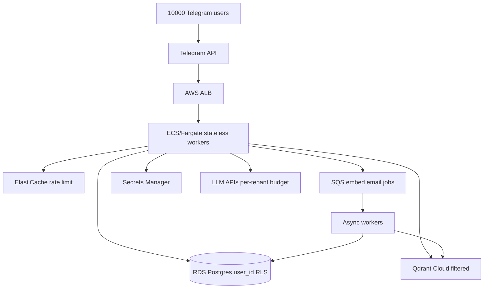

### Sharding strategy

- **Compute:** Horizontal pod autoscaling on message queue depth
- **SQL:** Postgres with strict RLS on user_id OR schema-per-tenant for largest customers
- **Vectors:** Collection per user_id or metadata filter mandatory on every query
- **Scheduler:** EventBridge per-shard cron; heartbeat batched off-peak
- **Traces:** S3 JSONL partitioned by user_id/date; Athena for analytics
- **HITL:** Telegram remains; enterprise tier gets web approval portal

### Migration checklist from single-box

- Extract config to Secrets Manager; remove .env from images
- Replace SQLite with Postgres; add user_id column to all tables
- Move Chroma to Qdrant Cloud with tenant metadata
- Externalize scheduler to dedicated service
- Add SQS between turn completion and embedding jobs
- Implement per-tenant DAILY_LLM_CALL_CAP in Redis
- Load test execute_loop at p99 latency target
- Run evals/ harness in CI on every deploy

## Appendix A: Environment variables

See `.env.example` for full list. Critical vars:

- `TELEGRAM_BOT_TOKEN`
- `MY_TELEGRAM_USER_ID`
- `GROQ_API_KEY`
- `GOOGLE_GEMINI_API_KEY`
- `AUTONOMY_LEVEL`
- `AUTO_APPROVE`
- `DAILY_LLM_CALL_CAP`
- `AGENT_PAUSED`
- `VECTOR_BACKEND`
- `QDRANT_URL`
- `TOOL_RAG`
- `TOOL_RAG_K`
- `SWARM_ENABLED`
- `HEALING_ENABLED`
- `LECE_ENABLED`
- `HEARTBEAT_HOURS`

## Appendix B: Concept → code map

| Concept | Primary code |
|---|---|
| ReAct loop | `agent/loop.py` |
| Plan-and-execute | `agent/planner.py` |
| Reflexion | `agent/critic.py` |
| HITL | `agent/approvals.py` |
| Hybrid RAG | `memory/retrieval.py` |
| Tool-RAG | `agent/tool_retrieval.py` |
| Self-RAG | `agent/self_rag.py` |
| GraphRAG | `memory/graphrag.py` |
| Swarm | `agent/swarm/` |
| Self-healing | `agent/healing/` |
| LECE | `agent/cognition/` |
| Scheduler | `scheduler/jobs.py` |
| Traces | `agent/trace.py` |
| Eval harness | `evals/` |

## Appendix C: Eval suite & quality bar

- **`evals/runner.py`** — scenario-based agent eval entry
- **`evals/quality_runner.py`** — quality regression suite
- **`evals/quality_scenarios.py`** — golden ~30 queries (tasks, fuzzy recall, refusal)
- **`evals/judge.py`** — LLM-as-judge for faithfulness/precision
- **`evals/lece/`** — LECE ablation harness (principle vs instance, preplay on/off)
- **`research/`** — extended research eval pipeline (separate from prod harness)

Production bar before scale: run quality_runner in CI; track context precision and faithfulness; no full RAGAS pipeline shipped — evals/ harness is the intentional substitute.

## Expanded reference: tool category study notes

### Study notes: `calendar` (3 tools)

- **`calendar_create_event`** — Create an event on the founder's primary Google Calendar. Pass ISO datetimes (compute from the current time in your prom...
  - Approval: no
  - Practice: explain when LLM picks this over siblings in `calendar`.
- **`calendar_delete_event`** — Delete a calendar event by id. APPROVAL REQUIRED.
  - Approval: yes
  - Practice: explain when LLM picks this over siblings in `calendar`.
- **`calendar_list_events`** — List upcoming events on the founder's primary Google Calendar.
  - Approval: no
  - Practice: explain when LLM picks this over siblings in `calendar`.

### Study notes: `crm` (6 tools)

- **`add_contact`** — Add a person to the CRM.
  - Approval: no
  - Practice: explain when LLM picks this over siblings in `crm`.
- **`get_followups`** — List contacts whose follow-up is due now.
  - Approval: no
  - Practice: explain when LLM picks this over siblings in `crm`.
- **`pipeline_status`** — Summary of the sales/outreach pipeline by status.
  - Approval: no
  - Practice: explain when LLM picks this over siblings in `crm`.
- **`search_contacts`** — Search CRM contacts by name, company, role, or email.
  - Approval: no
  - Practice: explain when LLM picks this over siblings in `crm`.
- **`set_followup`** — Schedule a follow-up for a contact N days from now.
  - Approval: no
  - Practice: explain when LLM picks this over siblings in `crm`.
- **`update_contact_status`** — Update a contact's pipeline status (e.g. prospect, contacted, responded, meeting_set, closed, dead).
  - Approval: no
  - Practice: explain when LLM picks this over siblings in `crm`.

### Study notes: `evolution` (7 tools)

- **`best_approach`** — Ask which approach has worked best for a decision group, based on your recorded outcomes.
  - Approval: no
  - Practice: explain when LLM picks this over siblings in `evolution`.
- **`find_skill`** — Search your saved skills/playbooks for one relevant to a task.
  - Approval: no
  - Practice: explain when LLM picks this over siblings in `evolution`.
- **`propose_code_change`** — Propose a change to your OWN source code. This NEVER executes — it only files a proposal for the founder to review and a...
  - Approval: yes
  - Practice: explain when LLM picks this over siblings in `evolution`.
- **`record_lesson`** — Persist a lesson you learned (what worked, what failed, a founder preference, a correction). Lessons are retrieved into ...
  - Approval: no
  - Practice: explain when LLM picks this over siblings in `evolution`.
- **`record_outcome`** — Record whether an approach worked, so you learn which strategies win over time. 'group' is the decision family (e.g. 'em...
  - Approval: no
  - Practice: explain when LLM picks this over siblings in `evolution`.
- **`save_skill`** — Save a reusable playbook (skill) you can follow next time a similar task appears. Use clear, numbered steps.
  - Approval: no
  - Practice: explain when LLM picks this over siblings in `evolution`.
- **`update_instructions`** — Edit your own operating manual (the instructions injected into every prompt). Use mode='append' to add a bullet under a ...
  - Approval: no
  - Practice: explain when LLM picks this over siblings in `evolution`.

### Study notes: `finance` (2 tools)

- **`financial_status`** — Get current financial health: cash, burn, MRR, net burn, computed runway in months, and a status (healthy/warning/critic...
  - Approval: no
  - Practice: explain when LLM picks this over siblings in `finance`.
- **`set_financials`** — Record the company's current finances so the agent can track runway and warn you proactively. Provide cash in the bank, ...
  - Approval: no
  - Practice: explain when LLM picks this over siblings in `finance`.

### Study notes: `goals` (3 tools)

- **`add_goal`** — Record a long-running objective the founder wants pursued over time (e.g. 'book 5 demos with insurtech CTOs this month')...
  - Approval: no
  - Practice: explain when LLM picks this over siblings in `goals`.
- **`list_goals`** — List goals. status can be 'active', 'done', 'paused', 'dropped', or 'all'.
  - Approval: no
  - Practice: explain when LLM picks this over siblings in `goals`.
- **`update_goal`** — Update a goal's status, detail, or priority.
  - Approval: no
  - Practice: explain when LLM picks this over siblings in `goals`.

### Study notes: `memory` (12 tools)

- **`ask_network`** — Answer a BIG-PICTURE question about the founder's network/business by reasoning over knowledge-graph community summaries...
  - Approval: no
  - Practice: explain when LLM picks this over siblings in `memory`.
- **`deep_recall`** — Best-quality memory recall: hybrid dense+sparse search across ALL memory, reranked. Use for hard recall questions where ...
  - Approval: no
  - Practice: explain when LLM picks this over siblings in `memory`.
- **`graph_link`** — Record a relationship in the knowledge graph, e.g. link a person to a company, mark a competitor, or connect two people ...
  - Approval: no
  - Practice: explain when LLM picks this over siblings in `memory`.
- **`graph_lookup`** — Look up what the knowledge graph knows about a person, company, or topic (their relationships: who works where, who know...
  - Approval: no
  - Practice: explain when LLM picks this over siblings in `memory`.
- **`list_network_map`** — List the current knowledge-graph communities and their summaries (no rebuild).
  - Approval: no
  - Practice: explain when LLM picks this over siblings in `memory`.
- **`rebuild_network_map`** — Refresh the knowledge graph from the CRM, detect communities, and regenerate their summaries (GraphRAG index). Run after...
  - Approval: no
  - Practice: explain when LLM picks this over siblings in `memory`.
- **`recall_episodes`** — Recall past conversations relevant to a topic, weighted by relevance and recency (what was recently discussed).
  - Approval: no
  - Practice: explain when LLM picks this over siblings in `memory`.
- **`recent_memory`** — Get the most recent items from a memory collection (conversations, research, notes, or outreach).
  - Approval: no
  - Practice: explain when LLM picks this over siblings in `memory`.
- **`save_memory`** — Persist an important fact, note, or piece of knowledge to long-term memory.
  - Approval: no
  - Practice: explain when LLM picks this over siblings in `memory`.
- **`search_memory`** — Semantic search across everything the founder has ever told you (conversations, research, notes, outreach). Use this to ...
  - Approval: no
  - Practice: explain when LLM picks this over siblings in `memory`.
- **`smart_recall`** — Deep CONNECTED recall: fuses hybrid (dense+sparse) text recall across ALL memory and documents WITH knowledge-graph rela...
  - Approval: no
  - Practice: explain when LLM picks this over siblings in `memory`.
- **`world_state`** — Get a structured snapshot of the founder's current business state: CRM pipeline, active goals, open projects, pending re...
  - Approval: no
  - Practice: explain when LLM picks this over siblings in `memory`.

### Study notes: `meta` (22 tools)

- **`about_self`** — Describe yourself accurately: who built you (Utso, @officiallyutso), how complex/advanced you are, your architecture, an...
  - Approval: no
  - Practice: explain when LLM picks this over siblings in `meta`.
- **`agent_status`** — Report the agent's current operating status: autonomy level, today's LLM usage, estimated cost, and whether it's paused.
  - Approval: no
  - Practice: explain when LLM picks this over siblings in `meta`.
- **`backup_now`** — Create an immediate backup of the agent's entire memory (SQLite DB + vector store + world state) into data/backups/. Use...
  - Approval: no
  - Practice: explain when LLM picks this over siblings in `meta`.
- **`circuit_status`** — Show circuit breaker states for all monitored providers and tools.
  - Approval: no
  - Practice: explain when LLM picks this over siblings in `meta`.
- **`create_tool`** — Author a NEW tool for yourself when no existing tool fits a recurring need. Provide a snake_case name, a clear descripti...
  - Approval: yes
  - Practice: explain when LLM picks this over siblings in `meta`.
- **`distill_now`** — Run experiential self-distillation: extract principle-level experience from recent agent traces and update the personali...
  - Approval: no
  - Practice: explain when LLM picks this over siblings in `meta`.
- **`failure_log`** — List recent failures recorded by the self-healing system, with diagnosis and recovery actions taken.
  - Approval: no
  - Practice: explain when LLM picks this over siblings in `meta`.
- **`founder_profile`** — View the learned founder theory-of-mind model (preferences, risk, style).
  - Approval: no
  - Practice: explain when LLM picks this over siblings in `meta`.
- **`heal_now`** — Trigger immediate self-healing: run self-test and auto-remediate any detected issues (DB reconnect, vector store repair,...
  - Approval: no
  - Practice: explain when LLM picks this over siblings in `meta`.
- **`health_report`** — Get a full health report: self-test results, failure stats, circuit breaker states, storage health, and recent healing e...
  - Approval: no
  - Practice: explain when LLM picks this over siblings in `meta`.
- **`lece_metrics`** — Full LECE metrics report: preplay accuracy, principle effectiveness, trust, distillation.
  - Approval: no
  - Practice: explain when LLM picks this over siblings in `meta`.
- **`list_backups`** — List existing memory backups (newest first) with size and timestamp.
  - Approval: no
  - Practice: explain when LLM picks this over siblings in `meta`.
- **`list_principles`** — List learned principles from LECE self-distillation with effectiveness scores.
  - Approval: no
  - Practice: explain when LLM picks this over siblings in `meta`.
- **`preplay_action`** — Simulate a high-stakes action on the business digital twin before executing. Returns predicted outcomes for candidate va...
  - Approval: no
  - Practice: explain when LLM picks this over siblings in `meta`.
- **`recent_traces`** — Inspect the agent's own recent turns (flight recorder): which tools were called and how long each turn took. Useful for ...
  - Approval: no
  - Practice: explain when LLM picks this over siblings in `meta`.
- **`reset_circuit`** — Manually reset a circuit breaker to CLOSED state (e.g. after fixing an external service).
  - Approval: no
  - Practice: explain when LLM picks this over siblings in `meta`.
- **`run_self_test`** — Run a comprehensive self-test of all critical subsystems: SQLite, vector store, tools, generated tools, budget, circuit ...
  - Approval: no
  - Practice: explain when LLM picks this over siblings in `meta`.
- **`simulate_strategy`** — Run parallel counterfactual strategy rollouts on the digital twin (sandbox).
  - Approval: no
  - Practice: explain when LLM picks this over siblings in `meta`.
- **`trust_report`** — View learned trust/competence scores per action type for adaptive autonomy.
  - Approval: no
  - Practice: explain when LLM picks this over siblings in `meta`.
- **`twin_state`** — Get the current business digital twin state vector and top procedure transitions.
  - Approval: no
  - Practice: explain when LLM picks this over siblings in `meta`.
- **`why_did_you`** — Explain a recent decision using workspace state, trace, and preplay records.
  - Approval: no
  - Practice: explain when LLM picks this over siblings in `meta`.
- **`workspace_state`** — View the Global Workspace blackboard: active attention items and salience scores.
  - Approval: no
  - Practice: explain when LLM picks this over siblings in `meta`.

### Study notes: `orchestration` (23 tools)

- **`assign_swarm_agent`** — Bio-inspired agent assignment: match task to best agent profile by embedding + pheromone.
  - Approval: no
  - Practice: explain when LLM picks this over siblings in `orchestration`.
- **`board_post`** — Post a finding to an active swarm blackboard (stigmergic trace).
  - Approval: no
  - Practice: explain when LLM picks this over siblings in `orchestration`.
- **`board_read`** — Read entries from a swarm blackboard, ordered by salience.
  - Approval: no
  - Practice: explain when LLM picks this over siblings in `orchestration`.
- **`delegate`** — Hand off a focused task to a specialist sub-agent that has its own tools and runs its own loop. Specialists: 'researcher...
  - Approval: no
  - Practice: explain when LLM picks this over siblings in `orchestration`.
- **`delegate_parallel`** — Run several specialist handoffs at once (parallel) and get all results. Great for fanning out independent work, e.g. res...
  - Approval: no
  - Practice: explain when LLM picks this over siblings in `orchestration`.
- **`enqueue_swarm_job`** — Enqueue a swarm job for async/distributed execution (SQLite or Redis queue).
  - Approval: no
  - Practice: explain when LLM picks this over siblings in `orchestration`.
- **`handoff_start`** — Start a dynamic peer handoff session (OpenAI Swarm style). Returns session_id.
  - Approval: no
  - Practice: explain when LLM picks this over siblings in `orchestration`.
- **`handoff_to`** — Transfer control to another specialist within an active handoff session.
  - Approval: no
  - Practice: explain when LLM picks this over siblings in `orchestration`.
- **`list_swarm_profiles`** — List bio-inspired swarm agent profiles with pheromone scores.
  - Approval: no
  - Practice: explain when LLM picks this over siblings in `orchestration`.
- **`list_swarm_runs`** — List recent swarm execution runs with topology and status.
  - Approval: no
  - Practice: explain when LLM picks this over siblings in `orchestration`.
- **`route_topology`** — Analyze a task and recommend the optimal swarm topology (parallel, sequential, hierarchical, debate, mesh, blackboard).
  - Approval: no
  - Practice: explain when LLM picks this over siblings in `orchestration`.
- **`run_blackboard`** — Blackboard/stigmergic swarm: agents post findings to a shared board until consensus.
  - Approval: no
  - Practice: explain when LLM picks this over siblings in `orchestration`.
- **`run_debate`** — Multi-agent debate with advocate/skeptic roles and judge synthesis. Best for strategic decisions and evaluations.
  - Approval: no
  - Practice: explain when LLM picks this over siblings in `orchestration`.
- **`run_evolve_swarm`** — Self-evolving swarm that executes work and may propose new reusable skills.
  - Approval: no
  - Practice: explain when LLM picks this over siblings in `orchestration`.
- **`run_hierarchical_swarm`** — Hierarchical hybrid swarm composing parallel, mesh, and debate layers.
  - Approval: no
  - Practice: explain when LLM picks this over siblings in `orchestration`.
- **`run_langgraph_swarm`** — Run swarm via optional LangGraph adapter (falls back to native if unavailable).
  - Approval: no
  - Practice: explain when LLM picks this over siblings in `orchestration`.
- **`run_maker_checker`** — Maker-checker loop: one agent drafts, another validates, until approved.
  - Approval: no
  - Practice: explain when LLM picks this over siblings in `orchestration`.
- **`run_mesh`** — Mesh coordination: 3-8 agents iterate on a shared artifact until quality converges.
  - Approval: no
  - Practice: explain when LLM picks this over siblings in `orchestration`.
- **`run_proactive_swarm`** — Run budget-aware swarm over active goals (for heartbeat/proactive use).
  - Approval: no
  - Practice: explain when LLM picks this over siblings in `orchestration`.
- **`run_swarm`** — Execute a multi-agent swarm with adaptive topology (parallel, sequential, hierarchical, hybrid). Provide a goal and opti...
  - Approval: no
  - Practice: explain when LLM picks this over siblings in `orchestration`.
- **`run_swarmsys`** — Full SwarmSys cycle: explorer + worker + validator with pheromone reinforcement.
  - Approval: no
  - Practice: explain when LLM picks this over siblings in `orchestration`.
- **`swarm_aggregate`** — Synthesize multiple sub-agent results into one coherent answer (fan-in).
  - Approval: no
  - Practice: explain when LLM picks this over siblings in `orchestration`.
- **`swarm_status`** — Get swarm system status: config, recent runs, profiles, LangGraph availability.
  - Approval: no
  - Practice: explain when LLM picks this over siblings in `orchestration`.

### Study notes: `outreach` (3 tools)

- **`draft_email`** — Draft a personalized cold/outreach email for a contact and/or company. Returns subject, body, a LinkedIn variant, and th...
  - Approval: no
  - Practice: explain when LLM picks this over siblings in `outreach`.
- **`draft_linkedin`** — Draft a short LinkedIn connection note or DM (<=300 chars). Draft only — LinkedIn does not allow automated posting, so t...
  - Approval: no
  - Practice: explain when LLM picks this over siblings in `outreach`.
- **`send_email`** — Send an email via the founder's Gmail. APPROVAL REQUIRED. Provide the final recipient, subject, and body.
  - Approval: yes
  - Practice: explain when LLM picks this over siblings in `outreach`.

### Study notes: `perception` (7 tools)

- **`add_monitor`** — Watch a topic over time. The agent periodically searches it and alerts the founder when genuinely new results appear (ne...
  - Approval: no
  - Practice: explain when LLM picks this over siblings in `perception`.
- **`browse_page`** — Open a web page in a real headless browser and return its rendered text. Use for JavaScript-heavy pages where plain scra...
  - Approval: no
  - Practice: explain when LLM picks this over siblings in `perception`.
- **`check_email_replies`** — Read the inbox and match senders against CRM contacts to spot replies from people you're in touch with. Returns matches ...
  - Approval: no
  - Practice: explain when LLM picks this over siblings in `perception`.
- **`check_replies_now`** — Run the email reply-tracking loop right now: scan the inbox for new replies from CRM contacts, log them, mark contacts a...
  - Approval: no
  - Practice: explain when LLM picks this over siblings in `perception`.
- **`list_monitors`** — List active topic monitors.
  - Approval: no
  - Practice: explain when LLM picks this over siblings in `perception`.
- **`read_inbox`** — Read recent emails from the founder's inbox (does not mark them read). Use to check for replies, important messages, or ...
  - Approval: no
  - Practice: explain when LLM picks this over siblings in `perception`.
- **`remove_monitor`** — Stop watching a topic monitor by id.
  - Approval: no
  - Practice: explain when LLM picks this over siblings in `perception`.

### Study notes: `reminders` (3 tools)

- **`cancel_reminder`** — Cancel a pending reminder by id.
  - Approval: no
  - Practice: explain when LLM picks this over siblings in `reminders`.
- **`list_reminders`** — List pending reminders.
  - Approval: no
  - Practice: explain when LLM picks this over siblings in `reminders`.
- **`set_reminder`** — Set a reminder. The founder will be pinged on Telegram at the due time. Pass an absolute ISO datetime in due_at_iso (com...
  - Approval: no
  - Practice: explain when LLM picks this over siblings in `reminders`.

### Study notes: `research` (11 tools)

- **`ask_documents`** — Answer a question grounded in the founder's ingested documents using Corrective RAG: it retrieves passages, grades their...
  - Approval: no
  - Practice: explain when LLM picks this over siblings in `research`.
- **`find_leads`** — Find contactable leads (emails/phones/LinkedIn) for a company, a role at a company, or specific named people. Saves them...
  - Approval: no
  - Practice: explain when LLM picks this over siblings in `research`.
- **`get_context_space`** — Get full details of a Context Space by name, including assets and aliases.
  - Approval: no
  - Practice: explain when LLM picks this over siblings in `research`.
- **`ingest_file`** — Ingest a single local document (PDF/DOCX/TXT/MD/CSV/JSON) into the agent's knowledge base so it can answer questions gro...
  - Approval: no
  - Practice: explain when LLM picks this over siblings in `research`.
- **`ingest_folder`** — Ingest all supported documents in a folder (PDF/DOCX/TXT/MD/CSV/JSON) into the knowledge base. Use to load a whole direc...
  - Approval: no
  - Practice: explain when LLM picks this over siblings in `research`.
- **`list_context_spaces`** — List all Context Spaces (named knowledge buckets) with asset counts. Use when the user asks what contexts/projects/space...
  - Approval: no
  - Practice: explain when LLM picks this over siblings in `research`.
- **`list_ingested_documents`** — List which documents have been ingested into the knowledge base and how many chunks each has.
  - Approval: no
  - Practice: explain when LLM picks this over siblings in `research`.
- **`research_company`** — Run the full research pipeline on a company (web search + scrape + AI summary). Caches results in the CRM. Returns a str...
  - Approval: no
  - Practice: explain when LLM picks this over siblings in `research`.
- **`scrape_url`** — Fetch and read a web page; returns its title and cleaned text.
  - Approval: no
  - Practice: explain when LLM picks this over siblings in `research`.
- **`search_context`** — Search within Context Spaces for relevant knowledge. Optionally restrict to one space by name. Use when you need project...
  - Approval: no
  - Practice: explain when LLM picks this over siblings in `research`.
- **`web_search`** — Search the web and return a list of {title, url, snippet}.
  - Approval: no
  - Practice: explain when LLM picks this over siblings in `research`.

### Study notes: `social` (3 tools)

- **`draft_linkedin_post`** — Draft a LinkedIn post on a topic. Draft only — LinkedIn does not permit automated personal posting, so the founder publi...
  - Approval: no
  - Practice: explain when LLM picks this over siblings in `social`.
- **`x_post`** — Post a tweet to X (Twitter) from the founder's account (<=280 chars). APPROVAL REQUIRED. Requires the X API to be config...
  - Approval: yes
  - Practice: explain when LLM picks this over siblings in `social`.
- **`x_search`** — Search recent tweets on X (needs a configured bearer token / paid tier).
  - Approval: no
  - Practice: explain when LLM picks this over siblings in `social`.

### Study notes: `tasks` (12 tools)

- **`add_task`** — Add a to-do/action item for the founder.
  - Approval: no
  - Practice: explain when LLM picks this over siblings in `tasks`.
- **`advance_project`** — Mark a project step done and checkpoint its result, so progress survives across sessions.
  - Approval: no
  - Practice: explain when LLM picks this over siblings in `tasks`.
- **`complete_project`** — Mark an entire project finished.
  - Approval: no
  - Practice: explain when LLM picks this over siblings in `tasks`.
- **`complete_task`** — Mark a task as done by its id.
  - Approval: no
  - Practice: explain when LLM picks this over siblings in `tasks`.
- **`create_document`** — Create a plain-text or Markdown document file from content and deliver it to the founder on Telegram. Use for notes, spe...
  - Approval: no
  - Practice: explain when LLM picks this over siblings in `tasks`.
- **`generate_chart`** — Render a chart (bar/line/pie) from labels + values and send it to the founder as an image. Use to visualize metrics, pip...
  - Approval: no
  - Practice: explain when LLM picks this over siblings in `tasks`.
- **`generate_pdf`** — Generate a PDF document from text content (a report, brief, one-pager, memo, agenda, etc.) and deliver it to the founder...
  - Approval: no
  - Practice: explain when LLM picks this over siblings in `tasks`.
- **`list_projects`** — List open durable projects and their progress.
  - Approval: no
  - Practice: explain when LLM picks this over siblings in `tasks`.
- **`list_tasks`** — List pending tasks.
  - Approval: no
  - Practice: explain when LLM picks this over siblings in `tasks`.
- **`project_status`** — Get the full step-by-step status of one project, including step results.
  - Approval: no
  - Practice: explain when LLM picks this over siblings in `tasks`.
- **`send_voice_note`** — Speak a message aloud and send it to the founder as a Telegram VOICE message. Use whenever the founder asks for a voice ...
  - Approval: no
  - Practice: explain when LLM picks this over siblings in `tasks`.
- **`start_project`** — Begin a durable, multi-session project with named steps. Persists so it can be resumed later. Use for work that spans da...
  - Approval: no
  - Practice: explain when LLM picks this over siblings in `tasks`.

## Expanded reference: glossary flashcard drills

1. **ReAct** — cover the card, recite: definition, file, why, example.

2. **LangGraph** — cover the card, recite: definition, file, why, example.

3. **RAG** — cover the card, recite: definition, file, why, example.

4. **Tool-RAG** — cover the card, recite: definition, file, why, example.

5. **Self-RAG** — cover the card, recite: definition, file, why, example.

6. **GraphRAG** — cover the card, recite: definition, file, why, example.

7. **HITL** — cover the card, recite: definition, file, why, example.

8. **BM25** — cover the card, recite: definition, file, why, example.

9. **RRF** — cover the card, recite: definition, file, why, example.

10. **ChromaDB** — cover the card, recite: definition, file, why, example.

11. **Qdrant** — cover the card, recite: definition, file, why, example.

12. **SQLite** — cover the card, recite: definition, file, why, example.

13. **episodic memory** — cover the card, recite: definition, file, why, example.

14. **consolidation** — cover the card, recite: definition, file, why, example.

15. **world model** — cover the card, recite: definition, file, why, example.

16. **knowledge graph** — cover the card, recite: definition, file, why, example.

17. **approval gate** — cover the card, recite: definition, file, why, example.

18. **policy** — cover the card, recite: definition, file, why, example.

19. **constitution** — cover the card, recite: definition, file, why, example.

20. **preplay** — cover the card, recite: definition, file, why, example.

21. **digital twin** — cover the card, recite: definition, file, why, example.

22. **LECE** — cover the card, recite: definition, file, why, example.

23. **swarm** — cover the card, recite: definition, file, why, example.

24. **delegate** — cover the card, recite: definition, file, why, example.

25. **sub-agent** — cover the card, recite: definition, file, why, example.

26. **circuit breaker** — cover the card, recite: definition, file, why, example.

27. **semantic cache** — cover the card, recite: definition, file, why, example.

28. **Ollama** — cover the card, recite: definition, file, why, example.

29. **Groq** — cover the card, recite: definition, file, why, example.

30. **Gemini** — cover the card, recite: definition, file, why, example.

31. **MCP** — cover the card, recite: definition, file, why, example.

32. **Voyager-style** — cover the card, recite: definition, file, why, example.

33. **Reflexion** — cover the card, recite: definition, file, why, example.

34. **plan-and-execute** — cover the card, recite: definition, file, why, example.

35. **epsilon-greedy** — cover the card, recite: definition, file, why, example.

36. **prompt injection** — cover the card, recite: definition, file, why, example.

37. **kill switch** — cover the card, recite: definition, file, why, example.

38. **spend cap** — cover the card, recite: definition, file, why, example.

39. **flight recorder** — cover the card, recite: definition, file, why, example.

40. **heartbeat** — cover the card, recite: definition, file, why, example.

41. **watchdog** — cover the card, recite: definition, file, why, example.

42. **AgentCore** — cover the card, recite: definition, file, why, example.

43. **execute_loop** — cover the card, recite: definition, file, why, example.

44. **Tool schema** — cover the card, recite: definition, file, why, example.

45. **action_log** — cover the card, recite: definition, file, why, example.

46. **approval queue** — cover the card, recite: definition, file, why, example.

47. **inline keyboard** — cover the card, recite: definition, file, why, example.

48. **long polling** — cover the card, recite: definition, file, why, example.

49. **middleware** — cover the card, recite: definition, file, why, example.

50. **hybrid_search** — cover the card, recite: definition, file, why, example.

51. **fused_recall** — cover the card, recite: definition, file, why, example.

52. **tool_retrieval** — cover the card, recite: definition, file, why, example.

53. **context spaces** — cover the card, recite: definition, file, why, example.

54. **cross-encoder rerank** — cover the card, recite: definition, file, why, example.

55. **APScheduler** — cover the card, recite: definition, file, why, example.

56. **daily briefing** — cover the card, recite: definition, file, why, example.

57. **follow-up reminder** — cover the card, recite: definition, file, why, example.

58. **topic monitor** — cover the card, recite: definition, file, why, example.

59. **reply loop** — cover the card, recite: definition, file, why, example.

60. **RecoveryBudget** — cover the card, recite: definition, file, why, example.

61. **FailureClass** — cover the card, recite: definition, file, why, example.

62. **stuck-loop detection** — cover the card, recite: definition, file, why, example.

63. **metacog** — cover the card, recite: definition, file, why, example.

64. **checkpoint** — cover the card, recite: definition, file, why, example.

65. **failure ledger** — cover the card, recite: definition, file, why, example.

66. **AdaptOrch** — cover the card, recite: definition, file, why, example.

67. **blackboard** — cover the card, recite: definition, file, why, example.

68. **maker-checker** — cover the card, recite: definition, file, why, example.

69. **SwarmSys** — cover the card, recite: definition, file, why, example.

70. **DLQ** — cover the card, recite: definition, file, why, example.

71. **principles** — cover the card, recite: definition, file, why, example.

72. **Global Workspace** — cover the card, recite: definition, file, why, example.

73. **trust-calibrated autonomy** — cover the card, recite: definition, file, why, example.

74. **LoRA gate** — cover the card, recite: definition, file, why, example.

75. **simulation sandbox** — cover the card, recite: definition, file, why, example.

76. **identity** — cover the card, recite: definition, file, why, example.

77. **evolution** — cover the card, recite: definition, file, why, example.

78. **confidence** — cover the card, recite: definition, file, why, example.

79. **complete_with_tools** — cover the card, recite: definition, file, why, example.

80. **BudgetError** — cover the card, recite: definition, file, why, example.

81. **RateLimitError** — cover the card, recite: definition, file, why, example.

82. **PUBLIC_ACCESS** — cover the card, recite: definition, file, why, example.

83. **specialist** — cover the card, recite: definition, file, why, example.

84. **fan-out/fan-in** — cover the card, recite: definition, file, why, example.

85. **dynamic handoff** — cover the card, recite: definition, file, why, example.

86. **mesh convergence** — cover the card, recite: definition, file, why, example.

87. **hierarchical swarm** — cover the card, recite: definition, file, why, example.

88. **proactive swarm** — cover the card, recite: definition, file, why, example.

89. **skills_factory** — cover the card, recite: definition, file, why, example.

90. **FastAPI dashboard** — cover the card, recite: definition, file, why, example.

91. **eval harness** — cover the card, recite: definition, file, why, example.

## Expanded reference: Amazon behavioral probes

**Prompt:** Tell me about a time you disagreed with a shortcut
- Situation: Chose HITL over full autonomy despite faster demo
- Action: Founder trust > demo speed
- Result: Approval gate shipped default

**Prompt:** How do you prioritize when everything is P0?
- Situation: Heartbeat budgets + DAILY_LLM_CALL_CAP + recovery budget
- Action: Bounded autonomy
- Result: No runaway loops in prod

**Prompt:** Describe debugging a production incident
- Situation: Trace JSONL → action_log → healing_events
- Action: Flight recorder first
- Result: Root cause in wrong-tool class

## Appendix D: Complete environment variable reference

| Variable | Default | Purpose | Used in |
|---|---|---|---|
| `TELEGRAM_BOT_TOKEN` | — | Telegram BotFather token | `main.py ApplicationBuilder` |
| `MY_TELEGRAM_USER_ID` | — | Authorized founder chat ID | `bot/middleware.py` |
| `PUBLIC_ACCESS` | false | Allow any Telegram user (demo only) | `bot/middleware.py` |
| `GROQ_API_KEY` | — | Groq LLM API key | `llm/groq_client.py` |
| `GOOGLE_GEMINI_API_KEY` | — | Gemini API key | `llm/gemini_client.py` |
| `OPENAI_API_KEY` | — | OpenAI fallback key | `llm/openai_client.py` |
| `GMAIL_ADDRESS` | — | Gmail account for send/receive | `outreach tools` |
| `GMAIL_APP_PASSWORD` | — | Gmail app password | `outreach tools` |
| `SERPER_API_KEY` | — | Serper web search API | `tools/web_search.py` |
| `TAVILY_API_KEY` | — | Tavily search (primary) | `tools/web_search.py` |
| `AUTO_APPROVE` | false | Skip approval gate globally | `agent/policy.py` |
| `AUTONOMY_LEVEL` | balanced | cautious|balanced|autonomous | `agent/policy.py` |
| `HEARTBEAT_HOURS` | 4 | Proactive heartbeat interval | `scheduler/jobs.py` |
| `DAILY_LLM_CALL_CAP` | 0 | Daily LLM cap (0=unlimited) | `agent/budget.py` |
| `AGENT_PAUSED` | false | Kill switch | `agent/core.py` |
| `VOICE_REPLIES` | true | Reply with voice to voice messages | `bot/handlers.py` |
| `DASHBOARD_ENABLED` | true | Start FastAPI dashboard | `main.py api/server.py` |
| `OLLAMA_ENABLED` | false | Enable local Ollama fallback | `llm/ollama_client.py` |
| `OLLAMA_MODEL` | llama3.1 | Ollama model name | `llm/ollama_client.py` |
| `VECTOR_BACKEND` | qdrant | chroma|qdrant | `memory/vector_store.py` |
| `QDRANT_URL` | — | Qdrant cluster URL | `memory/vector_store.py` |
| `SEMANTIC_CACHE` | true | Cache duplicate LLM prompts | `llm/cache.py` |
| `CACHE_DISTANCE_THRESHOLD` | 0.08 | Semantic cache similarity threshold | `llm/cache.py` |
| `TOOL_RAG` | true | Retrieve relevant tools per turn | `agent/tool_retrieval.py` |
| `TOOL_RAG_K` | 16 | Tools retrieved per turn | `agent/tool_retrieval.py` |
| `SWARM_ENABLED` | true | Multi-agent swarm master switch | `agent/swarm/` |
| `SWARM_MAX_AGENTS` | 5 | Max concurrent swarm agents | `agent/swarm/runner.py` |
| `SWARM_WORKER_MODE` | sqlite | inproc|sqlite|redis | `agent/swarm/workers/` |
| `HEALING_ENABLED` | true | Self-healing control plane | `agent/healing/` |
| `HEALING_MAX_RECOVERIES` | 4 | Per-turn recovery budget | `agent/healing/orchestrator.py` |
| `WATCHDOG_MINUTES` | 30 | Watchdog cron interval | `scheduler/jobs.py` |
| `LECE_ENABLED` | true | LECE cognitive layer | `agent/cognition/` |
| `LECE_PREPLAY_ENABLED` | true | Simulate before high-stakes actions | `agent/cognition/preplay.py` |
| `LECE_DISTILL_TRAIN` | false | Tier B LoRA training | `agent/cognition/train/` |

## Appendix E: Per-tool interview one-liners

Quick reference: name → one sentence for whiteboard interviews.

- **`calendar_create_event`** (calendar): Create an event on the founder's primary Google Calendar. Pass ISO datetimes (compute from the curre...
- **`calendar_delete_event`** [APPROVAL] (calendar): Delete a calendar event by id. APPROVAL REQUIRED.
- **`calendar_list_events`** (calendar): List upcoming events on the founder's primary Google Calendar.
- **`add_contact`** (crm): Add a person to the CRM.
- **`get_followups`** (crm): List contacts whose follow-up is due now.
- **`pipeline_status`** (crm): Summary of the sales/outreach pipeline by status.
- **`search_contacts`** (crm): Search CRM contacts by name, company, role, or email.
- **`set_followup`** (crm): Schedule a follow-up for a contact N days from now.
- **`update_contact_status`** (crm): Update a contact's pipeline status (e.g. prospect, contacted, responded, meeting_set, closed, dead).
- **`best_approach`** (evolution): Ask which approach has worked best for a decision group, based on your recorded outcomes.
- **`find_skill`** (evolution): Search your saved skills/playbooks for one relevant to a task.
- **`propose_code_change`** [APPROVAL] (evolution): Propose a change to your OWN source code. This NEVER executes — it only files a proposal for the fou...
- **`record_lesson`** (evolution): Persist a lesson you learned (what worked, what failed, a founder preference, a correction). Lessons...
- **`record_outcome`** (evolution): Record whether an approach worked, so you learn which strategies win over time. 'group' is the decis...
- **`save_skill`** (evolution): Save a reusable playbook (skill) you can follow next time a similar task appears. Use clear, numbere...
- **`update_instructions`** (evolution): Edit your own operating manual (the instructions injected into every prompt). Use mode='append' to a...
- **`financial_status`** (finance): Get current financial health: cash, burn, MRR, net burn, computed runway in months, and a status (he...
- **`set_financials`** (finance): Record the company's current finances so the agent can track runway and warn you proactively. Provid...
- **`add_goal`** (goals): Record a long-running objective the founder wants pursued over time (e.g. 'book 5 demos with insurte...
- **`list_goals`** (goals): List goals. status can be 'active', 'done', 'paused', 'dropped', or 'all'.
- **`update_goal`** (goals): Update a goal's status, detail, or priority.
- **`ask_network`** (memory): Answer a BIG-PICTURE question about the founder's network/business by reasoning over knowledge-graph...
- **`deep_recall`** (memory): Best-quality memory recall: hybrid dense+sparse search across ALL memory, reranked. Use for hard rec...
- **`graph_link`** (memory): Record a relationship in the knowledge graph, e.g. link a person to a company, mark a competitor, or...
- **`graph_lookup`** (memory): Look up what the knowledge graph knows about a person, company, or topic (their relationships: who w...
- **`list_network_map`** (memory): List the current knowledge-graph communities and their summaries (no rebuild).
- **`rebuild_network_map`** (memory): Refresh the knowledge graph from the CRM, detect communities, and regenerate their summaries (GraphR...
- **`recall_episodes`** (memory): Recall past conversations relevant to a topic, weighted by relevance and recency (what was recently ...
- **`recent_memory`** (memory): Get the most recent items from a memory collection (conversations, research, notes, or outreach).
- **`save_memory`** (memory): Persist an important fact, note, or piece of knowledge to long-term memory.
- **`search_memory`** (memory): Semantic search across everything the founder has ever told you (conversations, research, notes, out...
- **`smart_recall`** (memory): Deep CONNECTED recall: fuses hybrid (dense+sparse) text recall across ALL memory and documents WITH ...
- **`world_state`** (memory): Get a structured snapshot of the founder's current business state: CRM pipeline, active goals, open ...
- **`about_self`** (meta): Describe yourself accurately: who built you (Utso, @officiallyutso), how complex/advanced you are, y...
- **`agent_status`** (meta): Report the agent's current operating status: autonomy level, today's LLM usage, estimated cost, and ...
- **`backup_now`** (meta): Create an immediate backup of the agent's entire memory (SQLite DB + vector store + world state) int...
- **`circuit_status`** (meta): Show circuit breaker states for all monitored providers and tools.
- **`create_tool`** [APPROVAL] (meta): Author a NEW tool for yourself when no existing tool fits a recurring need. Provide a snake_case nam...
- **`distill_now`** (meta): Run experiential self-distillation: extract principle-level experience from recent agent traces and ...
- **`failure_log`** (meta): List recent failures recorded by the self-healing system, with diagnosis and recovery actions taken.
- **`founder_profile`** (meta): View the learned founder theory-of-mind model (preferences, risk, style).
- **`heal_now`** (meta): Trigger immediate self-healing: run self-test and auto-remediate any detected issues (DB reconnect, ...
- **`health_report`** (meta): Get a full health report: self-test results, failure stats, circuit breaker states, storage health, ...
- **`lece_metrics`** (meta): Full LECE metrics report: preplay accuracy, principle effectiveness, trust, distillation.
- **`list_backups`** (meta): List existing memory backups (newest first) with size and timestamp.
- **`list_principles`** (meta): List learned principles from LECE self-distillation with effectiveness scores.
- **`preplay_action`** (meta): Simulate a high-stakes action on the business digital twin before executing. Returns predicted outco...
- **`recent_traces`** (meta): Inspect the agent's own recent turns (flight recorder): which tools were called and how long each tu...
- **`reset_circuit`** (meta): Manually reset a circuit breaker to CLOSED state (e.g. after fixing an external service).
- **`run_self_test`** (meta): Run a comprehensive self-test of all critical subsystems: SQLite, vector store, tools, generated too...
- **`simulate_strategy`** (meta): Run parallel counterfactual strategy rollouts on the digital twin (sandbox).
- **`trust_report`** (meta): View learned trust/competence scores per action type for adaptive autonomy.
- **`twin_state`** (meta): Get the current business digital twin state vector and top procedure transitions.
- **`why_did_you`** (meta): Explain a recent decision using workspace state, trace, and preplay records.
- **`workspace_state`** (meta): View the Global Workspace blackboard: active attention items and salience scores.
- **`assign_swarm_agent`** (orchestration): Bio-inspired agent assignment: match task to best agent profile by embedding + pheromone.
- **`board_post`** (orchestration): Post a finding to an active swarm blackboard (stigmergic trace).
- **`board_read`** (orchestration): Read entries from a swarm blackboard, ordered by salience.
- **`delegate`** (orchestration): Hand off a focused task to a specialist sub-agent that has its own tools and runs its own loop. Spec...
- **`delegate_parallel`** (orchestration): Run several specialist handoffs at once (parallel) and get all results. Great for fanning out indepe...
- **`enqueue_swarm_job`** (orchestration): Enqueue a swarm job for async/distributed execution (SQLite or Redis queue).
- **`handoff_start`** (orchestration): Start a dynamic peer handoff session (OpenAI Swarm style). Returns session_id.
- **`handoff_to`** (orchestration): Transfer control to another specialist within an active handoff session.
- **`list_swarm_profiles`** (orchestration): List bio-inspired swarm agent profiles with pheromone scores.
- **`list_swarm_runs`** (orchestration): List recent swarm execution runs with topology and status.
- **`route_topology`** (orchestration): Analyze a task and recommend the optimal swarm topology (parallel, sequential, hierarchical, debate,...
- **`run_blackboard`** (orchestration): Blackboard/stigmergic swarm: agents post findings to a shared board until consensus.
- **`run_debate`** (orchestration): Multi-agent debate with advocate/skeptic roles and judge synthesis. Best for strategic decisions and...
- **`run_evolve_swarm`** (orchestration): Self-evolving swarm that executes work and may propose new reusable skills.
- **`run_hierarchical_swarm`** (orchestration): Hierarchical hybrid swarm composing parallel, mesh, and debate layers.
- **`run_langgraph_swarm`** (orchestration): Run swarm via optional LangGraph adapter (falls back to native if unavailable).
- **`run_maker_checker`** (orchestration): Maker-checker loop: one agent drafts, another validates, until approved.
- **`run_mesh`** (orchestration): Mesh coordination: 3-8 agents iterate on a shared artifact until quality converges.
- **`run_proactive_swarm`** (orchestration): Run budget-aware swarm over active goals (for heartbeat/proactive use).
- **`run_swarm`** (orchestration): Execute a multi-agent swarm with adaptive topology (parallel, sequential, hierarchical, hybrid). Pro...
- **`run_swarmsys`** (orchestration): Full SwarmSys cycle: explorer + worker + validator with pheromone reinforcement.
- **`swarm_aggregate`** (orchestration): Synthesize multiple sub-agent results into one coherent answer (fan-in).
- **`swarm_status`** (orchestration): Get swarm system status: config, recent runs, profiles, LangGraph availability.
- **`draft_email`** (outreach): Draft a personalized cold/outreach email for a contact and/or company. Returns subject, body, a Link...
- **`draft_linkedin`** (outreach): Draft a short LinkedIn connection note or DM (<=300 chars). Draft only — LinkedIn does not allow aut...
- **`send_email`** [APPROVAL] (outreach): Send an email via the founder's Gmail. APPROVAL REQUIRED. Provide the final recipient, subject, and ...
- **`add_monitor`** (perception): Watch a topic over time. The agent periodically searches it and alerts the founder when genuinely ne...
- **`browse_page`** (perception): Open a web page in a real headless browser and return its rendered text. Use for JavaScript-heavy pa...
- **`check_email_replies`** (perception): Read the inbox and match senders against CRM contacts to spot replies from people you're in touch wi...
- **`check_replies_now`** (perception): Run the email reply-tracking loop right now: scan the inbox for new replies from CRM contacts, log t...
- **`list_monitors`** (perception): List active topic monitors.
- **`read_inbox`** (perception): Read recent emails from the founder's inbox (does not mark them read). Use to check for replies, imp...
- **`remove_monitor`** (perception): Stop watching a topic monitor by id.
- **`cancel_reminder`** (reminders): Cancel a pending reminder by id.
- **`list_reminders`** (reminders): List pending reminders.
- **`set_reminder`** (reminders): Set a reminder. The founder will be pinged on Telegram at the due time. Pass an absolute ISO datetim...
- **`ask_documents`** (research): Answer a question grounded in the founder's ingested documents using Corrective RAG: it retrieves pa...
- **`find_leads`** (research): Find contactable leads (emails/phones/LinkedIn) for a company, a role at a company, or specific name...
- **`get_context_space`** (research): Get full details of a Context Space by name, including assets and aliases.
- **`ingest_file`** (research): Ingest a single local document (PDF/DOCX/TXT/MD/CSV/JSON) into the agent's knowledge base so it can ...
- **`ingest_folder`** (research): Ingest all supported documents in a folder (PDF/DOCX/TXT/MD/CSV/JSON) into the knowledge base. Use t...
- **`list_context_spaces`** (research): List all Context Spaces (named knowledge buckets) with asset counts. Use when the user asks what con...
- **`list_ingested_documents`** (research): List which documents have been ingested into the knowledge base and how many chunks each has.
- **`research_company`** (research): Run the full research pipeline on a company (web search + scrape + AI summary). Caches results in th...
- **`scrape_url`** (research): Fetch and read a web page; returns its title and cleaned text.
- **`search_context`** (research): Search within Context Spaces for relevant knowledge. Optionally restrict to one space by name. Use w...
- **`web_search`** (research): Search the web and return a list of {title, url, snippet}.
- **`draft_linkedin_post`** (social): Draft a LinkedIn post on a topic. Draft only — LinkedIn does not permit automated personal posting, ...
- **`x_post`** [APPROVAL] (social): Post a tweet to X (Twitter) from the founder's account (<=280 chars). APPROVAL REQUIRED. Requires th...
- **`x_search`** (social): Search recent tweets on X (needs a configured bearer token / paid tier).
- **`add_task`** (tasks): Add a to-do/action item for the founder.
- **`advance_project`** (tasks): Mark a project step done and checkpoint its result, so progress survives across sessions.
- **`complete_project`** (tasks): Mark an entire project finished.
- **`complete_task`** (tasks): Mark a task as done by its id.
- **`create_document`** (tasks): Create a plain-text or Markdown document file from content and deliver it to the founder on Telegram...
- **`generate_chart`** (tasks): Render a chart (bar/line/pie) from labels + values and send it to the founder as an image. Use to vi...
- **`generate_pdf`** (tasks): Generate a PDF document from text content (a report, brief, one-pager, memo, agenda, etc.) and deliv...
- **`list_projects`** (tasks): List open durable projects and their progress.
- **`list_tasks`** (tasks): List pending tasks.
- **`project_status`** (tasks): Get the full step-by-step status of one project, including step results.
- **`send_voice_note`** (tasks): Speak a message aloud and send it to the founder as a Telegram VOICE message. Use whenever the found...
- **`start_project`** (tasks): Begin a durable, multi-session project with named steps. Persists so it can be resumed later. Use fo...

## Appendix F: How to read a trace JSONL entry

### Event: `start`
- **Meaning:** Turn opened with actor and user message
- **Source:** `agent/trace.py trace.start`
- **Teaching drill:** Find this event in today's trace and explain what happened before/after it.

### Event: `plan`
- **Meaning:** Planner created steps with plan_id
- **Source:** `agent/planner.py make_plan`
- **Teaching drill:** Find this event in today's trace and explain what happened before/after it.

### Event: `tool_call`
- **Meaning:** Tool name, args, policy decision, result preview
- **Source:** `agent/loop.py trace.add_tool_event`
- **Teaching drill:** Find this event in today's trace and explain what happened before/after it.

### Event: `healing`
- **Meaning:** Recovery action attempted on failure
- **Source:** `agent/healing/orchestrator.py`
- **Teaching drill:** Find this event in today's trace and explain what happened before/after it.

### Event: `finish`
- **Meaning:** Final reply text
- **Source:** `agent/trace.py trace.finish`
- **Teaching drill:** Find this event in today's trace and explain what happened before/after it.

## Appendix G: Scheduler job deep dive

### `daily_briefing`
- **Schedule:** 08:00 daily
- **Purpose:** Morning pipeline/tasks summary via report specialist
- **Function:** `job_daily_briefing`
- **Paused when:** AGENT_PAUSED=true (most jobs check _paused())
- **Interview line:** "daily_briefing runs on 08:00 daily — Morning pipeline/tasks summary via report specialist"

### `followup_reminder`
- **Schedule:** 10:00 daily
- **Purpose:** CRM contacts needing follow-up today
- **Function:** `job_followup_reminder`
- **Paused when:** AGENT_PAUSED=true (most jobs check _paused())
- **Interview line:** "followup_reminder runs on 10:00 daily — CRM contacts needing follow-up today"

### `backup`
- **Schedule:** 02:00 daily
- **Purpose:** Nightly data backup to data/backups/
- **Function:** `job_backup`
- **Paused when:** AGENT_PAUSED=true (most jobs check _paused())
- **Interview line:** "backup runs on 02:00 daily — Nightly data backup to data/backups/"

### `consolidate_memory`
- **Schedule:** 03:00 daily
- **Purpose:** Memory consolidation + GraphRAG rebuild
- **Function:** `job_consolidate_memory`
- **Paused when:** AGENT_PAUSED=true (most jobs check _paused())
- **Interview line:** "consolidate_memory runs on 03:00 daily — Memory consolidation + GraphRAG rebuild"

### `lece_distill`
- **Schedule:** 03:30 daily (LECE_DISTILL_HOUR:30)
- **Purpose:** Principle distillation from traces
- **Function:** `job_distill`
- **Paused when:** AGENT_PAUSED=true (most jobs check _paused())
- **Interview line:** "lece_distill runs on 03:30 daily (LECE_DISTILL_HOUR:30) — Principle distillation from traces"

### `check_monitors`
- **Schedule:** 09:30, 15:30, 20:30 daily
- **Purpose:** Topic monitor web search for fresh URLs
- **Function:** `job_check_monitors`
- **Paused when:** AGENT_PAUSED=true (most jobs check _paused())
- **Interview line:** "check_monitors runs on 09:30, 15:30, 20:30 daily — Topic monitor web search for fresh URLs"

### `check_inbox`
- **Schedule:** Every hour :15 from 09:00-21:00
- **Purpose:** Email reply tracking loop
- **Function:** `job_check_inbox`
- **Paused when:** AGENT_PAUSED=true (most jobs check _paused())
- **Interview line:** "check_inbox runs on Every hour :15 from 09:00-21:00 — Email reply tracking loop"

### `heartbeat`
- **Schedule:** Every HEARTBEAT_HOURS (default 4) from 09:00-21:00
- **Purpose:** Proactive agent self-check + optional swarm
- **Function:** `job_heartbeat`
- **Paused when:** AGENT_PAUSED=true (most jobs check _paused())
- **Interview line:** "heartbeat runs on Every HEARTBEAT_HOURS (default 4) from 09:00-21:00 — Proactive agent self-check + optional swarm"

### `watchdog`
- **Schedule:** Every WATCHDOG_MINUTES (default 30)
- **Purpose:** Self-test and auto-remediation
- **Function:** `job_watchdog`
- **Paused when:** AGENT_PAUSED=true (most jobs check _paused())
- **Interview line:** "watchdog runs on Every WATCHDOG_MINUTES (default 30) — Self-test and auto-remediation"

### `swarm_dlq_retry`
- **Schedule:** Every 15 minutes
- **Purpose:** Retry failed swarm jobs from DLQ
- **Function:** `job_swarm_dlq_retry`
- **Paused when:** AGENT_PAUSED=true (most jobs check _paused())
- **Interview line:** "swarm_dlq_retry runs on Every 15 minutes — Retry failed swarm jobs from DLQ"

### `reminder_*`
- **Schedule:** Dynamic DateTrigger per reminder
- **Purpose:** One-off or recurring user reminders
- **Function:** `job_fire_reminder`
- **Paused when:** AGENT_PAUSED=true (most jobs check _paused())
- **Interview line:** "reminder_* runs on Dynamic DateTrigger per reminder — One-off or recurring user reminders"

## Appendix H: Glossary alphabetical quick recall

**action_log** — Audit table of every tool invocation.
  - Code: `agent/store.py action_log` | Why: Replay, compliance, LECE episode scoring.

**AdaptOrch** — Task-adaptive topology routing from DAG metrics.
  - Code: `agent/swarm/topology.py` | Why: Picks parallel vs hierarchical vs debate.

**AgentCore** — Top-level supervisor orchestrating plan→execute→verify.
  - Code: `agent/core.py` | Why: Single entry point for all turns.

**approval gate** — Checkpoint before irreversible tool execution.
  - Code: `agent/loop.py _execute_tool, agent/approvals.py` | Why: Side-effect tools never run without allow decision.

**approval queue** — Pending side-effect actions awaiting founder decision.
  - Code: `agent/store.py approvals` | Why: Durable HITL state across restarts.

**APScheduler** — Cron scheduler for proactive jobs.
  - Code: `scheduler/jobs.py` | Why: Briefings, consolidation, heartbeat without user.

**blackboard** — Shared stigmergy board for swarm agents.
  - Code: `agent/swarm/board.py` | Why: Decentralized coordination without central planner.

**BM25** — Sparse lexical ranking for keyword/entity-heavy queries.
  - Code: `memory/retrieval.py` | Why: Complements dense embeddings for names, codenames, exact terms.

**BudgetError** — Raised when daily cap or pause blocks LLM.
  - Code: `agent/budget.py` | Why: Hard stop on spend.

**checkpoint** — Per-step snapshot for rollback.
  - Code: `agent/healing/checkpoint.py` | Why: State recovery on multi-step failure.

**ChromaDB** — Local embedded vector database for semantic memory.
  - Code: `memory/vector_store.py, data/chroma/` | Why: Default zero-setup vector backend on single machine.

**circuit breaker** — CLOSED/OPEN/HALF_OPEN per tool/provider after repeated failures.
  - Code: `agent/healing/circuit.py` | Why: Prevents hammering broken APIs; enables route-around.

**complete_with_tools** — LLM call returning tool_calls or final text.
  - Code: `llm/tool_client.py` | Why: Bridge between router and ReAct loop.

**confidence** — Annotate low-confidence replies honestly.
  - Code: `agent/confidence.py` | Why: Abstention over hallucination.

**consolidation** — Nightly job merging raw notes into durable memory + knowledge graph.
  - Code: `memory/consolidation.py, scheduler/jobs.py job_consolidate_memory` | Why: Prevents memory fragmentation; runs 03:00 cron.

**constitution** — Hard-coded safety rules in system prompt.
  - Code: `agent/identity.py` | Why: Non-negotiable boundaries even at autonomous level.

**context spaces** — Scoped document collections for project-specific RAG.
  - Code: `memory/context_store.py, context/` | Why: Isolate deck drafts from general memory.

**cross-encoder rerank** — Optional second-stage relevance scoring.
  - Code: `memory/retrieval.py _maybe_rerank` | Why: Improves precision when sentence-transformers installed.

**daily briefing** — Morning summary from report specialist.
  - Code: `scheduler/jobs.py 08:00, specialists/report_agent.py` | Why: Proactive founder value at day start.

**delegate** — Hand off subtask to specialist sub-agent with narrowed tools.
  - Code: `agent/subagent.py, agent/tools/orchestration_tools.py` | Why: Supervisor pattern without losing shared execute_loop semantics.

**digital twin** — Procedure graph predicting action outcomes from past traces.
  - Code: `agent/cognition/twin.py` | Why: Business state + transition reliabilities for simulation.

**DLQ** — Dead-letter queue for failed swarm jobs.
  - Code: `agent/swarm/workers/queue.py` | Why: Retry without losing work.

**dynamic handoff** — OpenAI Swarm-style agent-to-agent transfer.
  - Code: `agent/swarm/handoff.py` | Why: Context preserved across handoffs.

**episodic memory** — Time-stamped experiential records with recency/importance weighting.
  - Code: `memory/retrieval.py episodic_recall` | Why: Generative-Agents-style recall for 'what happened recently'.

**epsilon-greedy** — Explore/exploit balance for strategy A/B testing.
  - Code: `agent/optimizer.py, agent/store.py strategies table` | Why: Learn which email subject styles work.

**eval harness** — Quality scenarios + judge for regression testing.
  - Code: `evals/runner.py, evals/quality_runner.py` | Why: Production bar beyond ad-hoc testing; replaces full RAGAS pipeline.

**evolution** — Async reflection: lessons, skills, strategies.
  - Code: `agent/evolution.py` | Why: Self-improving without fine-tune.

**execute_loop** — Shared ReAct tool-calling loop with healing wrapper.
  - Code: `agent/loop.py` | Why: Same semantics for main agent and sub-agents.

**failure ledger** — Persistent failure→fix patterns for learning.
  - Code: `agent/healing/ledger.py` | Why: System learns which recoveries work.

**FailureClass** — Taxonomy: transient, wrong_tool, stuck_loop, etc.
  - Code: `agent/healing/taxonomy.py` | Why: Routes failure to cheapest fix.

**fan-out/fan-in** — Parallel sub-agents then aggregate results.
  - Code: `agent/tools/orchestration_tools.py delegate_parallel` | Why: Latency reduction for independent subtasks.

**FastAPI dashboard** — Local web UI for traces, cognition, CRM.
  - Code: `api/server.py, web/` | Why: Visual ops without Telegram limits.

**flight recorder** — Immutable per-turn JSONL trace of all events.
  - Code: `agent/trace.py, data/traces/` | Why: Debug, replay, LECE distillation input.

**follow-up reminder** — CRM contacts due for follow-up nudge.
  - Code: `scheduler/jobs.py 10:00` | Why: Prevents pipeline decay.

**fused_recall** — Multi-collection hybrid search with episodic scoring.
  - Code: `memory/retrieval.py fused_recall` | Why: Cross-collection recall for complex queries.

**Gemini** — Google LLM, preferred for research/analysis tasks.
  - Code: `llm/gemini_client.py` | Why: Strong long-context research in routing table.

**Global Workspace** — Attention blackboard with salience decay.
  - Code: `agent/cognition/workspace.py` | Why: Coalitions bid for founder attention.

**GraphRAG** — Community summaries over knowledge graph for global questions.
  - Code: `memory/graphrag.py, memory/graph.py` | Why: Answers 'who in my network knows X?' better than flat vector search.

**Groq** — Fast cloud LLM provider, first in general routing chain.
  - Code: `llm/groq_client.py, llm/router.py` | Why: Low-latency tool-calling for interactive Telegram UX.

**heartbeat** — Scheduled proactive self-check without user message.
  - Code: `scheduler/jobs.py job_heartbeat, agent/core.py actor=heartbeat` | Why: Autonomous nudges on goals, follow-ups, pipeline.

**hierarchical swarm** — Nested supervisor delegating to sub-supervisors.
  - Code: `agent/swarm/hierarchy.py` | Why: Complex org-chart style tasks.

**HITL** — Human-in-the-loop — founder approves side-effect actions before execution.
  - Code: `agent/approvals.py, bot/handlers.py` | Why: Customer Obsession: no surprise emails or posts.

**hybrid_search** — Dense + BM25 fused with RRF.
  - Code: `memory/retrieval.py` | Why: Best of semantic and lexical recall.

**identity** — System prompt builder with constitution.
  - Code: `agent/identity.py` | Why: Consistent agent persona and rules.

**inline keyboard** — Telegram tappable Approve/Reject buttons.
  - Code: `bot/handlers.py, scheduler/jobs.py` | Why: Mobile-first HITL UX.

**kill switch** — Emergency stop — no LLM calls, no autonomy.
  - Code: `config.py AGENT_PAUSED, agent/core.py` | Why: Instant halt without redeploy.

**knowledge graph** — Entity-relation store derived from CRM and notes.
  - Code: `memory/graph.py` | Why: Enables relational queries and GraphRAG communities.

**LangGraph** — Graph-based agent framework with explicit nodes/edges and checkpointing.
  - Code: `agent/swarm/adapters/langgraph_adapter.py` | Why: Optional adapter for swarm path 11; main agent uses custom loop, not LangGraph.

**LECE** — Lived-Experience Cognitive Engine — continual self-improvement from traces.
  - Code: `agent/cognition/` | Why: Closes loop: traces → principles → injection → better decisions.

**long polling** — Bot pulls updates from Telegram API (not webhook).
  - Code: `main.py app.run_polling()` | Why: Simpler local dev; no public HTTPS endpoint needed.

**LoRA gate** — Eval gate before promoting fine-tuned adapter.
  - Code: `agent/cognition/train/gate.py` | Why: Tier B training must beat baseline.

**maker-checker** — One agent drafts, another verifies.
  - Code: `agent/swarm/debate.py` | Why: Quality gate for high-stakes outputs.

**MCP** — Model Context Protocol — expose Founder OS tools to external agents.
  - Code: `mcp_server.py` | Why: Swarm path 8: Cursor/Claude can invoke swarm tools remotely.

**mesh convergence** — Iterative artifact refinement across agents.
  - Code: `agent/swarm/mesh.py` | Why: Draft improves over rounds.

**metacog** — MASC-style step anomaly scoring.
  - Code: `agent/healing/metacog.py` | Why: Early warning on suspicious tool sequences.

**middleware** — Auth gate — only MY_TELEGRAM_USER_ID unless PUBLIC_ACCESS.
  - Code: `bot/middleware.py` | Why: Single-tenant security default.

**Ollama** — Local LLM runtime for free offline fallback.
  - Code: `llm/ollama_client.py, llm/router.py` | Why: Last resort in provider cascade when cloud keys fail.

**plan-and-execute** — Explicit plan injected before tool loop for complex goals.
  - Code: `agent/planner.py, agent/core.py` | Why: Decomposes multi-step work into inspectable checklist.

**policy** — Tiered autonomy: cautious / balanced / autonomous.
  - Code: `agent/policy.py, agent/cognition/trust.py` | Why: Centralizes allow/approve/deny — not scattered in loop.

**preplay** — Simulate high-stakes actions on digital twin before real execution.
  - Code: `agent/cognition/preplay.py` | Why: ProPlay-style counterfactual planning for send_email, x_post.

**principles** — Distilled LECE rules from successful traces.
  - Code: `agent/cognition/principles.py, agent/cognition/distill.py` | Why: Durable learning beyond instance memory.

**proactive swarm** — Budget-aware swarm on heartbeat goals.
  - Code: `agent/swarm/proactive.py` | Why: Autonomous progress on active goals.

**prompt injection** — Malicious instructions embedded in untrusted content.
  - Code: `agent/safety.py` | Why: Email/web content must not override system instructions.

**PUBLIC_ACCESS** — Allow any Telegram user (demo mode).
  - Code: `config.py, bot/middleware.py` | Why: Shared brain warning — demo only.

**Qdrant** — Remote/managed vector database alternative to Chroma.
  - Code: `memory/vector_store.py` | Why: Scale embeddings to cloud without changing app logic.

**RAG** — Retrieval-Augmented Generation — fetch relevant context before answering.
  - Code: `memory/vector_store.py, memory/retrieval.py` | Why: Ground answers in founder-specific memory, not model weights.

**RateLimitError** — Groq rate limit — triggers cascade to next provider.
  - Code: `llm/groq_client.py` | Why: Resilient multi-provider routing.

**ReAct** — Reason + Act loop where the LLM alternates reasoning with tool calls until it can answer.
  - Code: `agent/loop.py, agent/core.py` | Why: Core agentic pattern — model decides tools dynamically instead of fixed pipeline...

**RecoveryBudget** — Per-turn cap on healing recovery attempts.
  - Code: `agent/healing/orchestrator.py` | Why: Prevents infinite heal loops.

**Reflexion** — Self-criticism after action to improve next attempt.
  - Code: `agent/critic.py verify_answer, agent/loop.py step reflection` | Why: Catches hallucination before reply sent.

**reply loop** — Track email replies and notify founder.
  - Code: `agent/reply_loop.py, job_check_inbox` | Why: Close the outreach feedback loop.

**RRF** — Reciprocal Rank Fusion — merges dense and sparse ranked lists without tuning.
  - Code: `memory/retrieval.py` | Why: Simple, robust hybrid fusion for local single-user setup.

**Self-RAG** — Agent evaluates whether retrieval is needed and if results are relevant.
  - Code: `agent/self_rag.py` | Why: Prevents blind retrieval and filters irrelevant chunks.

**semantic cache** — Cache LLM responses for near-duplicate prompts.
  - Code: `llm/cache.py` | Why: Cost control — embedding distance threshold match.

**simulation sandbox** — Intercept side-effect tools during preplay.
  - Code: `agent/cognition/sandbox.py` | Why: Safe counterfactual execution.

**skills_factory** — Runtime tool authoring with quarantine.
  - Code: `agent/skills_factory.py` | Why: Voyager-style capability expansion.

**specialist** — Named sub-agent with category-filtered tools.
  - Code: `agent/subagent.py SPECIALISTS` | Why: Focused expertise without full catalog noise.

**spend cap** — Daily LLM call budget to prevent runaway loops.
  - Code: `agent/budget.py, config DAILY_LLM_CALL_CAP` | Why: Cost and safety guardrail.

**SQLite** — Embedded relational DB for structured founder data.
  - Code: `memory/sql_store.py, agent/store.py, data/founder_os.db` | Why: Source of truth for tasks, CRM, approvals — not embeddings.

**stuck-loop detection** — Break when same tool+args repeats failing.
  - Code: `agent/loop.py detect_stuck_loop` | Why: Runaway token spend prevention.

**sub-agent** — Specialist running execute_loop with category-filtered schemas.
  - Code: `agent/subagent.py` | Why: Same safety stack as main agent; parallel via asyncio.gather.

**swarm** — Multi-agent orchestration with 12 topology paths.
  - Code: `agent/swarm/` | Why: Parallel research, debate, mesh refinement for complex goals.

**SwarmSys** — Bio-inspired explorer/worker/validator profiles.
  - Code: `agent/swarm/profiles.py` | Why: Diverse agent behaviors for exploration.

**Tool schema** — OpenAI-style JSON function definition per registered tool.
  - Code: `agent/registry.py Tool.schema()` | Why: LLM sees structured callable API.

**Tool-RAG** — Retrieve only relevant tool schemas per turn instead of full catalog.
  - Code: `agent/tool_retrieval.py` | Why: Saves tokens and improves tool choice accuracy with 117 tools.

**tool_retrieval** — Embed tool descriptions; retrieve top-k per message.
  - Code: `agent/tool_retrieval.py` | Why: Token efficiency at 117 tools.

**topic monitor** — Scheduled web search for new URLs on topic.
  - Code: `scheduler/jobs.py job_check_monitors` | Why: Competitive/market awareness.

**trust-calibrated autonomy** — Learned per-tool competence for policy.
  - Code: `agent/cognition/trust.py` | Why: Elevate autonomy only after proven success.

**Voyager-style** — Self-evolving skills from successful tool trajectories.
  - Code: `agent/swarm/evolve.py, agent/skills_factory.py` | Why: Agent authors new tools/skills from experience.

**watchdog** — Periodic self-test and auto-remediation.
  - Code: `agent/healing/watchdog.py, scheduler/jobs.py job_watchdog` | Why: Catches DB/vector/API degradation before user notices.

**world model** — Structured snapshot of founder's business state.
  - Code: `memory/world_model.py` | Why: Gives agent situational awareness each turn without full DB scan.

## Appendix I: Module walkthrough bullets

#### `main.py`
1. Purpose: Entry point: Telegram polling, scheduler, dashboard, cognitive loop
2. Entry: search for `def` or `class` in main.py
3. Upstream: who imports this module
4. Downstream: what this module calls
5. Interview: one failure mode if this module breaks
6. Test: locate this path in repo and open it while explaining Q-B01

#### `config.py`
1. Purpose: All env-var-backed settings
2. Entry: search for `def` or `class` in config.py
3. Upstream: who imports this module
4. Downstream: what this module calls
5. Interview: one failure mode if this module breaks
6. Test: locate this path in repo and open it while explaining Q-B01

#### `bot/handlers.py`
1. Purpose: Telegram message/command/callback handlers
2. Entry: search for `def` or `class` in bot/handlers.py
3. Upstream: who imports this module
4. Downstream: what this module calls
5. Interview: one failure mode if this module breaks
6. Test: locate this path in repo and open it while explaining Q-B01

#### `bot/middleware.py`
1. Purpose: Authorization gate
2. Entry: search for `def` or `class` in bot/middleware.py
3. Upstream: who imports this module
4. Downstream: what this module calls
5. Interview: one failure mode if this module breaks
6. Test: locate this path in repo and open it while explaining Q-B01

#### `bot/formatters.py`
1. Purpose: Long message splitting for Telegram limits
2. Entry: search for `def` or `class` in bot/formatters.py
3. Upstream: who imports this module
4. Downstream: what this module calls
5. Interview: one failure mode if this module breaks
6. Test: locate this path in repo and open it while explaining Q-B01

#### `agent/core.py`
1. Purpose: AgentCore plan→execute→verify
2. Entry: search for `def` or `class` in agent/core.py
3. Upstream: who imports this module
4. Downstream: what this module calls
5. Interview: one failure mode if this module breaks
6. Test: locate this path in repo and open it while explaining Q-B01

#### `agent/loop.py`
1. Purpose: execute_loop ReAct MAX_STEPS=8
2. Entry: search for `def` or `class` in agent/loop.py
3. Upstream: who imports this module
4. Downstream: what this module calls
5. Interview: one failure mode if this module breaks
6. Test: locate this path in repo and open it while explaining Q-B01

#### `agent/planner.py`
1. Purpose: Plan-and-execute
2. Entry: search for `def` or `class` in agent/planner.py
3. Upstream: who imports this module
4. Downstream: what this module calls
5. Interview: one failure mode if this module breaks
6. Test: locate this path in repo and open it while explaining Q-B01

#### `agent/critic.py`
1. Purpose: Reflexion verify + precheck
2. Entry: search for `def` or `class` in agent/critic.py
3. Upstream: who imports this module
4. Downstream: what this module calls
5. Interview: one failure mode if this module breaks
6. Test: locate this path in repo and open it while explaining Q-B01

#### `agent/registry.py`
1. Purpose: Tool registration and call
2. Entry: search for `def` or `class` in agent/registry.py
3. Upstream: who imports this module
4. Downstream: what this module calls
5. Interview: one failure mode if this module breaks
6. Test: locate this path in repo and open it while explaining Q-B01

#### `agent/subagent.py`
1. Purpose: 10 specialist sub-agents
2. Entry: search for `def` or `class` in agent/subagent.py
3. Upstream: who imports this module
4. Downstream: what this module calls
5. Interview: one failure mode if this module breaks
6. Test: locate this path in repo and open it while explaining Q-B01

#### `agent/policy.py`
1. Purpose: Autonomy tiers
2. Entry: search for `def` or `class` in agent/policy.py
3. Upstream: who imports this module
4. Downstream: what this module calls
5. Interview: one failure mode if this module breaks
6. Test: locate this path in repo and open it while explaining Q-B01

#### `agent/approvals.py`
1. Purpose: HITL queue
2. Entry: search for `def` or `class` in agent/approvals.py
3. Upstream: who imports this module
4. Downstream: what this module calls
5. Interview: one failure mode if this module breaks
6. Test: locate this path in repo and open it while explaining Q-B01

#### `agent/safety.py`
1. Purpose: Injection defense
2. Entry: search for `def` or `class` in agent/safety.py
3. Upstream: who imports this module
4. Downstream: what this module calls
5. Interview: one failure mode if this module breaks
6. Test: locate this path in repo and open it while explaining Q-B01

#### `agent/budget.py`
1. Purpose: Spend cap and pause
2. Entry: search for `def` or `class` in agent/budget.py
3. Upstream: who imports this module
4. Downstream: what this module calls
5. Interview: one failure mode if this module breaks
6. Test: locate this path in repo and open it while explaining Q-B01

#### `agent/trace.py`
1. Purpose: Flight recorder JSONL
2. Entry: search for `def` or `class` in agent/trace.py
3. Upstream: who imports this module
4. Downstream: what this module calls
5. Interview: one failure mode if this module breaks
6. Test: locate this path in repo and open it while explaining Q-B01

#### `agent/store.py`
1. Purpose: SQLite agent tables
2. Entry: search for `def` or `class` in agent/store.py
3. Upstream: who imports this module
4. Downstream: what this module calls
5. Interview: one failure mode if this module breaks
6. Test: locate this path in repo and open it while explaining Q-B01

#### `agent/evolution.py`
1. Purpose: Reflection and lessons
2. Entry: search for `def` or `class` in agent/evolution.py
3. Upstream: who imports this module
4. Downstream: what this module calls
5. Interview: one failure mode if this module breaks
6. Test: locate this path in repo and open it while explaining Q-B01

#### `agent/identity.py`
1. Purpose: System prompt + constitution
2. Entry: search for `def` or `class` in agent/identity.py
3. Upstream: who imports this module
4. Downstream: what this module calls
5. Interview: one failure mode if this module breaks
6. Test: locate this path in repo and open it while explaining Q-B01

#### `agent/tool_retrieval.py`
1. Purpose: Tool-RAG
2. Entry: search for `def` or `class` in agent/tool_retrieval.py
3. Upstream: who imports this module
4. Downstream: what this module calls
5. Interview: one failure mode if this module breaks
6. Test: locate this path in repo and open it while explaining Q-B01

#### `agent/self_rag.py`
1. Purpose: Self-RAG grading
2. Entry: search for `def` or `class` in agent/self_rag.py
3. Upstream: who imports this module
4. Downstream: what this module calls
5. Interview: one failure mode if this module breaks
6. Test: locate this path in repo and open it while explaining Q-B01

#### `agent/healing/`
1. Purpose: 28-technique self-healing package
2. Entry: search for `def` or `class` in agent/healing/
3. Upstream: who imports this module
4. Downstream: what this module calls
5. Interview: one failure mode if this module breaks
6. Test: locate this path in repo and open it while explaining Q-B01

#### `agent/swarm/`
1. Purpose: 12-path multi-agent orchestration
2. Entry: search for `def` or `class` in agent/swarm/
3. Upstream: who imports this module
4. Downstream: what this module calls
5. Interview: one failure mode if this module breaks
6. Test: locate this path in repo and open it while explaining Q-B01

#### `agent/cognition/`
1. Purpose: LECE cognitive engine
2. Entry: search for `def` or `class` in agent/cognition/
3. Upstream: who imports this module
4. Downstream: what this module calls
5. Interview: one failure mode if this module breaks
6. Test: locate this path in repo and open it while explaining Q-B01

#### `memory/vector_store.py`
1. Purpose: Chroma/Qdrant abstraction
2. Entry: search for `def` or `class` in memory/vector_store.py
3. Upstream: who imports this module
4. Downstream: what this module calls
5. Interview: one failure mode if this module breaks
6. Test: locate this path in repo and open it while explaining Q-B01

#### `memory/retrieval.py`
1. Purpose: hybrid_search, episodic_recall, fused_recall
2. Entry: search for `def` or `class` in memory/retrieval.py
3. Upstream: who imports this module
4. Downstream: what this module calls
5. Interview: one failure mode if this module breaks
6. Test: locate this path in repo and open it while explaining Q-B01

#### `memory/sql_store.py`
1. Purpose: CRM tasks contacts SQL
2. Entry: search for `def` or `class` in memory/sql_store.py
3. Upstream: who imports this module
4. Downstream: what this module calls
5. Interview: one failure mode if this module breaks
6. Test: locate this path in repo and open it while explaining Q-B01

#### `memory/world_model.py`
1. Purpose: Business snapshot block
2. Entry: search for `def` or `class` in memory/world_model.py
3. Upstream: who imports this module
4. Downstream: what this module calls
5. Interview: one failure mode if this module breaks
6. Test: locate this path in repo and open it while explaining Q-B01

#### `memory/graph.py`
1. Purpose: Knowledge graph
2. Entry: search for `def` or `class` in memory/graph.py
3. Upstream: who imports this module
4. Downstream: what this module calls
5. Interview: one failure mode if this module breaks
6. Test: locate this path in repo and open it while explaining Q-B01

#### `memory/graphrag.py`
1. Purpose: Community summaries
2. Entry: search for `def` or `class` in memory/graphrag.py
3. Upstream: who imports this module
4. Downstream: what this module calls
5. Interview: one failure mode if this module breaks
6. Test: locate this path in repo and open it while explaining Q-B01

#### `memory/consolidation.py`
1. Purpose: Nightly memory merge
2. Entry: search for `def` or `class` in memory/consolidation.py
3. Upstream: who imports this module
4. Downstream: what this module calls
5. Interview: one failure mode if this module breaks
6. Test: locate this path in repo and open it while explaining Q-B01

#### `memory/context_store.py`
1. Purpose: Context spaces RAG
2. Entry: search for `def` or `class` in memory/context_store.py
3. Upstream: who imports this module
4. Downstream: what this module calls
5. Interview: one failure mode if this module breaks
6. Test: locate this path in repo and open it while explaining Q-B01

#### `llm/router.py`
1. Purpose: Provider cascade
2. Entry: search for `def` or `class` in llm/router.py
3. Upstream: who imports this module
4. Downstream: what this module calls
5. Interview: one failure mode if this module breaks
6. Test: locate this path in repo and open it while explaining Q-B01

#### `llm/tool_client.py`
1. Purpose: complete_with_tools for ReAct
2. Entry: search for `def` or `class` in llm/tool_client.py
3. Upstream: who imports this module
4. Downstream: what this module calls
5. Interview: one failure mode if this module breaks
6. Test: locate this path in repo and open it while explaining Q-B01

#### `llm/cache.py`
1. Purpose: Semantic cache
2. Entry: search for `def` or `class` in llm/cache.py
3. Upstream: who imports this module
4. Downstream: what this module calls
5. Interview: one failure mode if this module breaks
6. Test: locate this path in repo and open it while explaining Q-B01

#### `scheduler/jobs.py`
1. Purpose: All cron jobs
2. Entry: search for `def` or `class` in scheduler/jobs.py
3. Upstream: who imports this module
4. Downstream: what this module calls
5. Interview: one failure mode if this module breaks
6. Test: locate this path in repo and open it while explaining Q-B01

#### `specialists/`
1. Purpose: 10 specialist agent modules
2. Entry: search for `def` or `class` in specialists/
3. Upstream: who imports this module
4. Downstream: what this module calls
5. Interview: one failure mode if this module breaks
6. Test: locate this path in repo and open it while explaining Q-B01

#### `evals/`
1. Purpose: Quality harness and LECE ablations
2. Entry: search for `def` or `class` in evals/
3. Upstream: who imports this module
4. Downstream: what this module calls
5. Interview: one failure mode if this module breaks
6. Test: locate this path in repo and open it while explaining Q-B01

#### `mcp_server.py`
1. Purpose: MCP external tool server
2. Entry: search for `def` or `class` in mcp_server.py
3. Upstream: who imports this module
4. Downstream: what this module calls
5. Interview: one failure mode if this module breaks
6. Test: locate this path in repo and open it while explaining Q-B01

#### `api/server.py`
1. Purpose: FastAPI dashboard backend
2. Entry: search for `def` or `class` in api/server.py
3. Upstream: who imports this module
4. Downstream: what this module calls
5. Interview: one failure mode if this module breaks
6. Test: locate this path in repo and open it while explaining Q-B01

#### `data/traces/`
1. Purpose: Per-turn JSONL flight recorder
2. Entry: search for `def` or `class` in data/traces/
3. Upstream: who imports this module
4. Downstream: what this module calls
5. Interview: one failure mode if this module breaks
6. Test: locate this path in repo and open it while explaining Q-B01

#### `data/founder_os.db`
1. Purpose: SQLite database
2. Entry: search for `def` or `class` in data/founder_os.db
3. Upstream: who imports this module
4. Downstream: what this module calls
5. Interview: one failure mode if this module breaks
6. Test: locate this path in repo and open it while explaining Q-B01

#### `docs/LECE.md`
1. Purpose: LECE whitepaper
2. Entry: search for `def` or `class` in docs/LECE.md
3. Upstream: who imports this module
4. Downstream: what this module calls
5. Interview: one failure mode if this module breaks
6. Test: locate this path in repo and open it while explaining Q-B01

## Appendix J: Tool-by-tool interview rapid fire

**about_self** (meta): Describe yourself accurately: who built you (Utso, @officiallyutso), how complex/advanced  | Approval: False | Say: 'I'd use about_self when the founder needs meta-class work.'
Follow-up probe: What breaks if about_self is removed from registry? → Agent loses capability; Tool-RAG may omit it unless in _CORE.
Whiteboard: draw arrow from execute_loop → registry.call('about_self') → meta backend.
Trace check: grep 'about_self' in latest data/traces/*.jsonl after a live demo.

**add_contact** (crm): Add a person to the CRM. | Approval: False | Say: 'I'd use add_contact when the founder needs crm-class work.'
Follow-up probe: What breaks if add_contact is removed from registry? → Agent loses capability; Tool-RAG may omit it unless in _CORE.
Whiteboard: draw arrow from execute_loop → registry.call('add_contact') → crm backend.
Trace check: grep 'add_contact' in latest data/traces/*.jsonl after a live demo.

**add_goal** (goals): Record a long-running objective the founder wants pursued over time (e.g. 'book 5 demos wi | Approval: False | Say: 'I'd use add_goal when the founder needs goals-class work.'
Follow-up probe: What breaks if add_goal is removed from registry? → Agent loses capability; Tool-RAG may omit it unless in _CORE.
Whiteboard: draw arrow from execute_loop → registry.call('add_goal') → goals backend.
Trace check: grep 'add_goal' in latest data/traces/*.jsonl after a live demo.

**add_monitor** (perception): Watch a topic over time. The agent periodically searches it and alerts the founder when ge | Approval: False | Say: 'I'd use add_monitor when the founder needs perception-class work.'
Follow-up probe: What breaks if add_monitor is removed from registry? → Agent loses capability; Tool-RAG may omit it unless in _CORE.
Whiteboard: draw arrow from execute_loop → registry.call('add_monitor') → perception backend.
Trace check: grep 'add_monitor' in latest data/traces/*.jsonl after a live demo.

**add_task** (tasks): Add a to-do/action item for the founder. | Approval: False | Say: 'I'd use add_task when the founder needs tasks-class work.'
Follow-up probe: What breaks if add_task is removed from registry? → Agent loses capability; Tool-RAG may omit it unless in _CORE.
Whiteboard: draw arrow from execute_loop → registry.call('add_task') → tasks backend.
Trace check: grep 'add_task' in latest data/traces/*.jsonl after a live demo.

**advance_project** (tasks): Mark a project step done and checkpoint its result, so progress survives across sessions. | Approval: False | Say: 'I'd use advance_project when the founder needs tasks-class work.'
Follow-up probe: What breaks if advance_project is removed from registry? → Agent loses capability; Tool-RAG may omit it unless in _CORE.
Whiteboard: draw arrow from execute_loop → registry.call('advance_project') → tasks backend.
Trace check: grep 'advance_project' in latest data/traces/*.jsonl after a live demo.

**agent_status** (meta): Report the agent's current operating status: autonomy level, today's LLM usage, estimated  | Approval: False | Say: 'I'd use agent_status when the founder needs meta-class work.'
Follow-up probe: What breaks if agent_status is removed from registry? → Agent loses capability; Tool-RAG may omit it unless in _CORE.
Whiteboard: draw arrow from execute_loop → registry.call('agent_status') → meta backend.
Trace check: grep 'agent_status' in latest data/traces/*.jsonl after a live demo.

**ask_documents** (research): Answer a question grounded in the founder's ingested documents using Corrective RAG: it re | Approval: False | Say: 'I'd use ask_documents when the founder needs research-class work.'
Follow-up probe: What breaks if ask_documents is removed from registry? → Agent loses capability; Tool-RAG may omit it unless in _CORE.
Whiteboard: draw arrow from execute_loop → registry.call('ask_documents') → research backend.
Trace check: grep 'ask_documents' in latest data/traces/*.jsonl after a live demo.

**ask_network** (memory): Answer a BIG-PICTURE question about the founder's network/business by reasoning over knowl | Approval: False | Say: 'I'd use ask_network when the founder needs memory-class work.'
Follow-up probe: What breaks if ask_network is removed from registry? → Agent loses capability; Tool-RAG may omit it unless in _CORE.
Whiteboard: draw arrow from execute_loop → registry.call('ask_network') → memory backend.
Trace check: grep 'ask_network' in latest data/traces/*.jsonl after a live demo.

**assign_swarm_agent** (orchestration): Bio-inspired agent assignment: match task to best agent profile by embedding + pheromone. | Approval: False | Say: 'I'd use assign_swarm_agent when the founder needs orchestration-class work.'
Follow-up probe: What breaks if assign_swarm_agent is removed from registry? → Agent loses capability; Tool-RAG may omit it unless in _CORE.
Whiteboard: draw arrow from execute_loop → registry.call('assign_swarm_agent') → orchestration backend.
Trace check: grep 'assign_swarm_agent' in latest data/traces/*.jsonl after a live demo.

**backup_now** (meta): Create an immediate backup of the agent's entire memory (SQLite DB + vector store + world  | Approval: False | Say: 'I'd use backup_now when the founder needs meta-class work.'
Follow-up probe: What breaks if backup_now is removed from registry? → Agent loses capability; Tool-RAG may omit it unless in _CORE.
Whiteboard: draw arrow from execute_loop → registry.call('backup_now') → meta backend.
Trace check: grep 'backup_now' in latest data/traces/*.jsonl after a live demo.

**best_approach** (evolution): Ask which approach has worked best for a decision group, based on your recorded outcomes. | Approval: False | Say: 'I'd use best_approach when the founder needs evolution-class work.'
Follow-up probe: What breaks if best_approach is removed from registry? → Agent loses capability; Tool-RAG may omit it unless in _CORE.
Whiteboard: draw arrow from execute_loop → registry.call('best_approach') → evolution backend.
Trace check: grep 'best_approach' in latest data/traces/*.jsonl after a live demo.

**board_post** (orchestration): Post a finding to an active swarm blackboard (stigmergic trace). | Approval: False | Say: 'I'd use board_post when the founder needs orchestration-class work.'
Follow-up probe: What breaks if board_post is removed from registry? → Agent loses capability; Tool-RAG may omit it unless in _CORE.
Whiteboard: draw arrow from execute_loop → registry.call('board_post') → orchestration backend.
Trace check: grep 'board_post' in latest data/traces/*.jsonl after a live demo.

**board_read** (orchestration): Read entries from a swarm blackboard, ordered by salience. | Approval: False | Say: 'I'd use board_read when the founder needs orchestration-class work.'
Follow-up probe: What breaks if board_read is removed from registry? → Agent loses capability; Tool-RAG may omit it unless in _CORE.
Whiteboard: draw arrow from execute_loop → registry.call('board_read') → orchestration backend.
Trace check: grep 'board_read' in latest data/traces/*.jsonl after a live demo.

**browse_page** (perception): Open a web page in a real headless browser and return its rendered text. Use for JavaScrip | Approval: False | Say: 'I'd use browse_page when the founder needs perception-class work.'
Follow-up probe: What breaks if browse_page is removed from registry? → Agent loses capability; Tool-RAG may omit it unless in _CORE.
Whiteboard: draw arrow from execute_loop → registry.call('browse_page') → perception backend.
Trace check: grep 'browse_page' in latest data/traces/*.jsonl after a live demo.

**calendar_create_event** (calendar): Create an event on the founder's primary Google Calendar. Pass ISO datetimes (compute from | Approval: False | Say: 'I'd use calendar_create_event when the founder needs calendar-class work.'
Follow-up probe: What breaks if calendar_create_event is removed from registry? → Agent loses capability; Tool-RAG may omit it unless in _CORE.
Whiteboard: draw arrow from execute_loop → registry.call('calendar_create_event') → calendar backend.
Trace check: grep 'calendar_create_event' in latest data/traces/*.jsonl after a live demo.

**calendar_delete_event** (calendar): Delete a calendar event by id. APPROVAL REQUIRED. | Approval: True | Say: 'I'd use calendar_delete_event when the founder needs calendar-class work.'
Follow-up probe: What breaks if calendar_delete_event is removed from registry? → Agent loses capability; Tool-RAG may omit it unless in _CORE.
Whiteboard: draw arrow from execute_loop → registry.call('calendar_delete_event') → calendar backend.
Trace check: grep 'calendar_delete_event' in latest data/traces/*.jsonl after a live demo.

**calendar_list_events** (calendar): List upcoming events on the founder's primary Google Calendar. | Approval: False | Say: 'I'd use calendar_list_events when the founder needs calendar-class work.'
Follow-up probe: What breaks if calendar_list_events is removed from registry? → Agent loses capability; Tool-RAG may omit it unless in _CORE.
Whiteboard: draw arrow from execute_loop → registry.call('calendar_list_events') → calendar backend.
Trace check: grep 'calendar_list_events' in latest data/traces/*.jsonl after a live demo.

**cancel_reminder** (reminders): Cancel a pending reminder by id. | Approval: False | Say: 'I'd use cancel_reminder when the founder needs reminders-class work.'
Follow-up probe: What breaks if cancel_reminder is removed from registry? → Agent loses capability; Tool-RAG may omit it unless in _CORE.
Whiteboard: draw arrow from execute_loop → registry.call('cancel_reminder') → reminders backend.
Trace check: grep 'cancel_reminder' in latest data/traces/*.jsonl after a live demo.

**check_email_replies** (perception): Read the inbox and match senders against CRM contacts to spot replies from people you're i | Approval: False | Say: 'I'd use check_email_replies when the founder needs perception-class work.'
Follow-up probe: What breaks if check_email_replies is removed from registry? → Agent loses capability; Tool-RAG may omit it unless in _CORE.
Whiteboard: draw arrow from execute_loop → registry.call('check_email_replies') → perception backend.
Trace check: grep 'check_email_replies' in latest data/traces/*.jsonl after a live demo.

**check_replies_now** (perception): Run the email reply-tracking loop right now: scan the inbox for new replies from CRM conta | Approval: False | Say: 'I'd use check_replies_now when the founder needs perception-class work.'
Follow-up probe: What breaks if check_replies_now is removed from registry? → Agent loses capability; Tool-RAG may omit it unless in _CORE.
Whiteboard: draw arrow from execute_loop → registry.call('check_replies_now') → perception backend.
Trace check: grep 'check_replies_now' in latest data/traces/*.jsonl after a live demo.

**circuit_status** (meta): Show circuit breaker states for all monitored providers and tools. | Approval: False | Say: 'I'd use circuit_status when the founder needs meta-class work.'
Follow-up probe: What breaks if circuit_status is removed from registry? → Agent loses capability; Tool-RAG may omit it unless in _CORE.
Whiteboard: draw arrow from execute_loop → registry.call('circuit_status') → meta backend.
Trace check: grep 'circuit_status' in latest data/traces/*.jsonl after a live demo.

**complete_project** (tasks): Mark an entire project finished. | Approval: False | Say: 'I'd use complete_project when the founder needs tasks-class work.'
Follow-up probe: What breaks if complete_project is removed from registry? → Agent loses capability; Tool-RAG may omit it unless in _CORE.
Whiteboard: draw arrow from execute_loop → registry.call('complete_project') → tasks backend.
Trace check: grep 'complete_project' in latest data/traces/*.jsonl after a live demo.

**complete_task** (tasks): Mark a task as done by its id. | Approval: False | Say: 'I'd use complete_task when the founder needs tasks-class work.'
Follow-up probe: What breaks if complete_task is removed from registry? → Agent loses capability; Tool-RAG may omit it unless in _CORE.
Whiteboard: draw arrow from execute_loop → registry.call('complete_task') → tasks backend.
Trace check: grep 'complete_task' in latest data/traces/*.jsonl after a live demo.

**create_document** (tasks): Create a plain-text or Markdown document file from content and deliver it to the founder o | Approval: False | Say: 'I'd use create_document when the founder needs tasks-class work.'
Follow-up probe: What breaks if create_document is removed from registry? → Agent loses capability; Tool-RAG may omit it unless in _CORE.
Whiteboard: draw arrow from execute_loop → registry.call('create_document') → tasks backend.
Trace check: grep 'create_document' in latest data/traces/*.jsonl after a live demo.

**create_tool** (meta): Author a NEW tool for yourself when no existing tool fits a recurring need. Provide a snak | Approval: True | Say: 'I'd use create_tool when the founder needs meta-class work.'
Follow-up probe: What breaks if create_tool is removed from registry? → Agent loses capability; Tool-RAG may omit it unless in _CORE.
Whiteboard: draw arrow from execute_loop → registry.call('create_tool') → meta backend.
Trace check: grep 'create_tool' in latest data/traces/*.jsonl after a live demo.

**deep_recall** (memory): Best-quality memory recall: hybrid dense+sparse search across ALL memory, reranked. Use fo | Approval: False | Say: 'I'd use deep_recall when the founder needs memory-class work.'
Follow-up probe: What breaks if deep_recall is removed from registry? → Agent loses capability; Tool-RAG may omit it unless in _CORE.
Whiteboard: draw arrow from execute_loop → registry.call('deep_recall') → memory backend.
Trace check: grep 'deep_recall' in latest data/traces/*.jsonl after a live demo.

**delegate** (orchestration): Hand off a focused task to a specialist sub-agent that has its own tools and runs its own  | Approval: False | Say: 'I'd use delegate when the founder needs orchestration-class work.'
Follow-up probe: What breaks if delegate is removed from registry? → Agent loses capability; Tool-RAG may omit it unless in _CORE.
Whiteboard: draw arrow from execute_loop → registry.call('delegate') → orchestration backend.
Trace check: grep 'delegate' in latest data/traces/*.jsonl after a live demo.

**delegate_parallel** (orchestration): Run several specialist handoffs at once (parallel) and get all results. Great for fanning  | Approval: False | Say: 'I'd use delegate_parallel when the founder needs orchestration-class work.'
Follow-up probe: What breaks if delegate_parallel is removed from registry? → Agent loses capability; Tool-RAG may omit it unless in _CORE.
Whiteboard: draw arrow from execute_loop → registry.call('delegate_parallel') → orchestration backend.
Trace check: grep 'delegate_parallel' in latest data/traces/*.jsonl after a live demo.

**distill_now** (meta): Run experiential self-distillation: extract principle-level experience from recent agent t | Approval: False | Say: 'I'd use distill_now when the founder needs meta-class work.'
Follow-up probe: What breaks if distill_now is removed from registry? → Agent loses capability; Tool-RAG may omit it unless in _CORE.
Whiteboard: draw arrow from execute_loop → registry.call('distill_now') → meta backend.
Trace check: grep 'distill_now' in latest data/traces/*.jsonl after a live demo.

**draft_email** (outreach): Draft a personalized cold/outreach email for a contact and/or company. Returns subject, bo | Approval: False | Say: 'I'd use draft_email when the founder needs outreach-class work.'
Follow-up probe: What breaks if draft_email is removed from registry? → Agent loses capability; Tool-RAG may omit it unless in _CORE.
Whiteboard: draw arrow from execute_loop → registry.call('draft_email') → outreach backend.
Trace check: grep 'draft_email' in latest data/traces/*.jsonl after a live demo.

**draft_linkedin** (outreach): Draft a short LinkedIn connection note or DM (<=300 chars). Draft only — LinkedIn does not | Approval: False | Say: 'I'd use draft_linkedin when the founder needs outreach-class work.'
Follow-up probe: What breaks if draft_linkedin is removed from registry? → Agent loses capability; Tool-RAG may omit it unless in _CORE.
Whiteboard: draw arrow from execute_loop → registry.call('draft_linkedin') → outreach backend.
Trace check: grep 'draft_linkedin' in latest data/traces/*.jsonl after a live demo.

**draft_linkedin_post** (social): Draft a LinkedIn post on a topic. Draft only — LinkedIn does not permit automated personal | Approval: False | Say: 'I'd use draft_linkedin_post when the founder needs social-class work.'
Follow-up probe: What breaks if draft_linkedin_post is removed from registry? → Agent loses capability; Tool-RAG may omit it unless in _CORE.
Whiteboard: draw arrow from execute_loop → registry.call('draft_linkedin_post') → social backend.
Trace check: grep 'draft_linkedin_post' in latest data/traces/*.jsonl after a live demo.

**enqueue_swarm_job** (orchestration): Enqueue a swarm job for async/distributed execution (SQLite or Redis queue). | Approval: False | Say: 'I'd use enqueue_swarm_job when the founder needs orchestration-class work.'
Follow-up probe: What breaks if enqueue_swarm_job is removed from registry? → Agent loses capability; Tool-RAG may omit it unless in _CORE.
Whiteboard: draw arrow from execute_loop → registry.call('enqueue_swarm_job') → orchestration backend.
Trace check: grep 'enqueue_swarm_job' in latest data/traces/*.jsonl after a live demo.

**failure_log** (meta): List recent failures recorded by the self-healing system, with diagnosis and recovery acti | Approval: False | Say: 'I'd use failure_log when the founder needs meta-class work.'
Follow-up probe: What breaks if failure_log is removed from registry? → Agent loses capability; Tool-RAG may omit it unless in _CORE.
Whiteboard: draw arrow from execute_loop → registry.call('failure_log') → meta backend.
Trace check: grep 'failure_log' in latest data/traces/*.jsonl after a live demo.

**financial_status** (finance): Get current financial health: cash, burn, MRR, net burn, computed runway in months, and a  | Approval: False | Say: 'I'd use financial_status when the founder needs finance-class work.'
Follow-up probe: What breaks if financial_status is removed from registry? → Agent loses capability; Tool-RAG may omit it unless in _CORE.
Whiteboard: draw arrow from execute_loop → registry.call('financial_status') → finance backend.
Trace check: grep 'financial_status' in latest data/traces/*.jsonl after a live demo.

**find_leads** (research): Find contactable leads (emails/phones/LinkedIn) for a company, a role at a company, or spe | Approval: False | Say: 'I'd use find_leads when the founder needs research-class work.'
Follow-up probe: What breaks if find_leads is removed from registry? → Agent loses capability; Tool-RAG may omit it unless in _CORE.
Whiteboard: draw arrow from execute_loop → registry.call('find_leads') → research backend.
Trace check: grep 'find_leads' in latest data/traces/*.jsonl after a live demo.

**find_skill** (evolution): Search your saved skills/playbooks for one relevant to a task. | Approval: False | Say: 'I'd use find_skill when the founder needs evolution-class work.'
Follow-up probe: What breaks if find_skill is removed from registry? → Agent loses capability; Tool-RAG may omit it unless in _CORE.
Whiteboard: draw arrow from execute_loop → registry.call('find_skill') → evolution backend.
Trace check: grep 'find_skill' in latest data/traces/*.jsonl after a live demo.

**founder_profile** (meta): View the learned founder theory-of-mind model (preferences, risk, style). | Approval: False | Say: 'I'd use founder_profile when the founder needs meta-class work.'
Follow-up probe: What breaks if founder_profile is removed from registry? → Agent loses capability; Tool-RAG may omit it unless in _CORE.
Whiteboard: draw arrow from execute_loop → registry.call('founder_profile') → meta backend.
Trace check: grep 'founder_profile' in latest data/traces/*.jsonl after a live demo.

**generate_chart** (tasks): Render a chart (bar/line/pie) from labels + values and send it to the founder as an image. | Approval: False | Say: 'I'd use generate_chart when the founder needs tasks-class work.'
Follow-up probe: What breaks if generate_chart is removed from registry? → Agent loses capability; Tool-RAG may omit it unless in _CORE.
Whiteboard: draw arrow from execute_loop → registry.call('generate_chart') → tasks backend.
Trace check: grep 'generate_chart' in latest data/traces/*.jsonl after a live demo.

**generate_pdf** (tasks): Generate a PDF document from text content (a report, brief, one-pager, memo, agenda, etc.) | Approval: False | Say: 'I'd use generate_pdf when the founder needs tasks-class work.'
Follow-up probe: What breaks if generate_pdf is removed from registry? → Agent loses capability; Tool-RAG may omit it unless in _CORE.
Whiteboard: draw arrow from execute_loop → registry.call('generate_pdf') → tasks backend.
Trace check: grep 'generate_pdf' in latest data/traces/*.jsonl after a live demo.

**get_context_space** (research): Get full details of a Context Space by name, including assets and aliases. | Approval: False | Say: 'I'd use get_context_space when the founder needs research-class work.'
Follow-up probe: What breaks if get_context_space is removed from registry? → Agent loses capability; Tool-RAG may omit it unless in _CORE.
Whiteboard: draw arrow from execute_loop → registry.call('get_context_space') → research backend.
Trace check: grep 'get_context_space' in latest data/traces/*.jsonl after a live demo.

**get_followups** (crm): List contacts whose follow-up is due now. | Approval: False | Say: 'I'd use get_followups when the founder needs crm-class work.'
Follow-up probe: What breaks if get_followups is removed from registry? → Agent loses capability; Tool-RAG may omit it unless in _CORE.
Whiteboard: draw arrow from execute_loop → registry.call('get_followups') → crm backend.
Trace check: grep 'get_followups' in latest data/traces/*.jsonl after a live demo.

**graph_link** (memory): Record a relationship in the knowledge graph, e.g. link a person to a company, mark a comp | Approval: False | Say: 'I'd use graph_link when the founder needs memory-class work.'
Follow-up probe: What breaks if graph_link is removed from registry? → Agent loses capability; Tool-RAG may omit it unless in _CORE.
Whiteboard: draw arrow from execute_loop → registry.call('graph_link') → memory backend.
Trace check: grep 'graph_link' in latest data/traces/*.jsonl after a live demo.

**graph_lookup** (memory): Look up what the knowledge graph knows about a person, company, or topic (their relationsh | Approval: False | Say: 'I'd use graph_lookup when the founder needs memory-class work.'
Follow-up probe: What breaks if graph_lookup is removed from registry? → Agent loses capability; Tool-RAG may omit it unless in _CORE.
Whiteboard: draw arrow from execute_loop → registry.call('graph_lookup') → memory backend.
Trace check: grep 'graph_lookup' in latest data/traces/*.jsonl after a live demo.

**handoff_start** (orchestration): Start a dynamic peer handoff session (OpenAI Swarm style). Returns session_id. | Approval: False | Say: 'I'd use handoff_start when the founder needs orchestration-class work.'
Follow-up probe: What breaks if handoff_start is removed from registry? → Agent loses capability; Tool-RAG may omit it unless in _CORE.
Whiteboard: draw arrow from execute_loop → registry.call('handoff_start') → orchestration backend.
Trace check: grep 'handoff_start' in latest data/traces/*.jsonl after a live demo.

**handoff_to** (orchestration): Transfer control to another specialist within an active handoff session. | Approval: False | Say: 'I'd use handoff_to when the founder needs orchestration-class work.'
Follow-up probe: What breaks if handoff_to is removed from registry? → Agent loses capability; Tool-RAG may omit it unless in _CORE.
Whiteboard: draw arrow from execute_loop → registry.call('handoff_to') → orchestration backend.
Trace check: grep 'handoff_to' in latest data/traces/*.jsonl after a live demo.

**heal_now** (meta): Trigger immediate self-healing: run self-test and auto-remediate any detected issues (DB r | Approval: False | Say: 'I'd use heal_now when the founder needs meta-class work.'
Follow-up probe: What breaks if heal_now is removed from registry? → Agent loses capability; Tool-RAG may omit it unless in _CORE.
Whiteboard: draw arrow from execute_loop → registry.call('heal_now') → meta backend.
Trace check: grep 'heal_now' in latest data/traces/*.jsonl after a live demo.

**health_report** (meta): Get a full health report: self-test results, failure stats, circuit breaker states, storag | Approval: False | Say: 'I'd use health_report when the founder needs meta-class work.'
Follow-up probe: What breaks if health_report is removed from registry? → Agent loses capability; Tool-RAG may omit it unless in _CORE.
Whiteboard: draw arrow from execute_loop → registry.call('health_report') → meta backend.
Trace check: grep 'health_report' in latest data/traces/*.jsonl after a live demo.

**ingest_file** (research): Ingest a single local document (PDF/DOCX/TXT/MD/CSV/JSON) into the agent's knowledge base  | Approval: False | Say: 'I'd use ingest_file when the founder needs research-class work.'
Follow-up probe: What breaks if ingest_file is removed from registry? → Agent loses capability; Tool-RAG may omit it unless in _CORE.
Whiteboard: draw arrow from execute_loop → registry.call('ingest_file') → research backend.
Trace check: grep 'ingest_file' in latest data/traces/*.jsonl after a live demo.

**ingest_folder** (research): Ingest all supported documents in a folder (PDF/DOCX/TXT/MD/CSV/JSON) into the knowledge b | Approval: False | Say: 'I'd use ingest_folder when the founder needs research-class work.'
Follow-up probe: What breaks if ingest_folder is removed from registry? → Agent loses capability; Tool-RAG may omit it unless in _CORE.
Whiteboard: draw arrow from execute_loop → registry.call('ingest_folder') → research backend.
Trace check: grep 'ingest_folder' in latest data/traces/*.jsonl after a live demo.

**lece_metrics** (meta): Full LECE metrics report: preplay accuracy, principle effectiveness, trust, distillation. | Approval: False | Say: 'I'd use lece_metrics when the founder needs meta-class work.'
Follow-up probe: What breaks if lece_metrics is removed from registry? → Agent loses capability; Tool-RAG may omit it unless in _CORE.
Whiteboard: draw arrow from execute_loop → registry.call('lece_metrics') → meta backend.
Trace check: grep 'lece_metrics' in latest data/traces/*.jsonl after a live demo.

**list_backups** (meta): List existing memory backups (newest first) with size and timestamp. | Approval: False | Say: 'I'd use list_backups when the founder needs meta-class work.'
Follow-up probe: What breaks if list_backups is removed from registry? → Agent loses capability; Tool-RAG may omit it unless in _CORE.
Whiteboard: draw arrow from execute_loop → registry.call('list_backups') → meta backend.
Trace check: grep 'list_backups' in latest data/traces/*.jsonl after a live demo.

**list_context_spaces** (research): List all Context Spaces (named knowledge buckets) with asset counts. Use when the user ask | Approval: False | Say: 'I'd use list_context_spaces when the founder needs research-class work.'
Follow-up probe: What breaks if list_context_spaces is removed from registry? → Agent loses capability; Tool-RAG may omit it unless in _CORE.
Whiteboard: draw arrow from execute_loop → registry.call('list_context_spaces') → research backend.
Trace check: grep 'list_context_spaces' in latest data/traces/*.jsonl after a live demo.

**list_goals** (goals): List goals. status can be 'active', 'done', 'paused', 'dropped', or 'all'. | Approval: False | Say: 'I'd use list_goals when the founder needs goals-class work.'
Follow-up probe: What breaks if list_goals is removed from registry? → Agent loses capability; Tool-RAG may omit it unless in _CORE.
Whiteboard: draw arrow from execute_loop → registry.call('list_goals') → goals backend.
Trace check: grep 'list_goals' in latest data/traces/*.jsonl after a live demo.

**list_ingested_documents** (research): List which documents have been ingested into the knowledge base and how many chunks each h | Approval: False | Say: 'I'd use list_ingested_documents when the founder needs research-class work.'
Follow-up probe: What breaks if list_ingested_documents is removed from registry? → Agent loses capability; Tool-RAG may omit it unless in _CORE.
Whiteboard: draw arrow from execute_loop → registry.call('list_ingested_documents') → research backend.
Trace check: grep 'list_ingested_documents' in latest data/traces/*.jsonl after a live demo.

**list_monitors** (perception): List active topic monitors. | Approval: False | Say: 'I'd use list_monitors when the founder needs perception-class work.'
Follow-up probe: What breaks if list_monitors is removed from registry? → Agent loses capability; Tool-RAG may omit it unless in _CORE.
Whiteboard: draw arrow from execute_loop → registry.call('list_monitors') → perception backend.
Trace check: grep 'list_monitors' in latest data/traces/*.jsonl after a live demo.

**list_network_map** (memory): List the current knowledge-graph communities and their summaries (no rebuild). | Approval: False | Say: 'I'd use list_network_map when the founder needs memory-class work.'
Follow-up probe: What breaks if list_network_map is removed from registry? → Agent loses capability; Tool-RAG may omit it unless in _CORE.
Whiteboard: draw arrow from execute_loop → registry.call('list_network_map') → memory backend.
Trace check: grep 'list_network_map' in latest data/traces/*.jsonl after a live demo.

**list_principles** (meta): List learned principles from LECE self-distillation with effectiveness scores. | Approval: False | Say: 'I'd use list_principles when the founder needs meta-class work.'
Follow-up probe: What breaks if list_principles is removed from registry? → Agent loses capability; Tool-RAG may omit it unless in _CORE.
Whiteboard: draw arrow from execute_loop → registry.call('list_principles') → meta backend.
Trace check: grep 'list_principles' in latest data/traces/*.jsonl after a live demo.

**list_projects** (tasks): List open durable projects and their progress. | Approval: False | Say: 'I'd use list_projects when the founder needs tasks-class work.'
Follow-up probe: What breaks if list_projects is removed from registry? → Agent loses capability; Tool-RAG may omit it unless in _CORE.
Whiteboard: draw arrow from execute_loop → registry.call('list_projects') → tasks backend.
Trace check: grep 'list_projects' in latest data/traces/*.jsonl after a live demo.

**list_reminders** (reminders): List pending reminders. | Approval: False | Say: 'I'd use list_reminders when the founder needs reminders-class work.'
Follow-up probe: What breaks if list_reminders is removed from registry? → Agent loses capability; Tool-RAG may omit it unless in _CORE.
Whiteboard: draw arrow from execute_loop → registry.call('list_reminders') → reminders backend.
Trace check: grep 'list_reminders' in latest data/traces/*.jsonl after a live demo.

**list_swarm_profiles** (orchestration): List bio-inspired swarm agent profiles with pheromone scores. | Approval: False | Say: 'I'd use list_swarm_profiles when the founder needs orchestration-class work.'
Follow-up probe: What breaks if list_swarm_profiles is removed from registry? → Agent loses capability; Tool-RAG may omit it unless in _CORE.
Whiteboard: draw arrow from execute_loop → registry.call('list_swarm_profiles') → orchestration backend.
Trace check: grep 'list_swarm_profiles' in latest data/traces/*.jsonl after a live demo.

**list_swarm_runs** (orchestration): List recent swarm execution runs with topology and status. | Approval: False | Say: 'I'd use list_swarm_runs when the founder needs orchestration-class work.'
Follow-up probe: What breaks if list_swarm_runs is removed from registry? → Agent loses capability; Tool-RAG may omit it unless in _CORE.
Whiteboard: draw arrow from execute_loop → registry.call('list_swarm_runs') → orchestration backend.
Trace check: grep 'list_swarm_runs' in latest data/traces/*.jsonl after a live demo.

**list_tasks** (tasks): List pending tasks. | Approval: False | Say: 'I'd use list_tasks when the founder needs tasks-class work.'
Follow-up probe: What breaks if list_tasks is removed from registry? → Agent loses capability; Tool-RAG may omit it unless in _CORE.
Whiteboard: draw arrow from execute_loop → registry.call('list_tasks') → tasks backend.
Trace check: grep 'list_tasks' in latest data/traces/*.jsonl after a live demo.

**pipeline_status** (crm): Summary of the sales/outreach pipeline by status. | Approval: False | Say: 'I'd use pipeline_status when the founder needs crm-class work.'
Follow-up probe: What breaks if pipeline_status is removed from registry? → Agent loses capability; Tool-RAG may omit it unless in _CORE.
Whiteboard: draw arrow from execute_loop → registry.call('pipeline_status') → crm backend.
Trace check: grep 'pipeline_status' in latest data/traces/*.jsonl after a live demo.

**preplay_action** (meta): Simulate a high-stakes action on the business digital twin before executing. Returns predi | Approval: False | Say: 'I'd use preplay_action when the founder needs meta-class work.'
Follow-up probe: What breaks if preplay_action is removed from registry? → Agent loses capability; Tool-RAG may omit it unless in _CORE.
Whiteboard: draw arrow from execute_loop → registry.call('preplay_action') → meta backend.
Trace check: grep 'preplay_action' in latest data/traces/*.jsonl after a live demo.

**project_status** (tasks): Get the full step-by-step status of one project, including step results. | Approval: False | Say: 'I'd use project_status when the founder needs tasks-class work.'
Follow-up probe: What breaks if project_status is removed from registry? → Agent loses capability; Tool-RAG may omit it unless in _CORE.
Whiteboard: draw arrow from execute_loop → registry.call('project_status') → tasks backend.
Trace check: grep 'project_status' in latest data/traces/*.jsonl after a live demo.

**propose_code_change** (evolution): Propose a change to your OWN source code. This NEVER executes — it only files a proposal f | Approval: True | Say: 'I'd use propose_code_change when the founder needs evolution-class work.'
Follow-up probe: What breaks if propose_code_change is removed from registry? → Agent loses capability; Tool-RAG may omit it unless in _CORE.
Whiteboard: draw arrow from execute_loop → registry.call('propose_code_change') → evolution backend.
Trace check: grep 'propose_code_change' in latest data/traces/*.jsonl after a live demo.

**read_inbox** (perception): Read recent emails from the founder's inbox (does not mark them read). Use to check for re | Approval: False | Say: 'I'd use read_inbox when the founder needs perception-class work.'
Follow-up probe: What breaks if read_inbox is removed from registry? → Agent loses capability; Tool-RAG may omit it unless in _CORE.
Whiteboard: draw arrow from execute_loop → registry.call('read_inbox') → perception backend.
Trace check: grep 'read_inbox' in latest data/traces/*.jsonl after a live demo.

**rebuild_network_map** (memory): Refresh the knowledge graph from the CRM, detect communities, and regenerate their summari | Approval: False | Say: 'I'd use rebuild_network_map when the founder needs memory-class work.'
Follow-up probe: What breaks if rebuild_network_map is removed from registry? → Agent loses capability; Tool-RAG may omit it unless in _CORE.
Whiteboard: draw arrow from execute_loop → registry.call('rebuild_network_map') → memory backend.
Trace check: grep 'rebuild_network_map' in latest data/traces/*.jsonl after a live demo.

**recall_episodes** (memory): Recall past conversations relevant to a topic, weighted by relevance and recency (what was | Approval: False | Say: 'I'd use recall_episodes when the founder needs memory-class work.'
Follow-up probe: What breaks if recall_episodes is removed from registry? → Agent loses capability; Tool-RAG may omit it unless in _CORE.
Whiteboard: draw arrow from execute_loop → registry.call('recall_episodes') → memory backend.
Trace check: grep 'recall_episodes' in latest data/traces/*.jsonl after a live demo.

**recent_memory** (memory): Get the most recent items from a memory collection (conversations, research, notes, or out | Approval: False | Say: 'I'd use recent_memory when the founder needs memory-class work.'
Follow-up probe: What breaks if recent_memory is removed from registry? → Agent loses capability; Tool-RAG may omit it unless in _CORE.
Whiteboard: draw arrow from execute_loop → registry.call('recent_memory') → memory backend.
Trace check: grep 'recent_memory' in latest data/traces/*.jsonl after a live demo.

**recent_traces** (meta): Inspect the agent's own recent turns (flight recorder): which tools were called and how lo | Approval: False | Say: 'I'd use recent_traces when the founder needs meta-class work.'
Follow-up probe: What breaks if recent_traces is removed from registry? → Agent loses capability; Tool-RAG may omit it unless in _CORE.
Whiteboard: draw arrow from execute_loop → registry.call('recent_traces') → meta backend.
Trace check: grep 'recent_traces' in latest data/traces/*.jsonl after a live demo.

**record_lesson** (evolution): Persist a lesson you learned (what worked, what failed, a founder preference, a correction | Approval: False | Say: 'I'd use record_lesson when the founder needs evolution-class work.'
Follow-up probe: What breaks if record_lesson is removed from registry? → Agent loses capability; Tool-RAG may omit it unless in _CORE.
Whiteboard: draw arrow from execute_loop → registry.call('record_lesson') → evolution backend.
Trace check: grep 'record_lesson' in latest data/traces/*.jsonl after a live demo.

**record_outcome** (evolution): Record whether an approach worked, so you learn which strategies win over time. 'group' is | Approval: False | Say: 'I'd use record_outcome when the founder needs evolution-class work.'
Follow-up probe: What breaks if record_outcome is removed from registry? → Agent loses capability; Tool-RAG may omit it unless in _CORE.
Whiteboard: draw arrow from execute_loop → registry.call('record_outcome') → evolution backend.
Trace check: grep 'record_outcome' in latest data/traces/*.jsonl after a live demo.

**remove_monitor** (perception): Stop watching a topic monitor by id. | Approval: False | Say: 'I'd use remove_monitor when the founder needs perception-class work.'
Follow-up probe: What breaks if remove_monitor is removed from registry? → Agent loses capability; Tool-RAG may omit it unless in _CORE.
Whiteboard: draw arrow from execute_loop → registry.call('remove_monitor') → perception backend.
Trace check: grep 'remove_monitor' in latest data/traces/*.jsonl after a live demo.

**research_company** (research): Run the full research pipeline on a company (web search + scrape + AI summary). Caches res | Approval: False | Say: 'I'd use research_company when the founder needs research-class work.'
Follow-up probe: What breaks if research_company is removed from registry? → Agent loses capability; Tool-RAG may omit it unless in _CORE.
Whiteboard: draw arrow from execute_loop → registry.call('research_company') → research backend.
Trace check: grep 'research_company' in latest data/traces/*.jsonl after a live demo.

**reset_circuit** (meta): Manually reset a circuit breaker to CLOSED state (e.g. after fixing an external service). | Approval: False | Say: 'I'd use reset_circuit when the founder needs meta-class work.'
Follow-up probe: What breaks if reset_circuit is removed from registry? → Agent loses capability; Tool-RAG may omit it unless in _CORE.
Whiteboard: draw arrow from execute_loop → registry.call('reset_circuit') → meta backend.
Trace check: grep 'reset_circuit' in latest data/traces/*.jsonl after a live demo.

**route_topology** (orchestration): Analyze a task and recommend the optimal swarm topology (parallel, sequential, hierarchica | Approval: False | Say: 'I'd use route_topology when the founder needs orchestration-class work.'
Follow-up probe: What breaks if route_topology is removed from registry? → Agent loses capability; Tool-RAG may omit it unless in _CORE.
Whiteboard: draw arrow from execute_loop → registry.call('route_topology') → orchestration backend.
Trace check: grep 'route_topology' in latest data/traces/*.jsonl after a live demo.

**run_blackboard** (orchestration): Blackboard/stigmergic swarm: agents post findings to a shared board until consensus. | Approval: False | Say: 'I'd use run_blackboard when the founder needs orchestration-class work.'
Follow-up probe: What breaks if run_blackboard is removed from registry? → Agent loses capability; Tool-RAG may omit it unless in _CORE.
Whiteboard: draw arrow from execute_loop → registry.call('run_blackboard') → orchestration backend.
Trace check: grep 'run_blackboard' in latest data/traces/*.jsonl after a live demo.

**run_debate** (orchestration): Multi-agent debate with advocate/skeptic roles and judge synthesis. Best for strategic dec | Approval: False | Say: 'I'd use run_debate when the founder needs orchestration-class work.'
Follow-up probe: What breaks if run_debate is removed from registry? → Agent loses capability; Tool-RAG may omit it unless in _CORE.
Whiteboard: draw arrow from execute_loop → registry.call('run_debate') → orchestration backend.
Trace check: grep 'run_debate' in latest data/traces/*.jsonl after a live demo.

**run_evolve_swarm** (orchestration): Self-evolving swarm that executes work and may propose new reusable skills. | Approval: False | Say: 'I'd use run_evolve_swarm when the founder needs orchestration-class work.'
Follow-up probe: What breaks if run_evolve_swarm is removed from registry? → Agent loses capability; Tool-RAG may omit it unless in _CORE.
Whiteboard: draw arrow from execute_loop → registry.call('run_evolve_swarm') → orchestration backend.
Trace check: grep 'run_evolve_swarm' in latest data/traces/*.jsonl after a live demo.

**run_hierarchical_swarm** (orchestration): Hierarchical hybrid swarm composing parallel, mesh, and debate layers. | Approval: False | Say: 'I'd use run_hierarchical_swarm when the founder needs orchestration-class work.'
Follow-up probe: What breaks if run_hierarchical_swarm is removed from registry? → Agent loses capability; Tool-RAG may omit it unless in _CORE.
Whiteboard: draw arrow from execute_loop → registry.call('run_hierarchical_swarm') → orchestration backend.
Trace check: grep 'run_hierarchical_swarm' in latest data/traces/*.jsonl after a live demo.

**run_langgraph_swarm** (orchestration): Run swarm via optional LangGraph adapter (falls back to native if unavailable). | Approval: False | Say: 'I'd use run_langgraph_swarm when the founder needs orchestration-class work.'
Follow-up probe: What breaks if run_langgraph_swarm is removed from registry? → Agent loses capability; Tool-RAG may omit it unless in _CORE.
Whiteboard: draw arrow from execute_loop → registry.call('run_langgraph_swarm') → orchestration backend.
Trace check: grep 'run_langgraph_swarm' in latest data/traces/*.jsonl after a live demo.

**run_maker_checker** (orchestration): Maker-checker loop: one agent drafts, another validates, until approved. | Approval: False | Say: 'I'd use run_maker_checker when the founder needs orchestration-class work.'
Follow-up probe: What breaks if run_maker_checker is removed from registry? → Agent loses capability; Tool-RAG may omit it unless in _CORE.
Whiteboard: draw arrow from execute_loop → registry.call('run_maker_checker') → orchestration backend.
Trace check: grep 'run_maker_checker' in latest data/traces/*.jsonl after a live demo.

**run_mesh** (orchestration): Mesh coordination: 3-8 agents iterate on a shared artifact until quality converges. | Approval: False | Say: 'I'd use run_mesh when the founder needs orchestration-class work.'
Follow-up probe: What breaks if run_mesh is removed from registry? → Agent loses capability; Tool-RAG may omit it unless in _CORE.
Whiteboard: draw arrow from execute_loop → registry.call('run_mesh') → orchestration backend.
Trace check: grep 'run_mesh' in latest data/traces/*.jsonl after a live demo.

**run_proactive_swarm** (orchestration): Run budget-aware swarm over active goals (for heartbeat/proactive use). | Approval: False | Say: 'I'd use run_proactive_swarm when the founder needs orchestration-class work.'
Follow-up probe: What breaks if run_proactive_swarm is removed from registry? → Agent loses capability; Tool-RAG may omit it unless in _CORE.
Whiteboard: draw arrow from execute_loop → registry.call('run_proactive_swarm') → orchestration backend.
Trace check: grep 'run_proactive_swarm' in latest data/traces/*.jsonl after a live demo.

**run_self_test** (meta): Run a comprehensive self-test of all critical subsystems: SQLite, vector store, tools, gen | Approval: False | Say: 'I'd use run_self_test when the founder needs meta-class work.'
Follow-up probe: What breaks if run_self_test is removed from registry? → Agent loses capability; Tool-RAG may omit it unless in _CORE.
Whiteboard: draw arrow from execute_loop → registry.call('run_self_test') → meta backend.
Trace check: grep 'run_self_test' in latest data/traces/*.jsonl after a live demo.

**run_swarm** (orchestration): Execute a multi-agent swarm with adaptive topology (parallel, sequential, hierarchical, hy | Approval: False | Say: 'I'd use run_swarm when the founder needs orchestration-class work.'
Follow-up probe: What breaks if run_swarm is removed from registry? → Agent loses capability; Tool-RAG may omit it unless in _CORE.
Whiteboard: draw arrow from execute_loop → registry.call('run_swarm') → orchestration backend.
Trace check: grep 'run_swarm' in latest data/traces/*.jsonl after a live demo.

**run_swarmsys** (orchestration): Full SwarmSys cycle: explorer + worker + validator with pheromone reinforcement. | Approval: False | Say: 'I'd use run_swarmsys when the founder needs orchestration-class work.'
Follow-up probe: What breaks if run_swarmsys is removed from registry? → Agent loses capability; Tool-RAG may omit it unless in _CORE.
Whiteboard: draw arrow from execute_loop → registry.call('run_swarmsys') → orchestration backend.
Trace check: grep 'run_swarmsys' in latest data/traces/*.jsonl after a live demo.

**save_memory** (memory): Persist an important fact, note, or piece of knowledge to long-term memory. | Approval: False | Say: 'I'd use save_memory when the founder needs memory-class work.'
Follow-up probe: What breaks if save_memory is removed from registry? → Agent loses capability; Tool-RAG may omit it unless in _CORE.
Whiteboard: draw arrow from execute_loop → registry.call('save_memory') → memory backend.
Trace check: grep 'save_memory' in latest data/traces/*.jsonl after a live demo.

**save_skill** (evolution): Save a reusable playbook (skill) you can follow next time a similar task appears. Use clea | Approval: False | Say: 'I'd use save_skill when the founder needs evolution-class work.'
Follow-up probe: What breaks if save_skill is removed from registry? → Agent loses capability; Tool-RAG may omit it unless in _CORE.
Whiteboard: draw arrow from execute_loop → registry.call('save_skill') → evolution backend.
Trace check: grep 'save_skill' in latest data/traces/*.jsonl after a live demo.

**scrape_url** (research): Fetch and read a web page; returns its title and cleaned text. | Approval: False | Say: 'I'd use scrape_url when the founder needs research-class work.'
Follow-up probe: What breaks if scrape_url is removed from registry? → Agent loses capability; Tool-RAG may omit it unless in _CORE.
Whiteboard: draw arrow from execute_loop → registry.call('scrape_url') → research backend.
Trace check: grep 'scrape_url' in latest data/traces/*.jsonl after a live demo.

**search_contacts** (crm): Search CRM contacts by name, company, role, or email. | Approval: False | Say: 'I'd use search_contacts when the founder needs crm-class work.'
Follow-up probe: What breaks if search_contacts is removed from registry? → Agent loses capability; Tool-RAG may omit it unless in _CORE.
Whiteboard: draw arrow from execute_loop → registry.call('search_contacts') → crm backend.
Trace check: grep 'search_contacts' in latest data/traces/*.jsonl after a live demo.

**search_context** (research): Search within Context Spaces for relevant knowledge. Optionally restrict to one space by n | Approval: False | Say: 'I'd use search_context when the founder needs research-class work.'
Follow-up probe: What breaks if search_context is removed from registry? → Agent loses capability; Tool-RAG may omit it unless in _CORE.
Whiteboard: draw arrow from execute_loop → registry.call('search_context') → research backend.
Trace check: grep 'search_context' in latest data/traces/*.jsonl after a live demo.

**search_memory** (memory): Semantic search across everything the founder has ever told you (conversations, research,  | Approval: False | Say: 'I'd use search_memory when the founder needs memory-class work.'
Follow-up probe: What breaks if search_memory is removed from registry? → Agent loses capability; Tool-RAG may omit it unless in _CORE.
Whiteboard: draw arrow from execute_loop → registry.call('search_memory') → memory backend.
Trace check: grep 'search_memory' in latest data/traces/*.jsonl after a live demo.

**send_email** (outreach): Send an email via the founder's Gmail. APPROVAL REQUIRED. Provide the final recipient, sub | Approval: True | Say: 'I'd use send_email when the founder needs outreach-class work.'
Follow-up probe: What breaks if send_email is removed from registry? → Agent loses capability; Tool-RAG may omit it unless in _CORE.
Whiteboard: draw arrow from execute_loop → registry.call('send_email') → outreach backend.
Trace check: grep 'send_email' in latest data/traces/*.jsonl after a live demo.

**send_voice_note** (tasks): Speak a message aloud and send it to the founder as a Telegram VOICE message. Use whenever | Approval: False | Say: 'I'd use send_voice_note when the founder needs tasks-class work.'
Follow-up probe: What breaks if send_voice_note is removed from registry? → Agent loses capability; Tool-RAG may omit it unless in _CORE.
Whiteboard: draw arrow from execute_loop → registry.call('send_voice_note') → tasks backend.
Trace check: grep 'send_voice_note' in latest data/traces/*.jsonl after a live demo.

**set_financials** (finance): Record the company's current finances so the agent can track runway and warn you proactive | Approval: False | Say: 'I'd use set_financials when the founder needs finance-class work.'
Follow-up probe: What breaks if set_financials is removed from registry? → Agent loses capability; Tool-RAG may omit it unless in _CORE.
Whiteboard: draw arrow from execute_loop → registry.call('set_financials') → finance backend.
Trace check: grep 'set_financials' in latest data/traces/*.jsonl after a live demo.

**set_followup** (crm): Schedule a follow-up for a contact N days from now. | Approval: False | Say: 'I'd use set_followup when the founder needs crm-class work.'
Follow-up probe: What breaks if set_followup is removed from registry? → Agent loses capability; Tool-RAG may omit it unless in _CORE.
Whiteboard: draw arrow from execute_loop → registry.call('set_followup') → crm backend.
Trace check: grep 'set_followup' in latest data/traces/*.jsonl after a live demo.

**set_reminder** (reminders): Set a reminder. The founder will be pinged on Telegram at the due time. Pass an absolute I | Approval: False | Say: 'I'd use set_reminder when the founder needs reminders-class work.'
Follow-up probe: What breaks if set_reminder is removed from registry? → Agent loses capability; Tool-RAG may omit it unless in _CORE.
Whiteboard: draw arrow from execute_loop → registry.call('set_reminder') → reminders backend.
Trace check: grep 'set_reminder' in latest data/traces/*.jsonl after a live demo.

**simulate_strategy** (meta): Run parallel counterfactual strategy rollouts on the digital twin (sandbox). | Approval: False | Say: 'I'd use simulate_strategy when the founder needs meta-class work.'
Follow-up probe: What breaks if simulate_strategy is removed from registry? → Agent loses capability; Tool-RAG may omit it unless in _CORE.
Whiteboard: draw arrow from execute_loop → registry.call('simulate_strategy') → meta backend.
Trace check: grep 'simulate_strategy' in latest data/traces/*.jsonl after a live demo.

**smart_recall** (memory): Deep CONNECTED recall: fuses hybrid (dense+sparse) text recall across ALL memory and docum | Approval: False | Say: 'I'd use smart_recall when the founder needs memory-class work.'
Follow-up probe: What breaks if smart_recall is removed from registry? → Agent loses capability; Tool-RAG may omit it unless in _CORE.
Whiteboard: draw arrow from execute_loop → registry.call('smart_recall') → memory backend.
Trace check: grep 'smart_recall' in latest data/traces/*.jsonl after a live demo.

**start_project** (tasks): Begin a durable, multi-session project with named steps. Persists so it can be resumed lat | Approval: False | Say: 'I'd use start_project when the founder needs tasks-class work.'
Follow-up probe: What breaks if start_project is removed from registry? → Agent loses capability; Tool-RAG may omit it unless in _CORE.
Whiteboard: draw arrow from execute_loop → registry.call('start_project') → tasks backend.
Trace check: grep 'start_project' in latest data/traces/*.jsonl after a live demo.

**swarm_aggregate** (orchestration): Synthesize multiple sub-agent results into one coherent answer (fan-in). | Approval: False | Say: 'I'd use swarm_aggregate when the founder needs orchestration-class work.'
Follow-up probe: What breaks if swarm_aggregate is removed from registry? → Agent loses capability; Tool-RAG may omit it unless in _CORE.
Whiteboard: draw arrow from execute_loop → registry.call('swarm_aggregate') → orchestration backend.
Trace check: grep 'swarm_aggregate' in latest data/traces/*.jsonl after a live demo.

**swarm_status** (orchestration): Get swarm system status: config, recent runs, profiles, LangGraph availability. | Approval: False | Say: 'I'd use swarm_status when the founder needs orchestration-class work.'
Follow-up probe: What breaks if swarm_status is removed from registry? → Agent loses capability; Tool-RAG may omit it unless in _CORE.
Whiteboard: draw arrow from execute_loop → registry.call('swarm_status') → orchestration backend.
Trace check: grep 'swarm_status' in latest data/traces/*.jsonl after a live demo.

**trust_report** (meta): View learned trust/competence scores per action type for adaptive autonomy. | Approval: False | Say: 'I'd use trust_report when the founder needs meta-class work.'
Follow-up probe: What breaks if trust_report is removed from registry? → Agent loses capability; Tool-RAG may omit it unless in _CORE.
Whiteboard: draw arrow from execute_loop → registry.call('trust_report') → meta backend.
Trace check: grep 'trust_report' in latest data/traces/*.jsonl after a live demo.

**twin_state** (meta): Get the current business digital twin state vector and top procedure transitions. | Approval: False | Say: 'I'd use twin_state when the founder needs meta-class work.'
Follow-up probe: What breaks if twin_state is removed from registry? → Agent loses capability; Tool-RAG may omit it unless in _CORE.
Whiteboard: draw arrow from execute_loop → registry.call('twin_state') → meta backend.
Trace check: grep 'twin_state' in latest data/traces/*.jsonl after a live demo.

**update_contact_status** (crm): Update a contact's pipeline status (e.g. prospect, contacted, responded, meeting_set, clos | Approval: False | Say: 'I'd use update_contact_status when the founder needs crm-class work.'
Follow-up probe: What breaks if update_contact_status is removed from registry? → Agent loses capability; Tool-RAG may omit it unless in _CORE.
Whiteboard: draw arrow from execute_loop → registry.call('update_contact_status') → crm backend.
Trace check: grep 'update_contact_status' in latest data/traces/*.jsonl after a live demo.

**update_goal** (goals): Update a goal's status, detail, or priority. | Approval: False | Say: 'I'd use update_goal when the founder needs goals-class work.'
Follow-up probe: What breaks if update_goal is removed from registry? → Agent loses capability; Tool-RAG may omit it unless in _CORE.
Whiteboard: draw arrow from execute_loop → registry.call('update_goal') → goals backend.
Trace check: grep 'update_goal' in latest data/traces/*.jsonl after a live demo.

**update_instructions** (evolution): Edit your own operating manual (the instructions injected into every prompt). Use mode='ap | Approval: False | Say: 'I'd use update_instructions when the founder needs evolution-class work.'
Follow-up probe: What breaks if update_instructions is removed from registry? → Agent loses capability; Tool-RAG may omit it unless in _CORE.
Whiteboard: draw arrow from execute_loop → registry.call('update_instructions') → evolution backend.
Trace check: grep 'update_instructions' in latest data/traces/*.jsonl after a live demo.

**web_search** (research): Search the web and return a list of {title, url, snippet}. | Approval: False | Say: 'I'd use web_search when the founder needs research-class work.'
Follow-up probe: What breaks if web_search is removed from registry? → Agent loses capability; Tool-RAG may omit it unless in _CORE.
Whiteboard: draw arrow from execute_loop → registry.call('web_search') → research backend.
Trace check: grep 'web_search' in latest data/traces/*.jsonl after a live demo.

**why_did_you** (meta): Explain a recent decision using workspace state, trace, and preplay records. | Approval: False | Say: 'I'd use why_did_you when the founder needs meta-class work.'
Follow-up probe: What breaks if why_did_you is removed from registry? → Agent loses capability; Tool-RAG may omit it unless in _CORE.
Whiteboard: draw arrow from execute_loop → registry.call('why_did_you') → meta backend.
Trace check: grep 'why_did_you' in latest data/traces/*.jsonl after a live demo.

**workspace_state** (meta): View the Global Workspace blackboard: active attention items and salience scores. | Approval: False | Say: 'I'd use workspace_state when the founder needs meta-class work.'
Follow-up probe: What breaks if workspace_state is removed from registry? → Agent loses capability; Tool-RAG may omit it unless in _CORE.
Whiteboard: draw arrow from execute_loop → registry.call('workspace_state') → meta backend.
Trace check: grep 'workspace_state' in latest data/traces/*.jsonl after a live demo.

**world_state** (memory): Get a structured snapshot of the founder's current business state: CRM pipeline, active go | Approval: False | Say: 'I'd use world_state when the founder needs memory-class work.'
Follow-up probe: What breaks if world_state is removed from registry? → Agent loses capability; Tool-RAG may omit it unless in _CORE.
Whiteboard: draw arrow from execute_loop → registry.call('world_state') → memory backend.
Trace check: grep 'world_state' in latest data/traces/*.jsonl after a live demo.

**x_post** (social): Post a tweet to X (Twitter) from the founder's account (<=280 chars). APPROVAL REQUIRED. R | Approval: True | Say: 'I'd use x_post when the founder needs social-class work.'
Follow-up probe: What breaks if x_post is removed from registry? → Agent loses capability; Tool-RAG may omit it unless in _CORE.
Whiteboard: draw arrow from execute_loop → registry.call('x_post') → social backend.
Trace check: grep 'x_post' in latest data/traces/*.jsonl after a live demo.

**x_search** (social): Search recent tweets on X (needs a configured bearer token / paid tier). | Approval: False | Say: 'I'd use x_search when the founder needs social-class work.'
Follow-up probe: What breaks if x_search is removed from registry? → Agent loses capability; Tool-RAG may omit it unless in _CORE.
Whiteboard: draw arrow from execute_loop → registry.call('x_search') → social backend.
Trace check: grep 'x_search' in latest data/traces/*.jsonl after a live demo.

